# Architecture

> **本文件的『依赖图 / 分层 / 合规校验』由 `cargo-workspace-analyzer` 自动生成。**
> 修改 `Cargo.toml` 后重新运行 `cargo-workspace-analyzer -d .` 即可刷新。
> **不要手动编辑下方自动生成部分**——手写内容（设计原则、待决问题）请放在末尾『## 设计说明』。

## 分层总览

| 层 | 路径 | 前缀 | 职责 |
|---|---|---|---|
| kernel | `crates/kernel/` | `ze-` | 纯计算/数据内核（无 egui、无渲染；含通用能力领域，如几何、排版）|
| pod    | `crates/ze/pod/`    | `ze-` | **领域无关的 Pod 层**：核心组 `ze-pod-core` / `ze-pod-binding` / `ze-pod-macro`（平台无关，必须过 wasm gate）+ 门面 `ze-pod`（只聚合核心组，不含 lua / py）+ 语言适配器组 `ze-pod-lua` / `ze-pod-py`（按 mlua / pyo3 属平台相关，**不进** wasm gate）+ 测试组 `ze-pod-tests`（`publish = false`，只服务集成测试 / 基准）。全部生产依赖**均不含任何 `zela-*`**；domain 能力由 App 注入 |
| object | `crates/object/` | `ze-` | **场景对象层**（M3 新增）：用户可见的场景对象（图元 newtype / 相机 / 变换 / 绘制层级 / 装配对象 `Axes2D`·`FunctionGraph`），只依赖 kernel |
| graph  | `crates/ze/graph/`  | `ze-` | 图论 + 节点结构契约（NodeSpec/Property/DynamicObject）+ 门面 `ze-node`（聚合 core + schema + algo + eval，不含 UI）|
| schedule | `crates/schedule/` | `zela-` | 通用 ECS 调度框架（Resource / System trait / 六阶段 Scheduler + Telemetry）；不含任何场景/渲染概念 |
| scene  | `crates/scene/` | `zela-` | **场景层**（R1.6 更名、本轮归位）：ECS 场景数据（`Scene` / 组件）+ 场景 System + UI ↔ 场景 `domain` 契约 + Pod domain（`SceneApi` / `ContentApi`）|
| script | ~~`crates/script/`~~ | — | 已并入 `crates/ze/pod/` 的语言适配器组（本轮迁移，`crates/script/` 目录消失） |
| render | `crates/render/` | `zela-` | 渲染抽象（trait / 队列 / 三角化）+ 具体后端 |
| ui     | `crates/ui/`     | `zela-` | egui 前端 + 编辑器 |
| app    | `crates/app/`    | `zela-` | 组装 / 可执行 |
| zela   | `crates/zela/`   | `zela` | 应用层门面：聚合 `ze-pod` + `ze-node`（真实 re-export，不是空壳） |

## 依赖图

依赖方向自上而下：`kernel / pod → object / graph → schedule → scene → render → ui → app`，反向禁止。
（`pod` 是独立底座：除函子库 `ze-pod-func → ze-func`（组合子内核，S3）外只依赖自身核心组，
不依赖 scene；`schedule` 无内部依赖，是通用底座；
`render` / `ui` / `app` 亦可直接依赖 `kernel` / `pod` / `object` / `graph`。）

```mermaid
graph TD
    subgraph kernel[crates/kernel]
        ze_notion["ze-notion"]
        ze_render_ir["ze-render-ir"]
        ze_scene_contract["ze-scene-contract"]
        ze_content["ze-content"]
        ze_prerender["ze-prerender"]
        ze_time["ze-time"]
        ze_func["ze-func"]
        ze_vertex["ze-vertex"]
        ze_resource["ze-resource"]
        ze_macro["ze-macro"]
    end

    subgraph pod[crates/ze/pod]
        ze_pod_core["ze-pod-core（核心组）"]
        ze_pod_binding["ze-pod-binding（核心组）"]
        ze_pod_macro["ze-pod-macro（核心组）"]
        ze_pod_func["ze-pod-func（函子库组）"]
        ze_pod_lua["ze-pod-lua（语言适配器组）"]
        ze_pod_py["ze-pod-py（语言适配器组）"]
        ze_pod_js["ze-pod-js（语言适配器组，boa）"]
        ze_pod_tests["ze-pod-tests（测试组，publish=false）"]
    end

    %% B3-1：`crates/object/ze-object` 已并入 ze-scene-core::object（crate 删除）

    subgraph graph[crates/ze/graph]
        ze_node_core["ze-node-core"]
        ze_graph_algo["ze-graph-algo"]
        ze_graph_eval["ze-graph-eval"]
        ze_node_schema["ze-node-schema"]
        ze_node_schema_macros["ze-node-schema-macros"]
    end

    subgraph schedule[crates/schedule]
        zela_schedule["zela-schedule"]
    end

    subgraph scene[crates/scene]
        ze_scene_core["ze-scene-core"]
        ze_scene_hecs["ze-scene-hecs"]
        ze_scene_api["ze-scene-api"]
        zela_scene_ecs["zela-scene-ecs"]
    end

    subgraph render[crates/render]
        zela_render["zela-render"]
        zela_render_backends["zela-render-backends"]
    end

    subgraph ui[crates/ui]
        zela_egui["zela-egui"]
        zela_node_editor["zela-node-editor"]
        zela_node_egui["zela-node-egui"]
        zela_node_egui_ui["zela-node-egui-ui"]
    end

    subgraph app[crates/app]
        zela_app["zela-app"]
    end

    %% kernel
    ze_notion
    ze_vertex
    ze_resource
    ze_macro
    ze_render_ir --> ze_notion
    ze_scene_contract --> ze_notion
    ze_scene_contract --> ze_render_ir
    ze_content --> ze_notion
    ze_prerender --> ze_content
    ze_prerender --> ze_notion
    ze_time --> ze_notion

    %% pod：核心组 + 函子库组 + 语言适配器组（生产边不含任何 zela-*）
    ze_pod_binding --> ze_pod_core
    ze_pod_func --> ze_pod_core
    ze_pod_func --> ze_pod_macro
    ze_pod_func --> ze_func
    ze_pod_py --> ze_pod_core
    ze_pod_py --> ze_pod_binding
    ze_pod_py --> ze_pod_macro
    ze_pod_lua --> ze_pod_core
    ze_pod_lua --> ze_pod_binding
    ze_pod_js --> ze_pod_core
    ze_pod_js --> ze_pod_binding
    ze_pod_tests --> ze_pod_core
    ze_pod_tests --> ze_pod_binding
    ze_pod_tests --> ze_pod_macro
    ze_pod_tests --> ze_pod_lua
    ze_pod_tests --> ze_pod_py
    ze_pod_tests --> ze_pod_js

    %% 原 ze-object 的依赖边已归入 ze_scene_core（见上）

    %% graph → kernel
    ze_graph_algo --> ze_node_core
    ze_graph_eval --> ze_node_core
    ze_node_schema --> ze_node_core
    ze_node_schema --> ze_node_schema_macros

    %% schedule（无内部依赖，仅依赖 hecs）

    %% render → kernel + object + schedule
    %% 场景分层（B3-1）：ECS 实现 → 核心 / 能力层（壳层已删除）
    zela_scene_ecs --> ze_scene_core
    zela_scene_ecs --> ze_scene_api
    zela_scene_ecs --> ze_scene_hecs
    ze_scene_hecs --> ze_scene_contract
    zela_scene_ecs --> zela_schedule
    zela_scene_ecs --> ze_pod_core
    zela_scene_ecs --> ze_pod_macro
    zela_scene_ecs --> ze_pod_func
    zela_scene_ecs --> ze_func
    ze_scene_api --> ze_scene_core
    ze_scene_api --> ze_pod_core
    ze_scene_api --> ze_pod_macro
    ze_scene_core --> ze_notion
    ze_scene_core --> ze_time
    ze_scene_core --> ze_macro
    ze_scene_core --> ze_content
    ze_scene_core --> ze_prerender
    ze_scene_core --> ze_pod_core
    ze_scene_core --> ze_pod_macro
    ze_scene_core --> ze_func
    ze_scene_core --> ze_render_ir
    ze_scene_core --> ze_scene_contract
    zela_render --> ze_content
    zela_render --> ze_notion
    zela_render --> ze_render_ir
    zela_render --> ze_scene_core
    zela_render --> ze_vertex
    zela_render --> ze_resource
    zela_render --> ze_scene_hecs
    zela_render --> zela_schedule
    zela_render --> ze_scene_contract
    zela_render_backends --> ze_notion
    zela_render_backends --> ze_render_ir
    zela_render_backends --> zela_render
    zela_render_backends --> ze_scene_core

    %% ZSB 装配产物 → scene（不含任何语言适配器）
    zela_scene_bundle --> zela_scene_ecs

    %% ui → kernel + graph + render + schedule
    zela_egui --> ze_notion
    zela_egui --> ze_macro
    zela_egui --> ze_scene_core
    zela_egui --> ze_pod_core
    zela_egui --> zela_scene_ecs
    zela_egui --> zela_schedule
    zela_egui --> zela_render
    zela_egui --> zela_render_backends
    zela_node_editor --> ze_node_core
    zela_node_editor --> ze_graph_algo
    zela_node_egui --> ze_node_core
    zela_node_egui --> zela_node_editor
    zela_node_egui_ui --> ze_node_core
    zela_node_egui_ui --> ze_node_schema
    zela_node_egui_ui --> zela_node_egui

    %% GUI 壳 → app + ui（S0：UI 不再由 app 依赖）
    zela_gui --> ze_pod_core
    zela_gui --> zela_app
    zela_gui --> zela_egui
    zela_gui --> zela_render_backends
    zela_gui --> zela_scene_ecs
    zela_gui --> zela_schedule

    %% app → everything（**不依赖 zela-egui**）
    zela_app --> zela_scene_ecs
    zela_app --> zela_scene_bundle
    zela_app --> zela_schedule
    zela_app --> ze_macro
    zela_app --> zela_render
    zela_app --> zela_render_backends
    zela_app --> ze_content
    zela_app --> ze_prerender
    zela_app --> ze_notion
    zela_app --> ze_scene_core
    zela_app --> ze_pod_core
    zela_app --> ze_pod_binding
    zela_app --> ze_pod_func
    zela_app --> ze_pod_lua
    zela_app --> ze_pod_py

    %% 独立编译器 → app + bundle
    zela_compile --> zela_app
    zela_compile --> zela_scene_bundle
```



## 合规校验

| 规则 | 状态 | 说明 |
|---|---|---|
| NoReverseDependency | ✅ 通过 | 无 ze-* → zela-* / egui / wgpu 生产依赖 |
| NoAppDependency | ✅ 通过 | 无 zela-* crate 依赖 zela-app |
| NoGraphDomainTypes | ✅ 通过 | crates/ze/graph 无领域类型引用 |
| NoPodDomainDependency | ✅ 通过 | `crates/ze/pod` 全部 crate 的生产依赖不含任何 `zela-*`（含语言适配器与函子库组）；domain 由 App 注入 |
| NoCycles | ✅ 通过 | 生产依赖为 DAG（dev-deps 不计入） |

**依赖分析（2026-10-18 按 `cargo metadata` 等价重算，仅生产依赖、dev-deps 不计；见文末说明）：**

> 本次复核把脚本层、`ze-pod-core` 家族与 ZSB 两个新 crate 一并纳入：mermaid **88 条 ⇔ Cargo.toml 88 条**，
> 零缺零余；FanIn/FanOut 共 **33 行**。
> 此前的 W2 复核（8 条漏边修复）仍有效，本表是在其基础上的全量重算。
>
> **2026-10-19 更新**：新增 `zela-playback` / `zela-web` 后，`cargo metadata` 口径的
> 内部生产边为 **100 条**，见 [`workspace-analyzer.mmd`](workspace-analyzer.mmd)。
> 下方 FanIn/FanOut 表仍是 2026-10-18 快照，**未包含这两个 crate**。
>
> **2026-10-26 更新（表达式层 S1/S2/S3）**：新增 `ze-func`（kernel）与 `ze-pod-func`（pod）。
> 生产边新增 `ze-pod-func → ze-pod-core / ze-pod-macro / ze-func`、`zela-app → ze-pod-func`、
> `zela-scene-ecs → ze-pod-func / ze-func`（宿主单子 `M` 的注入点）与
> `ze-scene-core → ze-func`（表达式绑定的数据层）；
> 两者均进 wasm gate。上方 FanIn/FanOut 表仍是 2026-10-18 快照，**未包含这两个 crate**。

| Package | FanIn | FanOut | Instability |
|---------|-------|--------|-------------|
| ze-graph-eval | 0 | 1 | 1.00 |
| ze-pod-tests | 0 | 5 | 1.00 |
| zela-compile | 0 | 2 | 1.00 |
| zela-gui | 0 | 6 | 1.00 |
| zela-node-egui-ui | 0 | 3 | 1.00 |
| zela-egui | 1 | 8 | 0.89 |
| zela-app | 2 | 14 | 0.88 |
| zela-render | 3 | 9 | 0.75 |
| zela-scene | 5 | 11 | 0.69 |
| ze-node-schema | 1 | 2 | 0.67 |
| zela-node-editor | 1 | 2 | 0.67 |
| zela-node-egui | 1 | 2 | 0.67 |
| ze-pod-py | 2 | 3 | 0.60 |
| zela-render-backends | 3 | 4 | 0.57 |
| ze-graph-algo | 1 | 1 | 0.50 |
| ze-pod-lua | 2 | 2 | 0.50 |
| ze-prerender | 2 | 2 | 0.50 |
| ze-time | 1 | 1 | 0.50 |
| ze-object | 5 | 4 | 0.44 |
| ze-scene-contract | 3 | 2 | 0.40 |
| zela-scene-bundle | 2 | 1 | 0.33 |
| ze-content | 4 | 1 | 0.20 |
| ze-pod-binding | 4 | 1 | 0.20 |
| ze-render-ir | 5 | 1 | 0.17 |
| ze-macro | 4 | 0 | 0.00 |
| ze-node-core | 6 | 0 | 0.00 |
| ze-node-schema-macros | 1 | 0 | 0.00 |
| ze-notion | 11 | 0 | 0.00 |
| ze-pod-core | 8 | 0 | 0.00 |
| ze-pod-macro | 3 | 0 | 0.00 |
| ze-resource | 1 | 0 | 0.00 |
| ze-vertex | 1 | 0 | 0.00 |
| zela-schedule | 5 | 0 | 0.00 |

Instability = FanOut / (FanIn + FanOut)；0 = 底层稳定，1 = 高层易变。

---

## 设计说明（手写区，不被脚本覆盖）

### 命令 / 事件机制（Driver pod）

「谁推进了时间」不再藏在调用栈里，而是一条显式命令：

```
App / zela-render ──submit(Advance { dt })──► DriverPod（持有 Scheduler + 相机）
                                                  │
                                                  ├─ publish_topic("zela.driver.events")
                                                  │    FrameFinished / Advanced / Error
                                                  │        └─ 按 PodId 升序 typed 调用 EventSink<E>::on_event
                                                  └─ 每帧 run_frame(dt)
```

| | 命令队列 `CommandQueue<C>` | 事件 topic（`publish_topic`） |
|---|---|---|
| 方向 | 控制 | 通知 |
| 语义 | FIFO、顺序确定 | 异步、可丢 |
| 参与帧推进 | **是** | **否** |
| 回执 | `Receipt::wait()` | — |

铁律：**任何影响场景状态的，必须走命令队列；事件只能用于观测。**
命令 / 事件是**不同泛型类型**（`C` vs `E`），把事件当命令提交是**编译错误**；
若退化成 `PodValue` 承载，两者签名会完全相同，约束就只剩约定。

GUI 与 headless（`zela-render` / `export_frames`）**共用同一个 Driver pod**：
GUI 用墙钟算 `dt`，导出用固定 `dt = 1/fps`；场景、系统图、渲染回调完全相同。
导出路径因此不存在"另写一套简化帧循环"的分叉。

### topic / 逻辑时序 / flush（P6）

- **topic**：广播 = `Broker::topic_members(topic)`（按 `PodId` 升序）+ 逐个
  `negotiate_on_handle::<EventSink<E>>` typed 调用；`Broadcast<E>` 保留为兼容入口，
  本身不做扇出。
- **Ord**：`SeqKey = (frame, source, seq)`，不含 `Instant` / 时间戳；
  `Sequenced<T>` 由框架实现 `Ord`（只比较键，不要求 `T: Ord`）。
- **flush**：`FlushBuffer` 只在 `FlushBoundary::FrameEnd / BatchEnd` 排序；
  `push_immediate` 是逃生舱，不保证顺序。
- **寻址**：`PodHandle`（`PodType` = `u64`）标识 Pod 本身；资源 `Handle` 带 owner，
  不得用于寻址。
- **自证**：`crates/ze/pod/ze-pod-tests`（`publish = false`）提供 mini pod、
  集成断言与基准；不被任何生产 crate 依赖。

### 调度流水线

**每个 Phase 的系统**（`zela-app` 的 `register_systems`）

```
Input:         DirectorAdvance · CameraDrive · CameraInput
LogicUpdate:   TimeControl · ParamPanel
SceneSync:     BindingApply
Prepare:       TransformHierarchy · AxesRefresh · FunctionGraphRefresh
RenderCommit:  SceneRecord (2D) · SceneRecord3D (3D) · ContentTextureRecord · MorphRecord · RevealRecord
FrameEnd:      —（内容提交由 host.present 承担；
                 面板 chrome 与 ViewRect 由 host.begin_frame 在 run_frame 前写入）
```

**M4 起，几何不再出现在 UI 层**：坐标轴 / 网格（相机裁剪、步长自适应、刻度线）
归 `ze_scene_core::Axes2D`，函数采样归 `ze_scene_core::FunctionGraph`；`Prepare` 阶段的两个
System 只做"取相机 / 取相位 → 调对象层 `refresh`"的接线。原先的 `GridBuildSystem`
已退役（其几何四段全部归位）。

3D 合成方式：`EguiSceneHost::present` 先铺 `SceneView::background`，再**遍历**
`SceneView::layers`（索引序 = 合成序，先 = 下），把**全部**图层（S4.1 后 2D / 3D /
内容纹理都走 GPU）交给**单个** `SceneCompositorCallback`（`Shape::Callback` 注册在
有效序**起点**），由它一次性离屏渲染并合成全部图层。
不使用 `Order::Background`，clip rect 自动限制到中央视口。

### 技术约束

- Rust edition 2024
- hecs 0.11 为唯一 ECS 后端，不替换
- wgpu 30 / egui 0.36 / eframe 0.36
- glam 0.33：NDC Z∈[0,1]；上层经 `ze_notion::proj` 使用 `directx::` 系列（不直接引 glam）
- Transform2D traits 由 `ze_macro::Transform2DInto` 过程宏派生
- System trait 关联类型 `Reads` / `Writes` 无默认值（stable Rust 不支持 associated type defaults）
- `ErasedSystem` 为 object-safe 运行时 trait，`Box<dyn ErasedSystem>` 存储
- Scheduler 每阶段独立 CommandBuffer，阶段结束 flush
- ExecutorContext `resources` 字段私有，仅通过 `get<T>()` / `get_mut<T>()` 访问
- DrawQueue 使用稳定排序保留同 ZIndex 的插入顺序

### 两阶段内容管线（ze-content / ze-prerender）

```
源码字符串 → ze-prerender（engine: typst [feature] / placeholder）
           → ze-content::ContentIR（StyledPath + fill/stroke + Span 锚点，pt，Y-up）
           → zela-render::ir_to_draw_cmds（scale = 目标字号 / nominal_font_size，
                                          Shape2D::Path + Style2D + Transform2D）
           → zela-app::formula（接线桥：flatten_subpaths + apply_point
                               → Path 组件（Path2D）+ StrokeSolid，每个字形一条实体，
                                 字形内全部子轮廓同路径 ⇒ 填充按 nonzero 挖孔）
```

- **铁律**：`typst` 仅允许出现在 `ze-prerender` 且 feature-gated；`zela-render`
  只依赖 `ze-content`（验收：`cargo tree -p zela-render` 无 typst）。
- 锚点两级映射：`Glyph.span` → `WorldExt::range`（main source 字节区间）
  → 原始归一化源码 `find`；归一化/哈希统一由 `ze-content` 实现，保证跨引擎一致。
- **消费侧接线**（`crates/app/zela-app/src/formula.rs`）：复用 `ir_to_draw_cmds` 的
  缩放/平移，不另写变换；用 `Path2D::flatten_subpaths` 按子轮廓分组后，把**同一字形**
  的全部子轮廓写进**同一个** `Path2D`（`MoveTo` 分段 + `Close`），再按字形 spawn 一条
  `(Path, StrokeSolid)`。这样既不会出现横穿字形内部的桥接线，填充又能按 nonzero 规则
  把 `o`/`e` 的 counter 挖成孔洞（拆成多条独立路径会被逐条填满）。
  零 System 改动——复用现有 `record_scene` 的 `(Path, StrokeSolid)` 分支。
- **字号解耦**：`FormulaSpec.nominal_font_size`（Typst 编译标称字号，默认 12.0）决定
  曲线提取精度与 IR 本地点尺度；`FormulaSpec.font_size` 是目标显示大小，仅经
  `ir_to_draw_cmds` 的 `scale = target / nominal` 生效。展平容差是相对标称尺度的绝对值，
  故显示尺寸缩小不会放大折线误差。
- **空心字口径（当前）**：旧管线 Fill 分支用 `convex_polygon`，非凸字形会被画成凸包，
  因此公式暂走 Stroke（轮廓）路径；实心填充待 S3 引入三角化后接管
  （挂在 `CustomSpec::to_triangles`；图元只带 `SpecId`，函数指针在具名规格表里）。
- feature：`zela-app` 默认 `typst`；`--no-default-features` 时回退 `placeholder` 引擎
  （显示方块，链路仍可跑通）。

### S1 插值内核与形变（路线甲）

```
ze-notion：Lerp / arc_lengths / resample_arc_length / Path2D::morph(+morph_points) / transformed
ze-time    ：Easing + AnimValue::Path + Curve::{Morph, PathMorph, Keyframes}
ze-content ：pair_by_anchor（语义配对，按源码锚点）
zela-scene  ：MorphShape 组件 + target::MorphT（`Arc<dyn Target>`，P0）+ MorphApplySystem（SceneSync）
```

- **路线甲**：`ze-time` 依赖 `ze-notion`（插值原语），但**不得**依赖 `ze-content`
  （语义配对知识留外层）。验收：`cargo tree -p ze-time | grep -c ze-content` = 0。
- 对齐按**弧长**（非索引）：`flatten` 输出点分布不均，按索引配对会让直线段被拉伸、
  曲线段被压缩，形变过程"抽动"。
- 输出顶点数**恒为 `samples`**（默认 128）→ 稳定开销，与输入复杂度无关。
- **场景接缝**：`MorphShape{from, to, t}` 只写 `t`（经 `ze_scene_core::animation::MorphT`），
  生产路径由 `zela-render::record_systems::MorphRecordSystem` 录成 `MorphItem`
  （from/to 常量 + 逐帧 `t`）交 GPU 形变管线；`MorphApplySystem` 是 CPU 回退
  （实体同时带 `Path` 时生效）。from/to 不每帧重建。
- **语义配对（S1b）**：`ze_content::pair_by_anchor` 按源码 `Span` 锚点配对
  （`x^2 → x^3` 的 `x` 配到 `x`，而非按位置配到 `3`）；单侧存在 → 淡入/淡出
  （退化为包围盒中心的一个点）；无锚点 → 退化为索引配对。
- 已知限制：旋转对齐（起点不一致会"绕圈"，原型期约定起点对齐）、
  Color 线性空间非感知均匀、当前为 CPU 插值。

### 呈现层度量空间（MeasureSpace）

让"宽度属于哪个空间"成为**可声明**的属性（仅 2D 描边宽度；不含 3D）。

**判断标准**：这个度量是**被观测对象的属性**，还是**观测工具的属性**？
- 被观测对象的属性（有数学含义的粗线段、公式描边）→ `MeasureSpace::World`：随缩放变化；
- 观测工具的属性（网格线、坐标轴）→ `MeasureSpace::Screen`：不随缩放变化；
- 需要保底时 → `MeasureSpace::WorldWithMinPx(min)`：世界单位但钳到最小像素。

属性分空间，不是对象分空间——同一个对象的不同属性可属不同空间
（向量箭头的**长度**是世界，**粗细**是屏幕）。

```
Stroke2D.space / StrokeSolid.space / Style2D.space（声明）
        │
        ▼
ze_notion::resolve_width(width, space, scale)   ← 唯一换算入口
        │
        ▼
zela-render::record_scene（从 camera.scale 取值）  ← 唯一换算点
        │
        ▼
DrawQueue（Style::Stroke.width 已是屏幕像素）
```

- **换算点必须唯一**：世界宽度需在**几何变换之前**乘一次 `scale`；若某些地方乘过、
  某些没乘，会出现"网格线在 2D 里对、3D 里错"这类不一致。项目中 `resolve_width`
  的非测试调用只有 `crate::draw` 的 `ResolveStyle for StrokeSolid` 一处。
- 默认 `MeasureSpace::Screen`（`StrokeSolid::new` / `Stroke2D::new` 两参构造），
  既有调用点行为不变；显式声明用 `new_in(...)`。
- 公式描边：`ir_to_draw_cmds` 把宽度乘 `target / nominal_font_size`（与几何同系数）
  换算为世界单位并标 `World` —— 否则 1.0pt 会被当成 1.0 世界单位，在 scale=40 下
  渲染成 40px。
- 与 S3 无关：`width / space / 当前 scale` 是 **per-draw uniform**，不碰顶点格式；
  只有到 S3 需要缓存几何时才把换算挪进 shader（接口不变）。

### S3 2D 渲染统一（M0 / S3-0 / S3-1）

**M0 图元体系迁移**：2D 载荷统一为 `Shape2D` / `Style2D`（旧 `Shape` / `Style` 枚举删除）。
`Painter2D::paint(&self, &Shape2D, &Style2D)`；`DrawQueue::push(DrawCommand { z, shape, style })`
+ `ensure_sorted()`（`Vec::sort`，稳定）+ `execute(&painter)`。迁移后画面不变。

**S3-0 三角化适配层**（`zela-render::tessellate`，纯 CPU / headless，无 feature 门控）：
`Shape2D + Transform2D + Style2D` → `Vec<Tessellation2D>`，顶点**严格**符合顶点契约
（`VertexLayout::standard`，**R0 后 stride 24、四槽** position/attrib0/attrib1/attrib2；
`Vertex2D { position, normal, side, advance }`，`size == 24` 编译期断言）。三角化用
`lyon_tessellation` 1.0，不自研；`tolerance_for_scale(scale) = (0.25/scale).clamp(1e-4, 1.0)`。
**描边几何参数化（R1）**：`position` 槽 = lyon `position_on_path()`（路径点，不含宽度），
轮廓点由 shader 现场补偿 `position + normal * (stroke_width * 0.5)`（`normal` 保持 lyon
原样、含 miter 缩放，**不得归一化**），故几何与宽度 / `camera.scale` 无关，填充顶点
`normal = [0,0]` → 偏移恒 0。宽度仍由 CPU 侧唯一换算点 `draw.rs::resolve_style` 解析。
`tessellation_layout()` 声明 `CacheStrategy::PerFrame`；2D 后端只读内容哈希、
从不读该标签，故标签**仅作声明**。

**S3-1 wGPU 2D 后端**（`zela-render-backends::wgpu_2d`）：离屏 `Rgba8Unorm`（非 sRGB，
存 gamma）+ MSAA 4x。`finish_frame` 流程 = 稳定排序 → 逐项三角化（**CPU 侧结果缓存，
命中 `mark_used` 防误驱逐**）→ **按 `(color, stroke_width)` 合批**（成员顶点拼接 +
索引 rebase 成一套缓冲，整批一次 `draw_indexed`；`draw_count` 仍是几何条数，
新增 `batch_count` = 实际 draw call 数）→ **形变项**（`from`/`to` 等点重采样后各三角化
一次并按内容哈希缓存，缓存键不含 `t`，逐帧只写 `t` uniform；`shape_2d_morph.wgsl`
双 vertex buffer 做 `mix`）→ `UniformArena`（**复用 `wgpu_3d`**，256B 对齐 dynamic offset，
`UNIFORM_SIZE = 96` = mat4 + color + **params**，`params.x = stroke_width`、`params.y = t`）
→ 离屏绘制。`SceneCompositorCallback`（egui-wgpu）经 `prepare` / `paint` 与之对接。
**S3-2 起本文件不再自带合成管线**（`pipeline_composite` / `composite_bgl` / `sampler` /
`composite()` / `COMPOSITE_QUAD` 已移除），离屏清屏改为**透明**，合成统一交给
`zela-render-backends::compositor::Compositor`。
**S4.1 起本文件是唯一的 2D 渲染路径**：旧 CPU 回放后端（`egui_2d`）与其
**编译期** feature、运行期管线开关已一并删除——2D 不再有"两条并存管线"，
全部 `Shape2D` 都经 lyon 三角化 + 离屏 MSAA + 合成。

**egui-wgpu 回调 viewport 契约（踩坑记录）**：egui-wgpu 处理 `Primitive::Callback` 时会把
render pass viewport 设为**回调自身矩形**（`set_viewport`，到下一个 primitive 才复位）。
即回调内 NDC `[-1,1]²` 对应回调矩形本身——合成四边形必须写死全 NDC 盒，不得用整屏尺寸
把视口像素矩形换算成裁剪坐标（否则视口被**二次应用** → 2D 视图在 X 方向被压扁）。
回归测试 `composite_lands_inside_scoped_viewport_on_real_device` 在旧实现下必然失败。

### S3-2 图层合成器

**目标**：每个图层渲染到自己的**离屏纹理**，由合成器按 `SceneView::layers` 的
**索引顺序**（先 = 下）混合进主 pass —— 2D / 3D 可任意叠放（此前 3D 硬编码在 2D 之上），
并为 S3-3（2D / 3D 互为纹理）铺路。

**声明契约**（`zela-scene::domain::view`）：
- `LayerBlend { Opaque, Alpha, Additive }`，`Default = Opaque`；
- `LayerDescriptor.opacity: f32` + `clamped_opacity()`（合成器唯一取值口径，clamp `[0,1]`）；
- `SceneView.background: Color32`，默认 `DEFAULT_BACKGROUND = (20,20,20,255)`
  —— 即改动前 2D 图层内那个全屏背景矩形；背景**不属于任何图层**，铺在所有图层之下。

**背景外移（C2）**：`GridBuildSystem` 不再产出 `ZIndex::new(-1000)` 的全屏矩形；
2D 离屏清屏 `CLEAR_COLOR` alpha 由 1 → 0（`Rgba8Unorm` 透明底）；背景改由
`EguiSceneHost::present` 在回放/合成前铺一次（CPU / GPU 两条路径都保留背景）。

**3D 离屏化（C3）**：`WgpuBackend3D::render_layer_offscreen` 把一层画进按视口尺寸缓存的
离屏纹理，清屏 **alpha = 0**；产出 `Layer3DFrame { offscreen, format, _arena_buffer }`。
`depth_stencil` 仍为 `None`（深度属 S4）。

**合成器（C4）**：`zela-render-backends::compositor`
- `CompositeOp { texture, src_format, blend, opacity, rect_px }` →
  `prepare(device, &[..]) -> CompositeFrame`（建 bind group + opacity uniform，
  **不重排**，层序 = 输入序）→ `composite_layers(pass, &frame)`；
- `COMPOSITE_QUAD` = 写死覆盖 NDC `[-1,1]²` 的 TriangleStrip（左上→右上→左下→右下），
  2D / 3D 共用；顶点布局仍来自契约 `VertexLayout::standard(AaModel::None, CacheStrategy::Static)`；
- **无动态 blend / 无动态入口点** → 预建 `HashMap<(LayerBlend, Conversion), RenderPipeline>`
  （3 blend × 3 conversion = 9 条，`label` 统一 `"zela-compositor-pipeline"`）；
- 混合（预乘 alpha）：`Opaque` = REPLACE；`Alpha` = 色/alpha 均 `One / OneMinusSrcAlpha`；
  `Additive` = `One / One`。`opacity` 由 uniform（x 分量）乘进源色，不走 blend constant；
- **sRGB 域转换**：`textureSample` 对 sRGB 格式纹理**自动解码**，故按
  (源 sRGB-ness, 目标 sRGB-ness) 选 fragment 入口：同域 `fs_identity`、
  源非 sRGB → sRGB 目标 `fs_gamma_to_linear`、源 sRGB → 非 sRGB 目标 `fs_linear_to_gamma`
  （`Conversion::for_formats`）。3D 离屏沿用主目标格式（源=目标 → Identity，逐字节保持现状），
  2D 离屏为 `Rgba8Unorm`（存 gamma）。

**接线（C5）**：`EguiSceneHost::present` 删除"`.find()` 取第一个 3D 层"的写法，
改为**遍历 `SceneView::layers`**（索引序 = 合成序）。
`UiConfig::flip_layer_order`（控制面板复选框）仅用于验收时翻转一次顺序。
两个图层都声明 `LayerBlend::Alpha` —— 离屏是透明底，用 `Opaque`(REPLACE) 会把透明像素
写进主 pass、抹掉背景与下层。

**单一回调（S3-2 修复）**：`egui_wgpu::CallbackResources` 是**全局共享**的
`HashMap<TypeId, _>`，**不是 per-callback 的**。早期"每个图层各注册一个回调"的设计里，
`Layer2DCallback` 与 `Layer3DCallback` 各自 `insert::<CompositeFrame>()` —— 后插入覆盖
先插入，两个 `paint()` 取到**同一帧**，把同一张离屏纹理画两遍（实机现象：顺序 A 只见 3D、
顺序 B 只见 2D）。故改为**单个** `SceneCompositorCallback`（`zela-render-backends::scene_callback`）：
- 持有本帧全部图层声明 `Vec<SceneLayer { id, kind, blend, opacity }>` + 两个队列快照；
- `prepare`：逐层渲染离屏 → 按声明序收集全部 `CompositeOp` → **一次** `Compositor::prepare`
  → 单个 `CompositeFrame`，与各层 `_arena_buffer`（保活）一起存入 TypeMap 的 `SceneCompositorFrame`；
- `paint`：设 scissor → `composite_layers`；
- `present` 只注册**一个**回调，放在有效序中**首个 GPU 图层**的位置（CPU 2D 层就地回放）。
- `LayerId` 改为**按层唯一**（`build_scene_view` 按索引派生），并有单测断言两两不相等。

**已知限制**：3D 离屏 MSAA 已与 2D 对齐（4x，B2-5；`DEFAULT_MSAA_SAMPLES`）；每层多一次全屏 blit（层数少时可接受，层多时优化）；
`opacity` × `blend` 组合未穷举验证；纹理采样走样（mipmap / 各向异性）仍是缺口（GAPS E-08）。

> 两条已退出限制：3D 两个 pass 均挂 `Depth32Float` 深度附件（`wgpu_3d::DEPTH_FORMAT`）；
> 旧 CPU 2D 回放（`egui_2d`）已在 S4.1 删除，2D 统一走 `wgpu_2d` 离屏 + 合成。

> **B1 批次（2026-10-21）已落地**（详见 `GAPS.md` D 段）：
> - **光照数据化**：`cube.wgsl` 的 `LIGHT_DIR` / `AMBIENT` 硬编码已删，改场景级 light
>   uniform buffer 驱动；`Light` 不带 position（位置走 `Transform` → `WorldTransforms`）。
> - **点光 / PBR**：Point light（range 窗口衰减，超限显式报错）；`ShaderVariant::Pbr`
>   （metallic-roughness，线性空间，法线贴图走**屏幕空间 TBN**，铁律 4 未改顶点格式）。
> - **脚本层 3D 入口**：`camera3d` / `cube` / `parametric_surface` / `material3d` / `light`
>   参数化构造器（不传顶点数组）⇒ 3D 首入 `--script == --bundle` 对拍网。
> - **pipeline 按需构建（B1-E）**：废弃 `(topology, variant)` 笛卡尔积预建，改
>   `get_or_create_pipeline` + 缓存，key 四维定齐 `(topology, variant, cull_mode, blending)`；
>   **不静默（B1-F）**：静默回退 Lambert 已结构性删除，点列表改 `panic!` 显式报错。

> **B2 批次（2026-10-21）已落地**（详见 `GAPS.md` E 段）：
> - **队列与层序（B2-1）**：2D / 3D 合并为**一个 `DrawQueue`**（`DrawItem::{Shape,Mesh,Line}`），
>   统一 `ZOrder`（IR 唯一声明；`ZOrder` 稳定排序，同层内保持插入序 —— 显式测试锁定 R-F）；
>   `DrawQueue3D` 成为类型别名；录制合并为 `SceneRecordAllSystem` 单写者。
> - **管线状态 IR 化（B2-2）**：`PipelineKey` 去 wgpu（`CullMode` / `LayerBlend`）+ 第五维
>   `VertexLayout`；作者只声明 `double_sided` / `transparent`（`Material3D`，D19）。
> - **2D 进 3D（B2-3）**：`derive_mesh` 把 2D 图元降级为平面网格（Flat + 双面 + 透明推导）；
>   透明桶按 `ZOrder` 排序、透明 pipeline 不写深度；epsilon 由 `ZOrder` 派生为 normal offset
>   （B2-4，不用常量 depth bias）。
> - **AA 统一（B2-5）**：3D MSAA 4x，采样数由能力侧给出（`new_with_samples` + `capabilities`）。
> - **可观测性（B2-6）**：xtask 双槽差分报告器（诊断旁路）；帧级 digest 采样旁路
>   （`ZELA_FRAME_DIGEST_SAMPLE=N`，不进序列哈希链）。
> - **脚本意图层 + demo（B2-7）**：`Material3D` 暴露 `double_sided` / `transparent`（version 6）；
>   新增 `fusion.lua` 入册。
> - **对拍与记账（B2-8）**：`demo3d` 升级为 frame hash fixture（3D 首入对拍网）；
>   `cargo verify --step hashes` 现覆盖 fourier / storyboard / demo3d。
> - **能力指纹（B2-9）**：`hash(signatures())` × `version` 配对校验，挂 xtask `structure`。

> **B3-0 前置批次（2026-10-21）已落地**（详见 `GAPS.md` F 段，**像素冻结**）：
> - **生产与上传解耦**：新增 `ze_vertex::VertexBufferData{ layout, vertices: Vec<u8>, indices, vertex_count }`，
>   生产端（`zela-render::vertex_record`）负责"几何 → 交错字节"，后端只做
>   `create_buffer_init`（组合由 N×M 降为 N+M）。
> - **3D 生产迁出**：`interleaved_pos_uv_normal` / `fallback_uvs` / line 顶点构造全部移到
>   `zela-render::vertex_record`（后端零命中），内联构造删除（B7 单一真源）。
> - **2D 打包迁出**：三角化调用与打包走 `tessellate_to_buffers` / `morph_endpoint_buffers` /
>   `tessellate_reveal_to_buffer`；`CachedGeometry` 缓存 `VertexBufferData`（两级缓存不变，B4）。
> - **不静默（B6）**：2D 三角化失败由 `eprintln + continue` 改为**显式错误**（有 `should_panic` 测试）。
> - 2D stride 24 / 3D stride 32 未变（D1）；像素与 B2 结束时**逐位相同**。

> **B3-0.5 批次（2026-10-21）已落地**（详见 `GAPS.md` G 段：Backend 抽象与 Pod 化）：
> - **Pod bulk 字节（B3-0.5a）**：`PodBytes` newtype + `PodValue::Bytes`；`Vec<u8>` 仍走
>   `Array(U8)`（语义不撞车）；脚本绑定层对 `Bytes` **显式报错**（bulk 数据不走脚本边界）。
> - **渲染目标契约进 IR（B3-0.5b）**：`ze_render_ir::target::RenderTargetDesc`
>   （尺寸 / `ColorFormat` / 采样数，serde + Hash + `validate()`）；GPU 句柄仍留后端。
> - **四个 render capability（B3-0.5c）**：`ze_render_ir::caps` 定义
>   `zela.render2d` / `zela.render3d` / `zela.render.mixed` / `zela.render.shapes` 的
>   签名集、能力指纹与 `negotiate`（**全有或全无**）；`structure` 步校验钉住指纹。
> - **后端自述（B3-0.5d）**：`zela-render-backends::render_backend::implemented_capabilities()`
>   声明 wgpu 实现 2d / 3d / mixed；**`shapes` 未实现** ⇒ 请求即显式协商失败。
> - **分层收口（B3-0.5e）**：`RenderTarget` / `RenderLayer` / `RenderBackend` /
>   `ResourceCache` shim 迁入 backends；`zela-render` 删除 `feature = "wgpu"`
>   （`cargo tree` 中 wgpu：12 → 0），成为真正的渲染无关层。
> - **像素口径纠正**：基线是**同后端 + 同机器**的测试夹具，不是跨端产品承诺
>   （`FRAME_HASH_BASELINES.md` / `baselines.txt` 同步）。

> **B3-1 批次（2026-10-21）已落地**（详见 `GAPS.md` H 段：场景层分层重构）：
> 原 `zela-scene` 12k 行按"概念 / 实现 / 能力"三分：
> - **`ze-scene-core`**（新）：场景对象（原 `ze-object`）+ 组件 + 纯逻辑
>   （animation 数据 / scene_script / persist / registry / domain / camera_input 纯函数 /
>   composer 数据）。**零 hecs、零 zela-***（CI 判据）。
> - **`ze-scene-api`**（新）：`SceneApi` / `ContentApi` + 两个 Service Pod（原 `pod/`）。
>   **零 hecs、零 zela-***；能力 namespace / version 不变（`zela.scene@6` / `zela.content@1`）。
> - **`zela-scene-ecs`**：只留 ECS 实现（world / resources / System 接线 / 生命周期）。
>   兼容壳层 `zela-scene` **已在同批删除**：237 处旧 `zela_scene` 路径全部改为
>   `zela_scene_ecs::`，ze-macro 派生代码改指向 `ze_scene_core::transform`。
> - **`ze-scene-hecs`**（收尾新增）：契约层 `SceneRead` 的 hecs 只读适配器
>   （`WorldView` / `object_id_of` / `entity_of`）。渲染层因此不再依赖 ECS 实现，
>   `cargo tree -p zela-render` 中 `zela-scene-ecs` 归零。
> - **`WorldTransforms` 下沉**：容器移入 `ze_scene_core::world_transforms`
>   （`from_map` / `insert` / `get` / `get2d`），生产仍由 ECS 侧
>   `TransformHierarchySystem` 负责。
> - **`zela-authored`**（新）：分镜 / demo 等**作品**移出场景层，app 按需依赖。
> - **`SceneWrite` 擦除写入口**：动画目标（`Target`）不再接受 `WorldScene`，
>   核心层因此完全不知道 hecs；ECS 用组件登记表实现具体分发。
> - **单一真源不变**：`ZOrder` 仍只在 `ze-render-ir` 声明；`ze-object` crate 已删除。

> **B3 批次（2026-10-21，进行中）**：Surface 双路径。
> - **派生桥复用三角化器**：`derive_mesh` 统一走 `tessellate_with`（lyon），覆盖
>   Rect / Circle / Ellipse / Polygon / Line / Path / Group；手写三角化已删除。
>   fill / stroke **各一份网格与材质**（`Vec<DerivedMesh>`，不再丢描边）；
>   2D 边法线（attrib0）丢弃，着色法线恒 +Z；`Polyline` / `Custom` 显式报错。
> - **Surface 归属**（`ze_scene_core::surface`）：`Surface`（bounds / mapping / anchor，
>   **无 position**）+ `SurfaceRenderer`（Renderer2D / Renderer3D，必填）。
>   归属沿 `Parent` 链解析（不存 `surface_id`），visited 环检测；缺 renderer ⇒ 显式错误。
> - **纹理契约**（B3 Step 4b）：`SurfaceTexture { texel_size(Fixed), filter, mipmap }`
>   + `camera_for`（bounds → 整张纹理）；缺声明 / 尺寸非法 / 宽高比不一致 ⇒ 显式错误。
>   `filter` / `mipmap` 不取后端默认值；mipmap **生成**仍未实现（E-08 仍成立）。
> - **Direct 路由**（`zela_render::surface_route`）：仅 `Renderer3D` 走 Direct；
>   失败（缺 renderer / 环 / Screen 映射 / Reveal·Morph·ContentTexture / 派生失败）
>   写进 `DrawQueue::surface_errors()`，不静默。
> - **Texture 契约链（B3 Step 4c-2）**：`ContentTextureSpecs` / `ContentTextureQueue`
>   均为多实例容器；`ObjectId → LayerId → TextureHandle` 由
>   `content_layer_id` / `content_texture_handle` **单一映射**派生，
>   视口图层改用固定 id（不再 `layers.len()` 位置分配）。
> - **脚本 Surface API（B3 Step 5-0）**：`scene.surface(zela.Surface)` 构造
>   `Surface + SurfaceRenderer + SurfaceTexture` 组件组；`Material3D.texture` 接受
>   `Texture.Surface(surface)`（脚本不接触 u64 句柄）⇒ `SurfaceTextureRef` 组件在
>   `commit` 解析为真实 `ObjectId`，3D 录制时派生纹理句柄。
>   **`zela.scene` version 6 → 7**（新增方法 ⇒ 指纹变更并同步 `PINNED`）。
> - **Texture 路径落地（B3 Step 4c-4）**：demo3d 改走
>   `Surface(Renderer2D) + SurfaceTexture(fit_margin=0.8)`，内容实体挂 `Parent(surface)`；
>   材质纹理句柄由 `content_texture_handle` 派生。**四基线逐位不变（零差异）**。
> - **录制器泛化（B3 Step 5-1）**：`record_scene_for_surface` 复用 9 组
>   (图元 × 样式) 全组合 + `Parent` 归属过滤；`ContentTextureItem` 标记不再是
>   归属条件（组件保留登记以兼容旧数据），不再出现"只录 `(Path, StrokeSolid)`
>   静默丢内容"。
> - **`composite` 可声明（B3 Step 5-2）**：`SurfaceTexture.composite`（默认 `false`），
>   `content_texture_specs` 不再硬编码。
> - **视口不再重复绘制 Surface 内容（B3 Step 5 修正）**：`record_group` 用
>   `SurfaceScope::{Viewport, Content}` 区分两条录制口径 —— 视口层**跳过**归属任一
>   `Surface` 的对象（内容只进该 Surface 的纹理）。否则同一对象会被视口与内容两套
>   相机各画一次，得到"出现两次且带偏移"的画面。
> - **UV 口径统一（B3 Step 5 修正）**：`Planar` 兜底 UV 取 `v = 1 - y`（纹理行首在
>   模型 `+y`）；`solid_cube` 改 24 顶点，每面带显式 UV 与**面法线**；`cube.wgsl`
>   的 PBR TBN 在 `abs(det) ≤ 1e-6` 时跳过法线贴图（旧实现 `normalize(0)` → NaN 噪点）。
> - **两个脚本作品（B3 Step 5-3/5-4）**：`surface_matrix.lua`（能力矩阵，
>   `composite=true` 直视纹理 + 内容层命令数断言）与 `atlas.lua`（2D 公式内容
>   → 3D 平面 consumer，带动画）；两者均已进 `cargo verify` 对拍 fixture。
> - **fourier / storyboard 迁移到纹理路径仍未执行（S5-01）**：两者仍走默认 2D
>   直画路径；迁移会引入一次纹理采样 ⇒ 需重录。

> **B4 批次（2026-10-22，Step 1-6 已落地）**：渲染参数契约 + 矢量后端移植。
> - **`RenderParams` 进 IR（Step 1）**：`ze_render_ir::params` 收口
>   size / supersample / msaa / filter / tone / bloom / ao / env。`Default` 逐字段
>   等价当前行为；`validate()` 管有效性、`is_supported_by(&Capabilities)` 管一致性
>   （**不支持 ⇒ 显式失败，不降级**）；`target_desc()` 是 `RenderTargetDesc` 的唯一上游投影。
>   `TextureFilter` 移入 IR，`ze-scene-core` 转发（调用点不变）。
> - **`PostCaps` 进 `Capabilities`（Step 1）**：tone / bloom / ao / env 四维能力。
>   wgpu 三角化后端声明 `none()` —— 一旦要求后处理就显式失败。
> - **Meta 承载 + 回放照参（Step 2）**：`Meta.render_params`（`#[serde(default)]`，
>   不进内容 hash）；`zela-playback` 提供 `bundle_render_params`（有效性）与
>   `check_render_params_supported`（一致性）；`zela-render` 开渲前两项都查。
> - **许可证基线（Step 3）**：新 crate `zela-render-vector` 收录上游
>   `LICENSES/{MIT,Apache-2.0}.txt`，`UPSTREAM.md` 记录 `manimgx @ dcfe01a` 与逐文件
>   许可（light / occlusion / tone / bloom + dfg.bin 为 Apache-2.0，源自 Filament）。
>   只开上游 `render` feature ⇒ x264(GPL) / ffmpeg(LGPL) / pyo3 / typst 不进依赖树。
> - **去掉单后端假设（Step 4）**：删除 `RenderCapabilitySet::ALL`，系统能力 =
>   已注册后端之并（`union`）；`BackendKind::{Wgpu, Vector}` 各自自述 namespace，
>   `BackendRegistry` 提供注册 / 选择 / 协商（未实现或未注册 ⇒ 显式错误）。
> - **三角化资产的性质（记账）**：`tessellate.rs` / `shape_to_mesh` 在双后端下是
>   **wgpu 后端专用路径**，不是全局唯一真源（矢量后端不做三角化）。
> - **矢量后端移植（Step 5）**：`zela-render-vector` 收录上游 `manimgx` 的三 pass
>   路径渲染（flatten / raster / composite，**解析 AA**，无三角化 / 无 stencil / 无 MSAA）
>   与着色栈、光栅后端；每个 `.rs` / `.wgsl` 都带 SPDX 头，修改处标 `Modified by Zela`。
>   宿主适配层 `api::{FilledPath, render_2d}` 把 zela 的填充路径喂到离屏一帧。
>   移植时令 `m1 = m2`（丢掉上游"一次上传 + GPU 插值"的性能模型，见 `GAPS.md` V2-03）。
> - **双后端容差回归（Step 6）**：`zela-render-backends/tests/vector_vs_wgpu.rs`
>   在同一进程里同时挂载两个后端，同一形状各渲一帧，**不断言像素相同**
>   （解析 AA vs MSAA 本来就不同），只断言：非空 + 覆盖率相对差 ≤ 10% + 逐像素
>   RGB MAE ≤ 8/255，且内部区 MAE ≤ 2/255（区分"AA 方式不同"与"色彩管线不同"）。
>   实测：轴对齐矩形逐位一致（MAE 0.00），非 45° 斜边三角形 MAE 0.09（内部区 0.00、
>   边缘带 3.44；早期 12.18 的读数来自夹具把屏幕坐标当世界坐标的镜像错误）。
> - **矢量后端的场景适配（V2-06，B4 验收：填充族）**：`zela-render-vector::scene`
>   把 `Shape2D + Transform2D + Style2D` 映射成上游填充记录（圆/椭圆 → 4 段三次曲线、
>   矩形/多边形、路径含 Quad/Cubic/Arc），变换与"画布中心为原点、y 向上"的坐标换算
>   在 CPU 侧烘进控制点；描边 / 渐变 / `Custom` **显式报错**（不静默丢图元）。
>   真实 `DrawQueue` 帧对拍：覆盖率 4568 vs 4580、MAE 0.05/255、内部区 0.00。
>   仍缺描边 / 渐变 / 纹理 ⇒ `BackendKind::Vector` 仍不可注册，也没有矢量作品基线。
> - **合成层保比例适配（S4-11，B4 验收）**：`CompositeOp::fit` 为 `Some(源尺寸)` 时，
>   顶点阶段按 per-layer uniform 的 `rect` 把全 NDC 四边形收窄成 **contain + 居中**
>   （letterbox），宽高比不一致不再拉伸；`fit = None`（视口层）仍是全 NDC ⇒ 逐位不变。
>   作品 A/B 的 4:3 = 4:3 换算为精确的 `(-1, 1, -1, 1)`，基线未动。
> - **基线归因口径 D（B4 验收 P1-4）**：`--record` 在脏工作树上写 `@ <sha>+dirty`，
>   提交后 `cargo verify --rebind` 把整段换成携带录制的提交；`smoke` / `hashes`
>   见到未归因的 `+dirty` 直接失败；`# delta:` 逐条记录 slotA → slotB 的变化。
>   （详见 `FRAME_HASH_BASELINES.md`；`GAPS.md` V2-08。）
> - **B5（2026-10-22）：描边形态进契约 + 孤儿 Surface 报错**。
>   `StrokeCap` / `StrokeJoin` / `StrokeShape` 进 `ze-render-ir`：`StrokeSolid` 带
>   `#[serde(default)]`（默认 butt + miter = lyon 实测默认），`Style2D.stroke_shape`
>   是后端唯一消费点；`tessellate.rs` 由 `stroke_options()` **显式**驱动 lyon
>   （`StrokeOptions::default()` 不再裸用）⇒ 把一处静默默认变成契约字段，既有基线不变。
>   同时关闭 S4-14：`Renderer2D + composite=false` 且无 `Material3D.texture` 引用的
>   孤儿 Surface 现在**显式报错**（S4-10 修掉重影后留下的"彻底沉默"）。
>   仍缺：矢量侧描边记录（B5 当时的理由是"需先移植 `Curves.miter` 计算"—— **B6 复核推翻**：
>   `Store::add_path` 已自动算 miter，缺的只是 `Record` 的描边构造，见 V2-14）、`shapes` 签名
>   （缺 target / `PathList` 表达力不足，V2-12）、渐变 / 纹理 / dash（V2-13）。
>
> **B6 批次（2026-10-23，Step 1 / 2.1 / 3 / 4 已落地）**：矢量后端从"能画一个填充三角形"
> 推进到"能出带质感的作品，且进基线门禁"。
> - **策略转变（B6 §0.1）**：基线是手段不是目的。新能力**默认开**，基线变化**允许**但须逐条
>   可解释；主校验从"逐位不变"改为**每帧容差回归**（内部区 ≤ 2、边缘带 ≤ 8、时域无跳变）。
> - **默认值绑定后端能力（§0.3）**：`RenderParams::default_for(caps)` ——
>   wgpu `PostCaps::none()` ⇒ tone / bloom / ao 全关；矢量 `all()` ⇒ 全开。
>   这不是静默降级：**显式**请求不支持项仍然 `is_supported_by` 报错。
> - **`ToneCurve` 语义修正（V2-16）**：上游 `tone.wgsl:45` 只有 `0 = clip / 1 = AgX`，
>   B4 建的 `Reinhard / Aces` 是猜的 ⇒ 改为 `ToneCurve { Clip, #[default] AgX }`。
> - **描边记录（V2-14）**：`Record::stroked`（`params.z` = 描边**宽度**、`flags >> STYLE` =
>   `cap | joint << 2`）+ `scene::scene_records`（逐对象先填充后描边）；
>   `scene_mapping` / 双后端对拍覆盖描边三角形（MAE 0.20）。
> - **3D 视图与着色栈入口（Step 1.2）**：`api::{View3, Light, render_3d}` 按上游
>   `feed.py::view` / `lighting` 打包（reversed Z、`NEAR = 0.05`、灯 16 float × 8）；
>   `FilledPath::{shade_in_3d, material}` 是上游 `shade_in_3d` 与材质编码，不是新发明。
>   **验收 = 像素**：AgX ≠ clip（clip 死白、AgX 压回）、bloom 让亮区外溢、AO 让"墙+地板"内角
>   变暗，且**只有方向光时 AO 无效**（上游 `occlusion_of()` 依赖环境光）。
> - **`--backend vector` 作品进基线（V2-07）**：`zela-render --backend vector` 用**同一份**
>   `DrawQueue` 快照喂矢量后端（只支持纯 2D 帧；含 3D / 内容图层即显式报错，不静默跳过）。
>   `vector_paths.lua` 覆盖填充 + 描边 + 折线 + 文本路径；`baselines.txt` 新增 `[vector]` 段，
>   `xtask` 的 `hashes` / `--record` / `--rebind` / `+dirty` 门禁都覆盖该段（`is_managed_section`）。
> - **仍未做**：`zela.render.shapes` 签名（V2-12，`submit_shapes` **没有任何实现**，改签名只会
>   得到一个无实现可校验的 ABI）、`BackendKind::Vector` 可注册（V2-18：它没有可自述的
>   namespace）、渐变 / 纹理 / dash（V2-13）、"开着色栈的脚本作品"（V2-19）。
>
> **B8 批次（2026-10-23）：性能优化与可观测性（纯性能，像素零变化）**。
> - **可观测性（Step 1）**：`zela-render` 每帧十段计时（`advance / build / prepare(tess+upload) /
>   paint / submit / read(含 GPU 等待) / sink / hash / verify(占位) / end`），`ZELA_FRAME_TIMING=1`
>   逐帧打 `[timing]` JSON、收尾打 `[timing-summary]`（窗口 + 全程），并设 500 ms 量级门禁
>   （首帧除外）。**profile 必须随数字一起报**（见 GAPS V3-07）。
> - **实测推翻了"渲染慢"的判断（V3-03）**：fourier 渲染核心 8.9 ms/帧（dev），
>   原本的 115 ms 里 93% 是**手写 SHA-256（54 ms）+ PNG 默认压缩档（57 ms）**。
> - **sink 抽象（Step 2，V3-06）**：`FrameSink` = `PngSink` / `FfmpegSink` / `HashSink`；
>   渲染核心不感知 sink，哈希默认**不挂**（`--hash` / `--hash-out` 才挂），
>   xtask 对拍显式传 `--hash`。挂与不挂产出同一份像素（V3-12 用 PNG 字节验证）。
> - **sha256 快路径（Step 3′0，V3-01）**：手写实现继续服务 payload hash；帧序列哈希走
>   `sha256_fast`（非 wasm 用 `sha2`，wasm 回退手写实现，两条路径有逐位对拍）。
> - **PNG 压缩档（Step 3′00，V3-02）**：`Compression::Fast` + `FilterType::Sub`
>   （`NoFilter` 实测更慢且文件大 4.3 倍）。只改文件字节，不改哈希输入。
> - **不做**：双缓冲（V3-04 取消：`t_read` ≤ 1.7 ms）、tile 指纹 / 换基线格式
>   （V3-05 推迟）、GPU 校验 pass（同上）、CI 分级（等优化后成本重定）。
>
> **B9 批次（2026-10-23）：构建 profile 与固定开销（纯性能，像素零变化）**。
> - **`[profile.verify]`（Step 1）**：`inherits = "dev"`（保留 debug-assertions / overflow-checks）
>   + `opt-level = 3` + `debug = false`。xtask 的 `run_args()` 统一给 `zela-compile` /
>   `zela-render` 加 `--profile verify`；`check` / `test` 仍走 dev。
>   前置实验（Step A）：release 与 dev 的序列哈希在 2D / 3D / 矢量三条路径上**逐位相同**。
> - **启动剖面（Step 2，临时探针未提交）**：每次渲染进程的固定开销里，
>   **GPU 初始化 ~0.5s** 与 **脚本运行时构建（含 typst）~0.7s** 各占一半，
>   `StandardBackends::new` 只有 5 ms ⇒ 不需要惰性 pipeline。
> - **批量化（Step 3）**：新 bin `zela-verify` —— **一次** GPU 初始化跑完全部作品
>   （每个作品新建 Runtime + `StandardBackends`；后者复用会有 `LayerId` 串味风险），
>   编译也在同一进程。帧循环抽成 `zela_app::frame_loop`，`zela-render` 与
>   `zela-verify` **共用一份**（不得出现第二条渲染路径）。`xtask --independent`
>   保留独立进程模式做对照；实测批量 6.46s vs 独立 53.16s，6 个哈希逐位相同。
> - **V3-12 自动化（Step 5）**：`xtask::assert_sink_bypass` 并入 `--step hashes`，
>   比 PNG **字节**（不挂哈希时没有哈希值可拿）。
> - **`hashes` 全量**：167s（B8 前 dev）→ 52.48s（profile 切换）→ **13.07s**（批量 + V3-12）；
>   编译：首次 verify-profile 全量 + 六步 530.57s，增量 9.03s。
>
> **B7 批次（2026-10-23）：内容丰满期（能力兑现 · JS 落地 · 覆盖矩阵）**。
> - **原则：已建能力必须在作品中可见，且由机制保证**（口号没有机制必然漂移）。
>   "零使用"要分三种：真没人用 / **脚本层不可达** / 纯标签（合理但无像素）。
> - **Step 1（`@7→@8`）**：删 `Target.TransformValue` 与 `TransformChannel.Auto`
>   （按值类型猜写哪一列、猜不中静默跳过、且没有 Rotation 分支）；六条基线逐位不变。
> - **Step 2**：manifest 的 13 个作品全部进 `[native]` 对拍 + `payload-hash` 全量非 `-`
>   （此前 12 件写 `-`，唯一有值的 fourier 也已不可复现 —— W1-02）。
>   顺带发现 `MeshGeometry.id` 取自**进程内**计数器且随 serde 进 payload
>   ⇒ ZSB 不是源码的纯函数（W1-01，记账未修）。
> - **Step 3**：`surface_matrix.js` 是 `surface_matrix.lua` 的逐语句翻译，分镜 JSON 与
>   帧序列哈希**逐位相同**（"同一场景、两种语言、同一像素"，Pod 架构最强实证）；
>   `js`（boa，纯 Rust）进对拍 features，否则它会继续腐烂。
> - **Step 4（`@8→@9`，用户豁免 A6 的"只变一次"）**：`Group` / `Target.Phase` /
>   `Target.MorphT` 此前**根本没有脚本入口**（不是没人用）⇒ 新增 `scene.group` /
>   `scene.phase_anim` / `scene.morph`；作品 `capability_gaps.lua` 一次覆盖
>   `despawn` / `Curve.Const` / `Phase` / `CameraEye` / `MorphT` / `Group`。
>   `Group` 判断结论 = **纯组合标签、不做父子变换累乘，与 `Parent` 分工清晰 ⇒ 补，不删**。
> - **Step 5（覆盖矩阵机制）**：`cargo verify --step coverage` 从**源码**抽能力清单
>   （`SceneApi` / `ContentApi` 的方法 + `Target` / `Curve` / `TransformChannel` 的变体），
>   与 manifest 作品的脚本（**去注释后**）比对：未覆盖 ⇒ 必须在
>   `demo/capability_exemptions.txt` 豁免，且该行必须指向 GAPS 里**真实存在**的 `W1-xx`
>   表格行；豁免过期（能力已被覆盖）同样失败 ⇒ 能力不落地就会红，机制不会腐烂。
>
> **B10 批次（2026-10-23）：着色栈生效与 3D 记录接入**。
> - **路线裁决：A（矢量后端自己承载 3D 网格），B（跨后端混合）否决**。两条硬理由：
>   ① B 路线下 mesh 由 wgpu 渲、不进矢量 store，而 **AO 的深度 pass 与阴影的 `cast_by`
>   都只吃 store 里的 `Kind::Mesh`** ⇒ 参数填了没效果、还不报错（静默失效）；
>   ② 两个后端各有自己的 device（`zela-render-vector` 内部 `Gpu::new()` 自建），
>   纹理无法直接共享 ⇒ B 需要先改造 `with_gpu` 注入外部 device，是架构级改动，而 A 是接线。
> - **真正的门闩不是"没有 3D 视图"，是"没有 Mesh 记录"**：`material` / `light` / `glow`
>   三级条件都要 `Kind::Mesh`，缺了它 bloom 的合成 pass 不创建 —— tone 也就无处应用。
> - **契约（Step 1）**：`RenderCapabilitySet` 新增 `mesh: MeshForms`（`Tri` / `Line`）
>   与 `require_mesh()`；后端必须显式自述，不支持所请求形态即**报错**。
> - **接线（Step 2/3）**：`MeshRecord` + `PathRecord::Mesh` + `render_3d_with`；
>   `Record::mesh` 写 `material[3] = 1` 是"受光"的开关。**计划 §5.1 与代码不符**：
>   本仓 `mesh::Mesh::new` 吃 f64 三元组、内部再压成 GPU 布局 ⇒ 不需要新顶点格式分支。
> - **作品级证据（Step 4）**：`shaded_meshes.lua`（真网格的墙 / 地板 / 亮立方体）走
>   `--backend vector`，帧哈希进 `[vector]` 基线；同一份 ZSB 只切 `vector_params`，
>   tone（AgX≠clip）/ bloom（开更亮）/ AO（开更暗）逐项可判读。
>   `Camera3D → View3`、`LightQueue → Light`（方向取反 + 环境 0.2）的桥在
>   `zela-playback/src/vector3d.rs`（`zela-render-vector` 只依赖 kernel，不认识场景队列）。
>
> **B11 批次（2026-10-23）：Device 注入与动态后端路由**。
> - **后端自述 device features（Step 0）**：`BackendKind::required_features(adapter)`
>   返回 `BackendFeatures { required, preferred }`。wgpu **显式空集**；矢量 required =
>   `DEPTH32FLOAT_STENCIL8` + adapter 自述的 `FLOAT32_BLENDABLE`，preferred =
>   `TEXTURE_ADAPTER_SPECIFIC_FORMAT_FEATURES`（只影响 MSAA 档位）。
> - **features 并集（Step 1）**：`BackendRegistry::required_device_features` 只对
>   **已注册且可用**的后端取并（不可用的后端不请求它的 feature —— 否则"以前能起 device
>   的机器现在起不来"）。仅 wgpu 注册 ⇒ `Features::empty()`，与改动前逐位相同（有断言）。
> - **注入（Step 3）**：`zela_render_vector::init_gpu(device, queue, adapter)` —— 绕开
>   `Gpu::new()`（wasm 上 `pollster::block_on` / `Instance::new` 不合法）；**adapter 必须
>   一起传**，否则 `max_samples` 无从查询 = 能力校验静默消失。`RenderContext` 也补了
>   `with_adapter`，web 的 compare 路径同样带 adapter。
> - **路由（Step 4）**：`zela-render-backends/src/routing.rs`（native 与浏览器共用一份）：
>   「帧内容 × 后端自述能力」⇒ 选后端，并给出**拒绝理由**。默认自动路径**优先 wgpu**
>   （16 条基线逐位不变）；`--backend vector` 是"偏好"，被拒则回退 wgpu 并打印理由
>   （消除"`--backend vector` + 内容纹理必失败"的假失败）；`BackendKind` 不再用于
>   可用性判断（`is_available_on(adapter)` 取而代之）。
> - **浏览器（Step 5）**：device/surface 全页面只建一次，切后端 = 重播（不整页重载、
>   不重新 request_device）；状态栏常驻"选了谁 / 为什么 / 谁被拒、理由"。
>   **矢量后端在浏览器能编译但不能出帧**：`Player::pixels` 的同步回读在 map 完成前取
>   `getMappedRange` ⇒ `OperationError`（GAPS X2-03）⇒ 路由在 wasm 上显式拒绝矢量。
>
> **B12 批次（2026-10-23）：可观测性专题**。
> 原则：**把已经存在但看不见的东西接出来，把不存在但需要的东西建起来**；本批不优化性能、
> 不改渲染语义。
> - **L0**：`init_tracing_headless()` 接入 headless 入口（默认 `warn`，`ZELA_LOG` 控级别，
>   `ZELA_LOG_FILE` 控目标）；`zela-verify`（唯一默认门禁路径）与 `zela-render` 共用
>   `frame_loop::FrameStats` 的同一套字段；`verify_ms` 保留但**显式标注"未启用"**。
> - **决策可观测（Step 2）**：`RoutingDecision::{validate, json, object_json}`；空拒绝理由
>   = 静默决策 ⇒ `run_frames` 直接失败；`zela-verify` 每作品每遍输出 `[decision]`。
>   浏览器 compare 上下文补 `with_adapter`（此前 `caps = None`，能力校验静默消失）。
> - **结构化落盘（Step 3）**：`ZELA_FRAME_REPORT=<path>` 追加 JSONL（逐帧计时汇总 + 决策 +
>   **环境指纹**：GPU / API / os / arch / debug_assertions）。**环境指纹必填**——
>   B8 的 dev/release 与 X1-11 的字体是同一类教训：脱离环境的数字不可比。
> - **GPU 归因（Step 4）**：`zela_render_backends::gpu_timing` 三态
>   （disabled / unsupported / measured）；做法是主帧前后各提交一个**空 compute pass**
>   写 timestamp（队列按提交顺序执行 ⇒ span 覆盖主帧全部 GPU 工作，不改现有 24 处 pass）。
>   `TIMESTAMP_QUERY` 只在 `ZELA_GPU_TIMING=1` 时请求（默认 device features 仍是空集）；
>   测不出时给 `unsupported` + 理由，**不填 0**。
> - **缓存与资源计数（Step 5）**：`FrameCacheStats` 此前零消费者 ⇒
>   `diagnostics::{CacheTotals, take_cache_totals}` 接出；新增 `textures_created`
>   （后端创建渲染目标的次数）——B8 "每帧建纹理"修好与否现在**有数**为证
>   （pendulum 300 帧只建 2 张）。
> - **量级门禁（Step 6）**：`FrameStats::check()` 恒开（单帧 > 500ms 即失败），打印才是可选的。
>
> **B13 批次（2026-10-23）：矢量作品对拍与字体口径**。
> - **字体口径（Step 0）**：`tools/typst-fonts.txt` 是版本 / 文件名 / SHA-256 的**唯一真源**，
>   `build.ps1`（下载+校验）与 xtask（对拍环境）共读；xtask 给所有对拍子进程注入
>   `ZELA_TYPST_FONT_DIR`，缺失即报错。关闭判据 = **可复现**（同代码连续两次录制逐位相同），
>   而不是"值被更新"。
> - **对拍设施（Step 1）**：`zela-parity` —— 同一脚本走 `run_frames` 跑两遍
>   （wgpu / 矢量），逐采样帧按 `vector_vs_wgpu.rs` 的判据比较（覆盖率相对差 ≤10% /
>   全图 MAE ≤8 / 内部区 MAE ≤2，不放宽），另报差异 bbox、差异像素占比、有符号偏差；
>   `--post match|backend-default` 把"后处理政策差异"与"渲染算法差异"分开，
>   `--dump` 落盘最差帧两张图。
> - **实测结论（Step 2，落档 GAPS Q 段）**：矢量后端在**2D 开放折线与 `Axes2D` 网格**
>   上缺内容（`scene::push_shape` 把 Polyline 当闭合多边形、<3 点直接丢），
>   在**3D 光照**上系统性偏暗（同参数下 fusion 内部区 MAE 149、偏差 +140/+158/+146）。
>   2D 颜色 / 文字 / 圆形填充与 wgpu 基本一致（vector_paths 内部区 MAE 0.35）。
>   ⇒ "后端融合还是分立"的判断现在有据：**修掉这两类差异之前，矢量不是 wgpu 的等价替代**。
> - **纳管（Step 3）**：`[vector]` 段 2 → 11 条（同一作品在 `[native]` 与 `[vector]` 各一条，
>   标签 `name#vector`，批量模式按 `--work` 顺序配对）；25 条对拍全绿。
>   ⚠️ 这批矢量基线锁的是**当前行为**，X4-01 / X4-02 修好后必须重录。
> - **被拒的 5 件**（不强行对拍，属既有能力边界）：`demo3d`（线框）、
>   `surface_matrix` / `_js` / `atlas`（内容纹理）、`capability_gaps`（2D+3D 混排）。
>
> **B14 批次（2026-10-23）：矢量 2D 开放折线与 3D 亮度口径**。
> 目标：把 B13 对拍暴露的两类差异修到"可解释、且大部分收敛"，门限不放宽。
> - **2D（X4-01）**：差异有**两层**。① `shape_to_scene` 的 `push_shape` 把 `Line` 直接丢弃、
>   把 `Polyline` 当闭合多边形（<3 点不产出）⇒ 网格线 / 地面线 / 2 点摆杆消失；修为
>   `Line`/`Polyline` 走**开放子路径**（`ranges` 闭合位 0）、`Polygon` 仍闭合，填充的隐式闭合
>   与描边的"不回连"各有一条 GPU 用例钉住。② 更宽的一层：**`RevealQueue` / `MorphQueue`
>   根本不在 `DrawQueue` 里**，而矢量快照只取了 DrawQueue ⇒ 所有 `content.polyline` /
>   `Reveal` 的曲线整片缺失。`zela_playback::vector_frame` 现按**归一化弧长**把 reveal 裁成
>   开放折线（与 wgpu 的"预细分 + 着色器丢弃"同语义），morph 则**显式拒绝**（不静默丢）。
>   实测 `--post match`：fourier 覆盖率 0.7239 → 0.0195、MAE 4.45 → 0.54；storyboard
>   0.6394 → 0.0039 / 7.25 → 0.62；pendulum 0.3614 → 0.0258 / 0.35 → 0.06；orbit、spring 全绿。
> - **3D（X4-02）**：Step 0 用"关 tone（A）/ 换 albedo / 探针场景"把候选逐个排除——
>   **不是 tone**（关掉差异仍在）、**不是 sRGB**（白与灰两种 albedo 下比值恒为 2.26）。
>   真因是**光照口径**：① 桥把光源方向**多取反了一次**（旧注释称 `LightQueue.direction`
>   是"传播方向"，而 wgpu 的 `fs_pbr` 直接 `dot(n, dirs)` 当"指向光源"）；② 强度归一化
>   不同（wgpu `(1−ambient)·I·NdotL·(kd·albedo/π+spec)` vs 矢量 `I·NdotL`）⇒ 桥里乘
>   `(1−ambient)/π`；③ 电介质反射率 0.5 → 0.04。修后 pbr_scene 内部区 26.11 → 7.63
>   （MAE 0.73）、pbr_lights 24.22 → 4.59（0.54）。
> - **顺带挖出的第四层（X5-01）**：`LightQueue` **从未注入 Resources** ⇒ 两个后端一直只用
>   默认灯，脚本里的 `Light` 组件被**一起静默忽略**。已补注入；含灯的 7 件 `[native]` 与
>   5 件 `[vector]` 基线随之重录（用户明确豁免"native 不动"）。
> - **仍未收敛（记账，不在本批假装解决）**：3D 取景（矢量大约 8%、偏移 ≈35px，X5-02）、
>   点光衰减与高光实现（X5-03）、`fusion` 的透明面板合成（X5-05）、2D 细笔画内部区
>   （fourier 3.01 / storyboard 6.96，X5-04）。⇒ "后端融合还是分立"的判断更新为：
>   **亮度项已对齐，剩下的都是可点名的具体口径**，不再是"算法完全不同"。
> - **两条"注释宣称与另一侧一致"的错误在本批清除**（`LightQueue.direction` 的"传播方向"、
>   `scene.rs` 的"与 wgpu 三角化一致"）。规则：此类断言必须指向**可执行的用例**。


### 已知未接线项（Known unwired，记账非缺陷）

以下各项是**有意保留的"已就绪未接线"**：用途明确、机制已就位，但当前不接线。
按本项目原则「有明确用途而非凭空设计 → 不是问题，但不能忘记」，集中记账于此。
（其中节点编辑器与其余各项性质不同：它**已排期**，只是触发条件未到 —— 见下表。）

> **S5 已把 `Parent` 移出本表**：`TransformHierarchySystem` 每帧产出 `WorldTransforms`，
> `SceneRecordSystem` / `RevealRecordSystem` 已消费（详见
> [`transform_hierarchy.rs`](crates/scene/zela-scene-ecs/src/transform_hierarchy.rs)）。
> **S1 换型为 3D**：`WorldTransforms` 只存 `Transform3D`（Mat4 单一真源），2D 消费方经
> `get2d` 读投影视图（丢 `z`，见 `GAPS.md` R-21）；`SceneRecord3DSystem` 同消费
> （`Reads = (WorldTransforms,)`），3D 父子层级已接线。

| 项 | 位置 | 现状 | 何时接 |
|---|---|---|---|
| `ObjectId` generation 失效检测 | 契约层 `ze_scene_contract::ObjectId::is_stale` | 有单元测试；**无生产消费方** | 引入对象销毁-重建流程时 |
| `Path3D` | 理念层 `ze-notion` | 已建、**零消费方**；与 `Path2D` **不同构**（不是同一类型的 3D 版本） | 需要真 3D 曲线时；因不同构，届时是**破坏性变更**，需单独立项 |
| `ze-notion`「全仓唯一数学元语出口」 | 全仓 | **2026-10-19 已收口**：`zela-render-backends` / `zela-app` / `zela-scene` / `zela-render` / `ze-time` / `zela-egui` / `zela-playback` 已改经 `ze-notion` 并删除 glam 依赖，CI 加门禁。剩余直接引用共 **25 次**（`*.rs` 出现次数口径）：`ze-notion` 定义侧 6 处、节点图组 17 处（`GAPS.md` R-19）、`zela-scene` 2 行说明性注释 | 节点图组在合成图（ComposerGraph）接入场景前统一；其余不再新增 |
| 节点编辑器（`zela-node-editor` / `zela-node-egui` / `zela-node-egui-ui`） | `crates/ui/*` + `crates/ze/graph/*` | **已排期（当前冻结）**：类型/算法/UI 齐备但**零生产消费方**（graph 6364 行 + UI 4502 行 ≈ 10866 行）。用户决策：**肯定要做，但要等 UI 接口与交互层稳定之后**，且**后期可能引入破坏性变更** | UI 接口与交互层稳定后单独立项 |
| 2D / 3D 录制 System 仍是两个 | `zela-render::record_systems`（`SceneRecordSystem` / `SceneRecord3DSystem`） | 两者已同住渲染层（A6），但仍是两个 System / 两个队列；是否合并取决于真实 3D 动画的录制结构 | 有真实 3D 动画时 |
| `formula.rs` 归位（632 行，约一半测试） | `crates/app/zela-app/src/formula.rs` | 承载"空心字"这一**既定视觉**；归位目标 crate 亦有争议（`ze-content` / `zela-render` / 新桥接层） | 真实动画确定它的形态之后 |
| `tessellate` 下沉 | `crates/render/zela-render/src/tessellate.rs` | 纯 CPU 三角化适配层，目前与 2D 后端同层 | 需要非 wgpu 三角化消费方时 |
| 非原生 Pod 的 `FunctionX2Y` 适配器 | `zela-scene::math_pod` | **C3 已消费（2026-10-17）**：第一个非原生 Pod（Lua / `ze-pod-lua`）已落地并接线 —— 方向是**脚本在装配期产出 `SceneScript`**，不参与每帧 `FunctionX2Y` 采样。走慢路径的 `FunctionX2Y` 适配器仍**无生产消费方**（`ze-pod-lua` 不消费它），故该子项继续记账 | 用户想用 Lua 定义**每帧采样**的数学函数时 |

> M4 起另有两项从"未接线"转为**已接线**：`Scene` trait 的**第二实现**
> （`zela-render` 测试里的非 ECS `TestScene`，与 hecs 侧 `WorldView` / `WorldScene` /
> `zela_scene_ecs::Scene` 并存），以及契约层的 `Scene::set` 写路径
> （消费方 `FunctionGraph::refresh`）。
>
> **W3 记账约束**：节点编辑器**后期可能引入破坏性变更**（用户决策），因此
> **现在任何跨层接口设计都不得以"将来节点编辑器要用"为理由** —— 这是
> 「不为假想需求设计」原则的直接应用。（它的 graph/UI 接口届时自会重画，
> 现在为它预留接口只会得到一份要拆掉的约束。）
>
> **W1 记账（非 UI 路径已被验证）**：`StandardBackends` + `render_frame_headless`
> 让渲染有了一条**不依赖 egui** 的入口，且与 egui 宿主路径**逐字节一致**
> （GPU 用例 `headless_path_matches_egui_path_bit_for_bit`）—— "Scene 可被任意消费"
> 从**类型层面的声明**变成**被验证的事实**。
>
> **B 线（序列帧导出，本轮已接线）**：`zela_app::export` 在 headless 入口上做
> "逐帧 → 抓像素 → PNG"，入口为 `cargo run -p zela-app --example export_frames`。
> **没有 seek**（Scene 不保证纯）⇒ 只能边跑边抓；视频编码仍交给外部工具。
> 每帧自建目标纹理的开销**只测不优化**（导出示例会打印 ms/帧）。
>
> **T0-② 判据口径已收窄（本轮修正）**：`new_target_requires_no_central_list_change`
> 只证明**构造期**（`SceneEncoder::animate::<T>` 走 `TargetCtor::make`）无需集中清单。
> **持久化期**仍需在 `target_ctor_by_name` 加一行（`serde::Deserialize` 拿不到外部
> registry 的必要取舍）—— 新增 target 若要可持久化，必须同步那张表。
> 函数侧走的是另一套（两步走：序列化写 name，反序列化由 Pod / registry 反查），
> 两套口径的差异是真实取舍，记账于此。
>
> **脚本 Pod（2026-10-17，C3 消费；D 线后归位到 `crates/ze/pod/ze-pod-lua`）**：
> 它是 `ze-pod-core` 的第一个**非原生 Pod** 生产消费方 —— 方向是**脚本在装配期产出
> `SceneScript`**（脚本 → 宿主经 `Injector` 注入的 `SceneApi` typed 函数；宿主 → 脚本
> 经 erased `Pod::call("zela.script::run")`），**不参与每帧采样**。
> 依赖图 / FanIn-FanOut 表**已包含** `ze-pod-core` / `ze-pod-macro` / `ze-pod-binding` /
> `ze-pod-lua` / `ze-pod-py`（2026-10-18 按 `cargo metadata` 口径重算，见文末备注）。
> 实际边：`zela-scene → ze-pod-core / ze-pod-macro`（`math_pod`）、
> `ze-pod-lua → ze-pod-core / ze-pod-binding / mlua`、`ze-pod-py → ze-pod-core / ze-pod-binding /
> ze-pod-macro / pyo3`；`zela-app → ze-pod-core / ze-pod-binding / ze-pod-lua / ze-pod-py`；
> **两条语言边都不含 `zela-*`**。
>
> **Pod 类型系统与绑定生成（2026-10-17，V 线）**：`ze-pod-core` 从"字符串签名"升级为
> **类型描述 IDL**：
> - `typespec.rs`：`TypeSpec`（Scalar / Struct / Enum / Array / Opaque）+ `ParamSpec`
>   （**形参名进 schema**）+ `ErasedFn`（绑定入口）；仍然零依赖、过 wasm gate；
> - `value.rs`：`PodValue` / `PodType` 只用于**跨语言边界**；`FunctionX2Y` 热路径
>   不引用（`math_pod` / `ze-time` 中 `PodValue|TypeSpec` 命中数为 0）；
> - `#[derive(PodType)]`：一处定义生成 schema + 双向转换 + `IntoPodTypeName`；
> - `#[capability(bindings)]`：生成 `FnIo` + 类型擦除 trampoline（`calls()`）；
> - `ze-pod-lua`（D 线前为 `zela-script`）：Lua 绑定与文档由 `calls()` + `TypeSpec` **自动生成**
>   （`Circle { ... }` / `Curve.Phase { ... }` 构造器），手写胶水只剩宿主落点转换；
> - `SceneApi` 升至 v2：4 个曲线函数 → `Curve` 枚举、`rgba:u32` → `Color` 结构体，
>   共 10 个函数。**未开启 `bindings` 的 capability 不受影响**（`calls()` 默认空）。
>
> **脚本接口补全（2026-10-17，W 线）**：
> - **target 变枚举**：`TargetKind`（`zela-scene`，`#[derive(PodType)]`）成为唯一真源；
>   `target_ctor_by_name` 退化为 `TargetKind::from_name` 的薄查询，字符串表已删除。
>   拼错变体在 Lua 绑定层即报错（不再静默不排期）；
> - **接口补齐**：`Axes2D` / `Arrow` / `Fill` / `Transform` / `RevealPath` / `PathShape`；
>   组件句柄可对应**组件组**（`RevealPath` = `Reveal` + `StrokeSolid`），内容样式不必在脚本重述；
> - **Injector 第二次真实使用**：`ContentApi`（`formula` / `text` → `Array<Path>`）独立成
>   Service，与场景服务共享 `PathStore`；排版引擎仍由 App 建一次后传入；
> - `storyboard.lua` 覆盖**全部 6 个镜头**；与硬编码参考实现逐对象 / 逐绑定等价
>   （占位引擎：25 对象 / 9 绑定）。`storyboard.rs` 保留为**参考实现**（默认启动路径仍在用），
>   是否删除由用户决定；
> - **W4**：删除 `spawn` 的 `ComponentList` 字符串 override（`Vec<Handle>` 自带 schema 名
>   `Array<ze_pod_core.Handle>`）；非法组件句柄从"静默跳过"改为 `run` 的明确失败。
>
> **Pod 解耦与 Broker（2026-10-17，B 线）**：
> - **B1 语言无关绑定层**：新增 kernel crate `ze-pod-binding`（只依赖 `ze-pod-core`，可进 wasm gate）。
>   它持有 `BindingPlan` / `ValueCodec` / `invoke` / JSON 文档；Lua 适配器只实现 `LuaCodec`。
>   `ze-pod-binding` 中不出现任何语言运行时类型；
> - **B2 domain 与解释器分居**：`SceneApi` / `ContentApi` / 类型词汇 / `SceneServicePod` /
>   `ContentServicePod` / `PathStore` 全部搬到 `zela-scene::script`（**D 线后改名
>   `zela-scene::pod`**）；Lua 适配器只留 Lua codec（**D 线后 `zela-script` 整个删除**）。
>   `grep SceneServicePod crates/ze/pod/ze-pod-lua/src/` = 0；
> - **B3 Broker**：`ze-pod-core::Broker` 收拢"需求校验 / 拓扑排序 / 环检测 / 注入 / 生命周期"。
>   依赖边 = `requires.service → provides`；`A → B → A` 在注入前即报 `BrokerError::Cycle`
>   （含参与链），不会构造 `Arc` 互持。每次装配打印一次报告（顺序 / 边 / 注入 / optional 缺失）；
> - **B4 Python（feature 门控）**：`ze-pod-py`（B4 时名 `zela-py`）用 pyo3 实现 `PythonApi`（`linspace` / `make_dot`）。
>   Python 侧经注入的 `scene.*` 建对象（通用绑定驱动 + `PyCodec`）；Lua 侧 `python.*` 表由
>   同一套绑定生成。feature 关闭时 `cargo test --workspace` 不引入 pyo3；
> - **optional 首次有消费方**：`python` 能力以 optional 需求注册 —— 无 Python 时装配通过、
>   `python` 表不存在；有提供者时自动接线。
>
> **Pod 层彻底解耦（2026-10-17，D 线）**：
> - **`zela-script` 删除**：`ScriptHost` 整个消失（`grep -r ScriptHost crates/` = 0）；
>   语言适配器拆为 `crates/ze/pod/ze-pod-lua` 与 `crates/ze/pod/ze-pod-py`，
>   两者**互不依赖**，生产边**不含任何 `zela-*`**（`cargo tree -p ...` 实测）；
> - **domain 归位**：`zela-scene::script` → **`zela-scene::pod`**。内容服务带来的
>   `zela-scene → ze-prerender` 依赖仍在（记账：若将来 scene 要进 wasm，这条会先挡路）；
> - **Broker 补 `run` / `run_with`**：在已装配的图上取节点 → `Pod::call` → downcast，
>   承担原 `ScriptHost::run` 的职责；错误通道为 `UnknownNode` / `BadEntry` /
>   `UnknownEntry` / `Run` / `BadOutput`；
> - **D3 描述层 / 执行层分离**：`ze-pod-core::AssemblyPlan` / `NodeSpec` 是**纯数据**
>   （拓扑 / 环 / optional 缺失可在不建 Pod 时单测）；App 的 `src/assembly.rs`
>   声明静态插件清单，Broker 消费它完成校验 / 排序 / 注入，并在 debug 下断言
>   "描述层 == 执行层"；
> - **资产归 App**：`storyboard.lua` 在 `crates/app/zela-app/scripts/`，
>   `export_scene_api` example 在 `crates/app/zela-app/examples/`；
> - **测试归属**：`ze-pod-lua` 用 dev-dependency 自建 mini domain Pod 验双向；
>   完整 6 镜头等价性仍在 `zela-app`（Lua / Python 两版各一条）。
>   两个语言适配器**不进 wasm gate**（mlua 需 C 工具链、pyo3 需系统 Python）。
>
> **Python 脚本与文档（2026-10-17，D+ 线）**：
> - `ze-pod-py` 补 `run` 入口（`zela.python::run(String) -> Any`），协议与 Lua 版同形
>   （入口服务 `__reset` / `__finish`）：Python 脚本在注入后的模块 globals 里执行；
> - App 新增 `scripts/storyboard.py` 与 `--python`（`SceneChoice::PythonStoryboard`），
>   与硬编码分镜逐对象 / 逐绑定等价（25 对象 / 9 绑定）；
> - **Python Pod 默认开启**：`zela-app` 的 `default` features 含 `python`
>   （需要系统 Python；关闭后 Lua 路径仍可用）；
> - 文档导出新增按 capability 命名空间落盘的 `.pyi`
>   （`zela/__init__.pyi` / `zela/scene.pyi` / `zela/content.pyi` / `zela/python.pyi`）；
>   `ze-pod-py` 同时把 capability 注册为真实的 `zela.*` 模块并安装到 `sys.modules`，
>   脚本可 `import zela.scene` / `from zela import scene, Circle`；
> - 多 `PyPod` 实例使用**唯一模块名**（`PyImport_ExecCodeModuleEx` 会复用同名模块，
>   否则实例间会共享 globals），并对 `sys.modules` 的安装 + 执行加锁串行化。
>
> **备注（2026-10-18，脚本层与 Pod 入图）**：按 `cargo metadata`（仅生产依赖，
> `kind != dev`）全量重算，内部依赖边 **59 → 73（+14）**：
> - 新增 `ze-pod-binding → ze-pod-core`；`ze-pod-lua → ze-pod-core / ze-pod-binding`；
>   `ze-pod-py → ze-pod-core / ze-pod-binding / ze-pod-macro`；
> - 补齐 `zela-scene → ze-content / ze-prerender / ze-pod-core / ze-pod-macro`；
> - 补齐 `zela-app → ze-pod-core / ze-pod-binding / ze-pod-lua / ze-pod-py`；
> - FanIn/FanOut 表由 24 行扩为 **29 行**（新增 `ze-pod-core` 5/0、`ze-pod-macro` 2/0、
>   `ze-pod-binding` 3/1、`ze-pod-lua` 1/2、`ze-pod-py` 1/3；`ze-notion` FanIn 11、
>   `zela-scene` FanOut 11、`zela-app` FanOut 14）；
> - 程序化比对结果：mermaid **73 条 ⇔ Cargo.toml 73 条**，零缺零余。
>   工具恢复后重跑 `cargo-workspace-analyzer -d .` 即可覆盖回自动产物。

### cargo-archtest 适配状态

`cargo-archtest v0.2.3` 的架构模型是「单 crate 内按 `src/` 子目录分层」，
不适用于本 workspace 的「workspace 级 crate 分层」。当前 CI 流程：
- `cargo check --workspace --all-targets`（编译自然拦截反向依赖）
- `cargo-workspace-analyzer -d .`（依赖分析 + 循环检测）

> 备注（2026-09-03）：本次刷新时 `cargo-workspace-analyzer` 在本机连续
> 挂起（CPU 空转、无文件输出；正常时会生成 `workspace-analyzer.mmd` /
> `architecture.json`），故图与 FanIn/FanOut 表改用
> `cargo metadata --format-version 1`（仅生产依赖，`kind != dev`）等价重算。
> 工具恢复后重跑 `cargo-workspace-analyzer -d .` 即可覆盖回自动产物。
>
> 备注（2026-10-13）：S1 引入 `ze-time → ze-notion` 边后按同一口径再次重算
> FanIn/FanOut（`ze-time` FanOut 0→1、`ze-notion` FanIn 5→7、`zela-app` FanOut 5→8）。
>
> 备注（2026-10-15）：依赖图与 `workspace-analyzer.mmd` 按同一 `cargo metadata` 口径
> 手工补齐（工具仍不可用），合计补 9 条边：
> - 本文件图区：修正 `zela_node_egui → ze_node_core`、`zela_node_egui_ui → ze_node_schema`
>   两处前缀笔误，并补 `ze-node-schema → ze-node-core` / `→ ze-node-schema-macros`（2 条）；
> - `workspace-analyzer.mmd`：补 `ze-prerender → ze-content` / `→ ze-notion`、
>   `ze-time → ze-notion`、`zela-app → ze-content` / `→ ze-notion` / `→ ze-prerender`、
>   `zela-render → ze-content`（7 条，29 → 36）。
>
> FanIn/FanOut 表经复核无需改动。工具恢复后重跑 `cargo-workspace-analyzer -d .`
> 即可覆盖回自动产物。
>
> 备注（2026-10-15，R1.6）：场景层 crate 由 core 更名为 `zela-scene`、ui 层的过程宏
> crate 归位 kernel 并更名为 `ze-macro`、ECS 调度内核抽为 `zela-schedule`
> （置于 `crates/schedule/`），依赖图按同一 `cargo metadata` 口径同步：
> - 新增 `schedule` 层 / 节点 `zela-schedule`；kernel 层补 `ze-vertex` / `ze-resource` /
>   `ze-macro`（R1 下沉 + R1.5 归位）；render 层描述改为「场景层 + 渲染抽象 + 具体后端」，
>   ui 层移除 proc-macro；
> - 补边（相对 R1 基线）：`zela-scene → zela-schedule`、`zela-app → zela-schedule`、
>   `zela-egui → zela-schedule`、`zela-render → ze-vertex`、`zela-render → ze-resource`、
>   `zela-egui → ze-notion`；
> - 图与 `workspace-analyzer.mmd` 保持「仅含 workspace 内部 crate 节点」的既有约定，
>   `zela-schedule → hecs`（外部 crate）不入图。
>
> FanIn/FanOut 表按 `cargo metadata` 全量重算（18 → 21 行）。工具恢复后重跑
> `cargo-workspace-analyzer -d .` 即可覆盖回自动产物。
>
> 备注（2026-10-16，M2/M3）：新增层 `object`（`crates/object/ze-object`）与 kernel
> 节点 `ze-render-ir` / `ze-scene-contract`，依赖图与 FanIn/FanOut 按同一
> `cargo metadata` 口径同步：
> - 新增边：`ze-render-ir → ze-notion`、`ze-scene-contract → ze-notion / ze-render-ir`、
>   `ze-object → ze-notion / ze-render-ir`、`zela-scene → ze-object`、
>   `zela-render → ze-render-ir / ze-object`、`zela-egui → ze-object`（9 条）；
> - 表由 21 → 24 行：`ze-notion` FanIn 8→11、`zela-scene` FanOut 4→5、
>   `zela-render` FanOut 5→7、`zela-egui` FanOut 6→7；新增 `ze-scene-contract`（0/2）、
>   `ze-object`（3/2）、`ze-render-ir`（3/1）。
> - **本轮为部分落地**：`ze-object` 暂不依赖 `ze-scene-contract`（`Describable`
>   派生宏延后），`record_scene` 暂保留 `&hecs::World`（见 M2/M3 交付说明）。
> 工具恢复后重跑 `cargo-workspace-analyzer -d .` 即可覆盖回自动产物。
>
> 备注（2026-10-16，M4）：M 阶段收尾。**M4 本身未新增依赖边**（它只搬逻辑，不加 crate 依赖），
> 但 M3 余项引入的边（`ze-object → ze-scene-contract`、`zela-scene → ze-object`、
> `zela-render → ze-object / ze-scene-contract`、`zela-render-backends → ze-object`、
> `zela-app → ze-object`）在上一轮的表中尚未计入，故本轮把 FanIn/FanOut 与
> `workspace-analyzer.mmd` 一并按同一口径全量重算：
> - 关键变化：`ze-scene-contract` FanIn **0 → 3**（消费者 `ze-object` / `zela-scene` /
>   `zela-render`，Instability 1.00 → 0.40 —— **契约层不再是零消费方空层**）；
>   `ze-object` 3/2 → **5/4**、`ze-render-ir` 3/1 → **4/1**、`ze-macro` 3/0 → **4/0**、
>   `zela-render` 3/7 → 3/8、`zela-scene` 4/5 → 4/7、`zela-render-backends` 2/3 → 2/4、
>   `zela-app` 0/9 → 0/10；
> - 结构判据（本轮）：`Parent` 定义 1 处、`record_scene` 不认识 hecs、
>   UI 层无几何计算（`GridBuildSystem` 退役）、装配对象 `Axes2D` / `FunctionGraph`
>   在对象层。已知未接线项（`Parent` 累乘 System、`Scene` 的第二实现等）见上文
>   「已知未接线项」章节。
> 工具恢复后重跑 `cargo-workspace-analyzer -d .` 即可覆盖回自动产物。
>
> 备注（2026-10-16，M4 收尾）：本轮**无行为变更**（只改注释 / 文档 + 一处换算归位）。
> - UI 层最后一处几何换算（指针拖拽像素 → 世界位移）归位到对象层
>   `Camera2D::screen_delta_to_world`，`host.rs` 只保留"取负"这一**控制器**语义；
> - `SceneRecordSystem` / `ContentTextureRecordSystem` / `MorphRecordSystem` 补写
>   "与 hecs 的接触面"标注（替换 `Scene` 实现时各自要改哪里）；
> - `Axes2D::refresh` 补写性能记账（每帧约 39 个实体 + 图元下沉判据 / 触发条件）；
> - 新增上文「已知未接线项」章节。
>
> 备注（2026-10-16，App 简化与渲染层清理）：本轮做**减法**（补下层能力 → 上层代码自然消失）。
> - **P1 能力补完**：`Circle2D::sample(n, start_angle)`（理念层补上与其他代数同类的"离散化"）、
>   `Camera2D::fit_bounds(bbox, margin)`（对象层补上"取景适配"）。补完之后 app 里的
>   手写 64 点三角函数循环与 `path.commands` 包围盒遍历**消失**（改为 `Circle2D::sample`
>   与 `Path2D::bounds` + `Rect2D::union`）；`grep -n "commands" crates/app/.../lib.rs` = 0。
> - **P2 渲染层清理**：删除 `draw_queue_2d.rs`（`DrawQueue2D` / `DrawCommand2D`，123 行，
>   零生产消费方 —— 保留只会成为"纸面能力"）；修正 `zela-render/src/lib.rs` 里
>   自相矛盾的模块注释（`shape.rs` 并非真实文件，是路径稳定的转发模块）；
>   `components.rs` 加"兼容 facade，非死代码"标注；**新增 `scene` 层**：
>   `crates/render/zela-scene` → `crates/scene/zela-scene`（层序改为
>   `kernel → object / graph → schedule → scene → render → ui → app`）。
> - **P3 app 归位**：后端安装 → `zela_render_backends::install_standard_backends`（app 一行）；
>   CJK 字体 → `EguiSceneHost::install_cjk_font`（跨平台候选 + `ZELA_CJK_FONT`，不再硬编码
>   Windows 路径）；内容纹理常量 → `ze_scene_core::{CONTENT_TEXTURE_ID, CONTENT_TEXTURE_WIDTH,
>   CONTENT_TEXTURE_HEIGHT}`（值不变 1 / 512 / 512）；可观测与帧管理 →
>   `EguiSceneHost::draw_call_count` / `end_frame`。
> - **依赖图无变化**：本轮只移动目录与搬内部实现，**没有新增/删除任何依赖边**，
>   package 名亦未变 ⇒ FanIn/FanOut 表与 `workspace-analyzer.mmd` 无需重算（工具不可用也不影响）。
>
> 备注（2026-10-16，首个数学动画原型 P0–P5）：本轮第一次**为"内容"改造引擎**
> （判据：脚本里写不出来的东西才补；脚本用不到的一个都不补）。依赖图新增两条边：
> `zela-render → zela-schedule`（三个录制 System 需要 `System`，P4）与
> `zela-render → hecs`（**仅 dev-dependencies**，测录制 System 用）。
> - **P0 目标 trait 化**：`BindingTarget` 枚举 → `Arc<dyn Target>`
>   （`zela-scene::animation::target`）。五个目标：`CircleRadius` / `Phase` / `CameraEye` /
>   `MorphT` / `Camera2DFraming`（新增）。新增驱动目标**不改枚举、不改 System 源码**。
>   代价（记账）：失去 enum exhaustiveness；`dyn Trait` 不能 serde。为 UI 分类当时另加了
>   无载荷的类别判别式（**T0-② 已删除**：改由 target 自报 `name()` / `target_id()`）。
> - **P1 相机归位 + 解绑**：`AppCamera` 删除 → 相机是**场景对象**（`ze_scene_core::Framing2D`，
>   无 `rect`）；`Camera2D` 与渲染目标 `rect` 解绑（录制时经 `ViewRect` 绑定，方案 a）；
>   控制器纯函数移到 `zela-scene::camera_input::apply_pan_zoom`；
>   `SceneRead` 新增只读**点查询** —— 实现为访客形态 `with<T, R>(id, f)`：
>   hecs 0.11 的 `World::get::<&T>` 返回**借用守卫** `Ref<'_, T>`，`&T` 交不出去
>   （与 `for_each` 同一约束；计划原文的 `Option<&T>` 断言与代码事实不符，以代码为准）。
> - **P2 相机句柄**：`ze_scene_core::Camera2DHandle(pub ObjectId)` + `resolve(scene, rect)`
>   + `spawn_camera2d`；本轮**只做引用型**，自由相机内联参数按 §5.1 延后（分镜用不到）。
> - **P3 Timeline**：`zela-scene::animation::timeline`，顺序游标 → 每段一个
>   `ClockNode{local_offset, span:(0,dur), mode:Hold}` + `Binding`；`parallel()` 表达
>   **同区间多动作**（镜头推进同时改 scale/center）。`ClockForest` / `eval_local` **零改动**。
> - **P4 录制 System 归位**：三个 System → `zela-render::record_systems`；`ViewRect`
>   下沉到 `zela-render`；`MorphRecordSystem` / `ContentTextureRecordSystem` 的
>   **内联 hecs 查询**改为契约层 `for_each*`（渲染层仍不认识 hecs）。
> - **P5 分镜脚本**：`zela-app::storyboard` 声明 §1.1 六条分镜（网格常驻 / 相机对象 /
>   0–2s 曲线生长 / wait / 2.5–3.5s 镜头推进 / 3.5–4.5s 公式浮现）；
>   原 2D demo（振动圆 / sin 曲线相位 / 圆↔方 / `x²`↔`x³`）被分镜取代，3D demo 不动。
> - **P5 实测修（引擎缺陷，非分镜问题）**：**零长度路径 lyon 不产出几何** ——
>   "退化点 → 完整折线"的形变（分镜 3/6）会被 2D 后端**整条跳过**，表现为
>   2D 视口只剩网格、**看不到任何动画**，而 `MorphQueue` 层完全看不出异常。
>   修法：`wgpu_2d::prepare` 在仅一侧可三角化时，用其拓扑合成另一侧
>   （顶点位置塌到该侧的点、法线归零 ⇒ `t=0` 不可见、随 `t` 平滑长出，
>   索引/顶点数按构造相等）。证据：`morph_from_degenerate_point_grows_into_target_line`
>   （GPU 像素级：`batch_count == 1`、覆盖像素随 `t` 严格递增、`t=0` 为 0）。
> - **P5 实测修（二）**：形变端点原先**恒按闭合环**重采样 ⇒ 开口曲线（`y = sin x`）
>   首尾之间多出一条**可见的弦**（画在 x 轴上）。改为**闭合性由两端共同决定**
>   （任一端带 `Close` 即闭合，两端都开口则保持开口）。
>   用例：`open_morph_endpoints_stay_open_without_chord` / `closed_morph_endpoints_stay_closed`。

### 相机控制与合成器滤镜（K 线 / C 线）

> 两条**无交集**的线：K 线在 `zela-scene` / `zela-egui` / `zela-app`，C 线在
> `zela-render` / `zela-render-backends`。执行中**未发生文件冲突**。

**K 线（相机控制）**

> - **K0 模式接线**：`CameraMode` 从"零消费方预留变体"变为**真正被消费** ——
>   模式是**相机对象的组件**（支持多相机各自不同模式；未挂 ⇒ `Default` = `PanZoom`）。
>   新增 `Fps` 变体；因枚举是 `#[non_exhaustive]`，另给 `CameraMode::{PAN_ZOOM,ORBIT,FPS,PATH}`
>   关联常量作为**下游构造路径**。
> - **命令路由（实测收敛的结论）**：app 中央视口里 2D / 3D 图层**占据同一矩形**，
>   "在哪层拖拽"无法从坐标区分 ⇒ 路由按**模式能力**：各模式只消费属于自己的命令，
>   其余 no-op（`PanZoom`：Pan/Zoom；`Orbit`：Orbit/Dolly；`Fps`：Look/Move；`Path`：全部忽略）。
>   `SceneEvent::Camera` 的 `layer` 字段因此**未被消费**（单视口 + 模式互不重叠）。
> - **K1 FPS**：新增命令 `Look{delta_yaw,delta_pitch}` / `Move{delta:Vec3}`（x=右/y=上/z=前）
>   + 组件 `ze_scene_core::FpsView{yaw,pitch}`（**显式存朝向**：增量旋转会漂移且 pitch 无法 clamp）
>   + 纯函数 `apply_fps`；pitch 钳 `±FPS_PITCH_LIMIT = π/2 − 0.01`。
>   **PH 后修（PH-09）**：`target` 保留命令前的 `|eye − target|`（矢量后端取景尺度
>   `focal` 就是它 —— 固定成一个单位远会让一拖拽画面缩到 1/d）；模式切换作废
>   `FpsView`（否则切回 FPS 第一下跳回上次朝向）；`FpsView` 记录会话的**世界上方向**
>   （取自 `Camera3D.up`，`up = +Z` 的场景不再按世界 Y 走 WASD）；WASD/QE 改为**按秒**
>   位移且不再要求指针悬停在视口内（文本输入时让位）；让位时移出**所有**写该 3D 相机的
>   绑定（含脚本的 `Target.CameraEye`）。
> - **K2 轨迹相机**：`Path` 模式**忽略全部交互命令**（与既有语义注释一致）；
>   轨迹**未新增 Curve 变体** —— `Keyframes`/`Sampled` 已能驱动 `Framing2D.center` /
>   `CameraEye`（分镜的镜头推进即生产中的 2D 轨迹样例）。
> - **K3 3D 轨道**：纯函数 `apply_orbit`（Orbit 绕 target 保持半径 + 俯仰钳制；Dolly 改
>   eye↔target 距离）。**与自动轨道动画的冲突：会打架**（`CameraEye` 绑定每帧无条件写 `eye`）；
>   处置 = **模式互斥 + 显式让位**：`CameraDriveSystem`（app 层）按「视口操作目标」把
>   3D 相机模式切到 `Orbit`/`Fps` 时，把**所有写这台相机的绑定**移出 `BindingTable`
>   （自动轨道 + 脚本自己建的 `Target.CameraEye`；后者按目标 id 动态收集，因为
>   `Camera3DHandle` 是宿主侧才登记的），切回 2D 时原样放回。
> - **K3 补（2D 也让位）**：同一条实测结论对 2D 相机同样成立 —— 分镜的 `Camera2DFraming` 绑定
>   （`center` + `scale`）也每帧无条件写、把用户的 Pan/Zoom **同帧抹掉**（相位序
>   `Input` → `SceneSync`）。处置 = 新增 `UiConfig::free_2d_camera` 开关：
>   打开 ⇒ 这 2 条分镜绑定**移出**、2D 相机模式改 `PanZoom`（接受交互）；关闭（默认）⇒ 放回、
>   模式 `Path`（分镜驱动）。两台相机的让位判定由**同一个** `CameraDriveSystem` 原子完成 ——
>   它们让位的是同一张 `BindingTable`（见下条「实测坑」）。
> - **GPU 像素级验收**：`test_k_line_camera_controllers_change_pixels`（同一场景用
>   控制器产出的位姿渲染 4 次：Look 后覆盖塌缩 / Move 后覆盖增大 / Orbit 后画面改变 /
>   轨迹三采样帧互不相同）。
> - **实测坑（app 启动即 panic）**：3D 模式 System 起初注册在 `LogicUpdate`，
>   与 `ParamPanelSystem` **同相位写 `BindingTable`** ⇒ `Scheduler::add_system` 的
>   debug 静态冲突检查在启动时 panic。**分别安装单个 System 的单测测不出来**
>   （`App::new` 需要 `eframe::CreationContext`，跑不到）。
>   处置：相机驱动 System 移到 **`Input` 相位**（那里没有别的 `BindingTable` 写者），
>   并在 `CameraInputSystem` **之前**注册（同帧改模式 ⇒ 同帧按新模式解释输入）；
>   同时把注册序列抽成**唯一注册点** `register_systems`，由
>   `full_system_graph_assembles_without_borrow_conflicts` 覆盖整张图
>   （已用"放回 LogicUpdate"证伪：该用例能复现同一条 conflict panic）。
>   **相位约束记账**：`BindingTable` 的写者 —— `ParamPanelSystem`(LogicUpdate) 与
>   `CameraDriveSystem`(Input)；`BindingApplySystem`(SceneSync) 只读。

**C 线（合成器滤镜）**

> - **C0 post 基础设施**：新增**中间全屏纹理**（格式 = 主 pass 目标格式 ⇒ 不再多一次域转换）
>   + 一次全屏 pass。**空滤镜链走直通路径（零改动、逐位不变）**；非空才建中间纹理。
>   证据：`gpu_post_route_with_identity_filter_matches_direct_bit_exactly`
>   （恒等滤镜槽走完整 post 路径 ⇔ 直通，**逐位一致**）。
> - **C1 uber shader + 4 固定槽位**：`shaders/post_filter.wgsl` 按 `kind` 分支（uniform 分支），
>   滤镜**不再是管线维度** ⇒ 管线数仍 = 3 blend × 3 域转换；`FilterKind::code()` 与 WGSL
>   常量表一一对应（单测锁定）。uniform 160 B（头 + 纹素步长 + 4×32 B 槽）。
>   证据：`gpu_filters_add_no_pipelines_and_pipelines_are_lazy`（三种滤镜跑完整链路后
>   `pipeline_count() == 1`）。
> - **C2 三类滤镜各一**：点运算 `Gain`（每通道增益）、几何重映射 `Distortion`
>   （**逆向映射** `uv' = c + (uv−c)·scale·(1+k1·r²n+k2·r²n²)`）、邻域 `Blur`（3×3 高斯，
>   权重 4/2/1、和 16）。**预乘 alpha 硬约束**：增益对 rgb 与 a 同乘（或 rgb 增益 ≤ 1）、
>   模糊在**预乘空间**做 —— 证据：`gpu_post_filters_point_geometry_neighborhood`
>   断言边界半透明像素 `r ≈ a`（非预乘空间会出现黑边 ⇒ 该断言会失败）。
> - **C3 惰性管线缓存**：`Compositor::new` **不再预建** 9 条；`ensure_for(&mut self, ..)`
>   按本帧 `(blend, 域转换)` 组合现场建、建后入表。**签名核查结论**：`paint` 拿到的是
>   `&CallbackResources`（不可变）⇒ 不能把 `composite_layers` 改 `&mut self`；落点是
>   **在 `prepare`（有 `&mut`）里 `ensure_for`** ⇒ `composite_layers` 借用形式**零改动**，
>   无需 `RefCell`/`Mutex`。实测（debug）：首建 **2.58 ms**、命中 **2.0 µs**。

**R 线（书写动画 reveal）**

> - **R0 契约扩容（解锁项）**：`VertexAttrib::VOCABULARY` 三槽 → 四槽（`+ "attrib2"`），
>   `VertexLayout::standard()` 加 `attrib2(F32)@20` ⇒ **stride 20 → 24**；`AaSlotSemantics`
>   加 `attrib2` 字段，`Analytic → AttribSemantic::Advance`（填上契约里**早已预留**的语义）。
>   连带改动（逐条都在计划 §11 清单里）：`Vertex2D` 加 `advance`（`size == 24` 编译期断言）、
>   `vertex_layout` 翻译测试的 offset/stride/location、`COMPOSITE_QUAD` 字面量、
>   `quad_bytes_are_twenty_per_vertex` → `..._twenty_four_...`、`shape_2d_morph.wgsl` 的
>   `to_*` location **顺延 +1**（from 占 0..3 / to 占 4..7）。
>   **哈希漂移**：布局哈希全变一次（进程内 pipeline 变体缓存重建；无持久化 ⇒ 无迁移成本）。
> - **R1 三角化填 `s`**：`StrokeCtor` 取 lyon `advancement()`，`tessellate_stroke` 末尾
>   `normalize_advance` 除以**实测最大值** ⇒ `s ∈ [0,1]`。除以实测值而非自算弧长，是为了
>   与 lyon 的两条内部口径（丢近点、闭合收尾边）**同源**，不依赖对它的推断。
>   **预细分**（`REVEAL_STEP_PX = 2.0` 输出空间 px）：lyon **完全不细分直线段**，
>   不补点则切口精度 = 顶点间距（`sin` 曲线放大后几十像素的阶梯）。
>   **多子路径 = 累加**（实测，`lyon_tessellation/src/stroke.rs:1359`：新子路径起点沿用
>   上一条末点的推进量，中间不补"抬笔"距离）⇒ 书写顺序是"轮廓依次写出"。
> - **R2 shader 消费**：`shape_2d.wgsl` 加 `@location(3) advance`（顶点）+ 同名 varying
>   （片元），并在 `fs_main` **discard** 掉 `s ∉ [params.z, params.w]` 的片元。
>   **做法从 (a) 顶点塌缩改为 (b) 片元丢弃（实测证伪 (a)）**：塌缩到同一个视口外点只对
>   "整个三角形都在区间外"成立；实测描边三角化里存在**恰有一个顶点越界**的三角形
>   （miter join 邻域），它会从塌缩点拉出覆盖屏幕的楔形 —— `b = 0` 时仍有 **747** 个
>   不透明像素、且覆盖数**不单调**（`b = 0.75` 的 1162 > `b = 1` 的 1080）。切 (b) 后
>   三条像素判据全绿。`REVEAL_EPS = 1e-6` 吸收插值末位误差（否则 `b = 1` 会误丢末端片元，
>   `[0,1]` 无法与既有画面逐位一致）。`params.z/w` 是**空闲位**（原本 `w` 恒 0 ⇒
>   现在普通绘制写 `w = 1.0` 表示"区间全开"，这是**必须**改的一处：漏了会把整条几何裁空）。
> - **R3 动画接线**：组件 `Reveal { path, start, end }`（与 `MorphShape` 同级；独立组件
>   ⇒ 不进 `record_scene` 的组件组合，天然避免"整条路径被画两遍"）+ target
>   `RevealRange`（`Scalar → end`、`Vec2 → (start, end)`，口径对齐 `Camera2DFraming`）+
>   目标类别变体（**T0-② 已删除**）。**不改枚举以外任何 System**（P0 trait 化的红利）。
> - **R4 队列与录制**：`RevealItem { path, start, end, style }` + `RevealQueue` +
>   `push_reveal_item`（屏幕空间 + 唯一换算点）+ `RevealRecordSystem`（RenderCommit，
>   `R=(ViewRect, Camera2DHandle)`、`W=(RevealQueue,)`）。后端 `wgpu_2d` 的**趟 4**：
>   `tessellate_reveal` → 缓存键 = 内容哈希（**不含区间**）⇒ 稳态零上传；区间逐项不同
>   ⇒ **不进合批**，每项一次 `draw_indexed`；**复用同一个 `pipeline_2d`**
>   （即"新增书写动画不改 shader 之外的渲染结构"，管线数不变）。
>   `SceneCompositorCallback` 多一个 `reveals` 快照（`host::present` 从 `RevealQueue` 取）。
> - **R5 像素级验收（4 条，全部实测通过）**：`reveal_grows_monotonically`
>   （`b = 0/0.25/0.5/0.75/1` 覆盖像素 `0 → 严格递增`）、`reveal_is_ordered_along_path`
>   （`b = 0.25` 时 `max_x` 不越过四分之一处）、`reveal_full_range_matches_no_reveal`
>   （`[0,1]` 与不带 reveal **逐位一致**）、`reveal_interval_covers_middle_only`
>   （`[0.3,0.7]` 中段可见、两端无像素）。
> - **端到端**：整图注册回归（`full_system_graph_assembles_without_borrow_conflicts`
>   加 `RevealQueue`，13 个 System 无冲突）、真实 `cargo run -p zela-app` 跑 1700+ 帧无 panic、
>   强制重编后零新增 warning。
> - **分镜表达同步改变**：分镜 3 / 6 从 `MorphShape`（整条曲线从一点"绽开"）改为
>   `Reveal`（笔尖沿路径推进）—— 这才是 §0.1 要的 Write 类效果；形变管线仍在（GPU 用例覆盖）。

>   **公式必须逐轮廓"依次"写**（第一版用了 `.parallel` ⇒ 全部轮廓共享同一 `ClockNode`，
>   实测表现是"每个字符同时被画出来"，不是写字）：改为连续 `play`（顺序游标首尾相接），
>   把分镜 6 的 1s 平摊给 N 个轮廓；判据 = `storyboard_declares_six_shots_with_declared_timing`
>   断言"≥2 段且严格首尾相接、合计 1s" + 运行期断言"t=4s 时仍有 end==0 的轮廓"
>   （并行动作时该断言必然失败，因为那时所有轮廓都是 0.5）。
>   **书写方向显式定义**：轮廓按包围盒 `min_x` 升序排期（`order_by_reading_order`，
>   **稳定排序**、无包围盒者排最后）—— 引擎输出顺序**不是** API 承诺，不能拿它当书写顺序。
>   排序放在"编译产物 → spawn"之间（`compile_to_stroke_paths` 是通用工具，不知道书写语义）。
>   **局限**：单键 `min_x` ⇒ 单行公式正确；多行 / 上下标需换键 `(min_y, min_x)` 或行聚类，本轮不做。

**W 线（补词汇前收尾：W1–W4）**

> - **W1 渲染入口解耦 + headless 入口**：新增 `standard_backends` 模块 ——
>   `StandardBackends::new(&RenderContext)`（**零 egui 依赖**，三个 `new` 只吃
>   device/queue/format，已核查）+ `install_into(&mut CallbackResources)`（egui 宿主）。
>   `install_standard_backends(rs)` **对外签名不变**，内部改为这两步（插入顺序不变）。
>   关键抽象是 `BackendStore`（取用口的两个实现：TypeMap / 自持有）——
>   **帧体只有一份**（`SceneCompositorCallback::prepare_frame` / `paint_frame`），
>   故"两条宿主路径逐位一致"是结构保证而非巧合；`scene_callback` 也随之**不再整体**
>   门控在 `egui-wgpu`（字段全是纯数据，它同时是 headless 的"一帧渲染请求"）。
>   `RenderContext::read_texture` 提升为公开 API（三份测试副本消除）。
>   证据：`headless_path_matches_egui_path_bit_for_bit`（内容层 + 2D + 3D 三层齐全、
>   空链与非空链各跑一遍，两条路径的目标纹理**逐字节相同**）。
>   **导出未做**（记账）：只到"抓一帧 → RGBA8"；且无 seek ⇒ 只能实时录制。
> - **W2 依赖图与文档修正**：8 条**漏画的** mermaid 边补齐（`zela_render → zela_schedule`
>   / `zela_render → ze_scene_contract` / `zela_render_backends → ze_object` /
>   `zela_scene → ze_render_ir` / `zela_scene → ze_scene_contract` /
>   `ze_object → ze_scene_contract` / `ze_object → ze_macro` / `zela_app → ze_object`），
>   并**程序化比对**（解析每个 `[dependencies]`，dev-deps 不计入）：mermaid **59 条 ⇔
>   Cargo.toml 59 条，零缺零余**。顺带扫出两处 FanIn/FanOut 漂移（`zela-render` 8→9、
>   `zela-schedule` 3→4，同源于漏边）与两处 README 自相矛盾（`ze-vertex` 的
>   stride 20 / `zela-render-backends` 的"预建 9 条管线"）——均已修。
> - **W3 节点编辑器排期记账**：见上文「已知未接线项」新增行 —— **已排期（当前冻结）**、
>   触发条件是**UI 接口与交互层稳定之后**、**预告破坏性变更**；并记一条约束：
>   任何跨层接口设计**不得**以"将来节点编辑器要用"为理由。
> - **W4 `zela-scene` 的 `glam::` 收敛**：43 处 → **0 处代码引用**（改用 `ze_notion`
>   或场景层出口 `crate::types`），仅剩 **2 行说明性注释**（`types.rs` 历史沿革 /
>   `transform.rs` 的"Y 翻转只有一份"约定）—— 按纪律**不为凑 grep 删注释**。
>   `types.rs` **未**补 `Mat3/Mat4/Quat` 转发：`transform.rs` 的 11 处只有 Vec2/Vec3，
>   不需要新增类型（不留纸面能力）。
>   2026-10-19 收口后全仓 `*.rs` 中 `glam::` **出现 25 次**
>   （口径：含注释、含 3 个豁免 crate；不含 `.md` 文档提及；不含根 `Cargo.toml`
>   workspace 声明）：`ze-notion` 定义侧 6 + 节点图组 17 + `zela-scene` 注释 2。
>   `zela-scene` 的 `glam` 依赖已在同批从 Cargo.toml 删除。

**N 线（准备阶段二：对象组织与可见性 N1–N6）**

> 解决"对象怎么被组织、怎么被引用、怎么被看见"——补词汇（Transform 通道 / 淡入淡出 /
> 出场退场 / 箭头 / 文字）的地基。四者全部落在**契约层 `ze-scene-contract`**（+ `Opacity`
> 在 `ze-render-ir`），与 `Parent` 同一判据："描述场景中的关系，不是数学概念"。
>
> - **N1 `Name`**：`Name(pub String)`，缺席 = 匿名。查找走
>   `zela_scene_ecs::contract::find_by_name(&impl SceneRead, &str) -> Option<ObjectId>`
>   （`for_each::<Name>` 遍历、返回**第一个**命中）—— **契约层不新增 trait 方法**
>   （加方法要动 4 个实现，成本不匹配收益；几十个对象的 O(n) 足够）。
> - **N2 `Group` / `GroupId`**：纯标签（**只含标识、不含变换**，这是与 `Parent` 的根本
>   区别 —— 绕开"父子变换累乘"这个未接线项）。`GroupId(u32)` 而非 `ObjectId`：
>   不建组实体 ⇒ 无生命周期、不需要 generation 失效检测。不做嵌套组。
> - **N3 `Visibility` / `VisibilityTag` / `GroupVisibility`**：可见性是**关系而非布尔**
>   （同一对象在不同相机下可不同）。一个组件含**非空 tag 集合**（而非挂多个组件 ——
>   多组件的并/交语义没有自然答案），**任一命中即可见（并，非交）**；空集与缺席**同口径**
>   （= 全局可见，避免"挂了组件反而隐形"）。tag 只认 `Global` / `Camera(ObjectId)` /
>   `Group(GroupId)`（复用相机 `ObjectId`，不另建标识体系）。`GroupVisibility` 是
>   **组级开关的另一半**（集中一处，不做 N 次逐对象写入）、注册为 app 资源。
>   **与图层总闸的优先级**：`UiConfig::show_2d` / `show_3d` 是**图层级总闸**（关掉整层
>   不画、不看对象 tag），**总闸优先**；总闸开后才轮到对象级 `Visibility`
>   （两处注释各写一句：`build_scene_view` 与 `record_scene_tagged`）。
> - **N4 `Opacity`**：`Opacity(pub f32)` 在 `ze-render-ir`（样式侧），缺席 = 1.0，
>   **显式 `impl Default` = `FULL`**（不 derive，以免得到 `0.0` 全透明这种危险缺省）。
>   通道 = 组件 + target `OpacityValue`（`Scalar → Opacity.0`）+ 目标类别变体
>   （**T0-② 已删除**，照 `Camera2DFraming` 的"单 target 按变体分派"口径）。
>   ⚠️ **预乘 alpha 硬约束（实测纠正计划初稿）**：`Style2D` 存**直色**，预乘发生在 GPU 侧
>   （`uniform_bytes` 写 `rgb * a`）⇒ **施加不透明度 = 只缩直色的 alpha**（`rgb` 不动）；
>   计划 §6.2.4 写的"`rgb` 与 `a` 同乘"对直色是**错的** —— 同乘会被 GPU 再乘一次 `a`，
>   预乘后 `rgb` 变成 `o²` 档（`o = 0.5` 时应得 `r ≈ a ≈ 128`，那样只得 `r ≈ 64`）。
>   "同乘"法则只适用于**已预乘**的数据（合成器 per-layer opacity）。
>   施加点**唯一**：`zela_render::draw::apply_opacity`（`o == 1.0` 逐位早退 ⇒ 未挂组件画面不变）。
> - **N5 录制过滤接线**：`record_group` 加 `camera_tag: Option<ObjectId>` + `GroupVisibility`，
>   闭包内先判可见性（不可见者连降级都不做）、再降级、最后施加不透明度。
>   新增 `record_scene_tagged(scene, camera, camera_tag, groups, queue)` ——
>   **`record_scene` 的冻结签名不动**（它是"`camera_tag = None`、无隐藏组"的不过滤形态，
>   内部转调新函数 ⇒ 行为逐位不变）。**为什么拆函数**：`record_scene` 只拿得到 `&Camera2D`、
>   **拿不到相机的 `ObjectId`**，而 `VisibilityTag::Camera(..)` 的判定恰恰需要它。
>   **闭包内二次借用 `scene`（计划 §1.2.4 的核查项）实测通过** —— `with` 与 `for_each*`
>   同为 `&self`，闭包首参即 `ObjectId` ⇒ 点查询即可，**契约层不必新增四元组访客**
>   （`for_each_pair_opt` 的三个位置已被 `(形状, 样式, ZOrder)` 占满）。
>   `SceneRecordSystem` / `MorphRecordSystem` / `RevealRecordSystem` 的 `Reads` 各加
>   `GroupVisibility`（可缺席资源 ⇒ 缺席按默认空处理），`camera_tag` 取自 `Camera2DHandle`。
> - **N6 GPU 像素级验收（5 条新用例，全部实测通过）**：`visibility_and_opacity_absent_match_global_full`
>   （`Visibility::global` + `Opacity::FULL` 与两者都缺席**逐位一致**）、
>   `visibility_camera_tag_filters_pixels`（相机 A 有像素 / 相机 B **零覆盖像素**）、
>   `visibility_group_switch_filters_pixels`（组开有 / 组关零）、
>   `opacity_half_premultiplies_and_has_no_dark_halo`（`o = 0.5` ⇒ 预乘后 `r ≈ a ≈ 128`、
>   全图 `|r − a| ≤ 2` 无黑边）、`opacity_zero_yields_no_pixels`（`o = 0` ⇒ 零像素）。
>   这些用例**走完整录制路径**（`record_scene_tagged` 消费真实 ECS 场景 → 队列 → 后端 →
>   回读），为此 `zela-render-backends` 增 `hecs` **dev-dependency**（库本体仍不认识 hecs）。
> - **端到端**：整图注册回归（`full_system_graph_assembles_without_borrow_conflicts`，
>   13 个 System 无冲突）、真实 `cargo run -p zela-app` 跑 2700+ 帧无 panic、
>   清缓存重编后 `cargo check --workspace --all-targets` **零新增 warning**。
> - **记账（本轮明确不做）**：运行时创建 / 销毁对象（`ctx.commands` 仍零消费方 ——
>   一旦引入，`⟲ 重新播放` = `seek(0)` 的"状态由 `t` 唯一决定"前提会坏，**这是引入
>   运行时 spawn 前必须先解决的约束**）；`Parent` 父子变换累乘；嵌套组；按名字的 tag；
>   `Name` 全局唯一性强制；**`SceneRecord3DSystem`（app 层）本轮不做** N5 过滤
>   （其 `Reads = ()` 无 `Camera2DHandle`，且 3D 侧无真实消费方）；
>   `ContentTextureRecordSystem` **不参与过滤**（它是**纹理源**而非显示层，其"相机"是
>   `spec.camera`、不是当前 2D 相机，按相机 tag 过滤没有明确语义）。**不新建 crate**。
> - **一处登记缺口顺带补上**：`Reveal` 此前**未进 `add_known` 白名单**（R 线遗留）——
>   漏登记会让 `spawn_dyn` 静默返回 `None`；本轮与 `Name`/`Group`/`Visibility`/`Opacity`
>   一并 `arm!`。
> - **能力测试 demo**（N 线之后追加）：`zela-app` 增 `capability_demo.rs`，用**最小场景**
>   （两条曲线 + 一个对照组）把四项能力各跑一遍；`--demo` / `ZELA_DEMO=1` 切换
>   （`SceneChoice`）。**它不是作品，是能力检验** —— 每条能力落在一处、GPU 像素判据
>   两两互斥（实测：组全开 `sin`=714 / `cos`=643 / 对照组=0；隐藏 `GROUP_COS` ⇒
>   `cos`=**0** 而 `sin` **仍为 714**；`Opacity = 0` ⇒ `cos`=0 / `sin` 仍 714）。
>   三条实测教训见该模块头注与 `zela-app/README.md`：① 光挂 `Group` **不会**随组开关走
>   （还要 `Visibility::of_group`，两组件正交）；② 两条曲线相交 ⇒ 像素读数互相污染
>   （demo 里竖直错开）；③ `Opacity` 组件缺席时 `OpacityValue` **静默跳过**（动画静默失效）。

待上游提供 workspace 模式后补充 `cargo archtest` 步骤。

### B15 矢量后端进 wasm（浏览器出帧）

> 一句话：**根因只有一处同步回读，异步容器（rAF + `spawn_local`）早已存在**。
> 本批把矢量后端的公开面按目标切成"native 同步 / 浏览器异步"，并让显示路径不再经过 CPU。

- **甲（异步回读）**：`Player::pixels` 里的 `map_async` → `poll(wait)` → `get_mapped_range`
  三连只在 native 保留（`Player::pixels` / `Gpu::read_buffer` 两处都不再复制）；
  浏览器走 `Player::pixels_async`——`map_async` 的回调接 `oneshot`，`await` 到完成后再
  `get_mapped_range`。`Device::poll` 在 WebGPU 上是 no-op（设备自动 poll），因此浏览器侧不调用它。
  native 的同步公开面（`render_2d[_with]` / `render_3d[_with]` / `render_scene_2d`）**逐位不变**；
  浏览器只暴露 `*_async`（同步签名在 wasm 上不存在，消灭"第二颗雷"）。
- **乙（GPU 内目标）**：矢量合成写的是 `Rgba8Unorm` **storage texture**（`render::COLOR`），
  而 surface 是 `Bgra8Unorm`（WebGPU 核心不允许它当 storage）⇒ 矢量**无法直接写 surface**。
  乙的真实形态 = **零 CPU 往返**：`render_2d/3d_to_texture[_async]` 把帧合成进宿主给的
  `Rgba8Unorm` 纹理（`Player::encode_to` → `Canvas::covered`），再由宿主的 `Blit`
  （全屏三角形 + `textureLoad`，1:1 像素）拷到 surface。
  **口径**：消掉的是 1.2 MB 回读 + 1.2 MB `write_texture`；`Rgba8Unorm → surface` 的
  GPU→GPU resolve 仍在 ⇒ **零 CPU 往返 ≠ 零拷贝**。
  `present_vector_frame`（CPU 上传）保留，只服务 `?compare=1`（对拍必须拿像素）。
- **路由**：`BackendKind::is_available_on_facts` 与 `unavailable_reason_for` 去掉
  `cfg!(target_arch = "wasm32")` 的显式拒绝——矢量在两个目标上**只按能力判定**；
  缺 required 仍由具体理由拒绝（C4 不变）。
- **Step 0 实测（本机 Chrome）**：`zela-web` 在 `create_display` 落一行 `[adapter-facts]`，
  并暴露 `adapter_facts()`。实测 `features=[0, ff8f]`、`can_compute=true`、
  `indirect_first_instance=true`、`float32_blendable=true`、`depth32float_stencil8=true`、
  `adapter_specific_formats=false`、`r32float_blendable=true`、`rgba32float_storage=true`、
  `rgba8unorm_storage=true`、`surface_format=Bgra8Unorm` ⇒ required 全齐。
- **验收状态**：浏览器实测（本地 `http.server`）：`vector_paths` 与 `pbr_lights` 由矢量后端出帧
  （状态栏 `后端：选择 Vector`；2D 截图为矢量作品）。补测（独立 Edge + CDP，同一构建）：
  `pbr_lights` **510/510 帧**播完、零异常；`?compare=1` 输出 `3b94c49a…`（浏览器内对拍可行）；
  vector→wgpu→vector 双向切换各重播一次、无异常。3D 矢量与 wgpu 的画面差异肉眼可见
  （矢量有 tone/bloom/IBL，wgpu 侧没有）。Trae 内嵌浏览器在 3D 长播后自身 GPU 进程崩溃
  （`webgpu found no adapters`）——环境问题，换独立浏览器即复现不了（GAPS X6-03）。

### B17 矢量后端资源生命周期（Player 常驻）

> 一句话：**`Player` 是常驻资源容器，不是逐帧对象。** 这条是上游的设计意图，此前无人写下，
> 也正是它被逐帧新建的原因。本批把它写进契约，并补上"每帧建了多少"的计数。

- **契约**：`Player` 持有画布、MSAA/深度附件、`rasters`、`buffers`、`targets`、`lists`、
  bloom / AO 金字塔。这些**随 `(width, height, samples)` 常驻**（`Gpu::players` 缓存，
  上限 4 份）；逐帧只重传路径、记录与视图。
- **复位**：`Gpu::take_player` 取出后调 `Player::reset` —— `Store::clear` 清几何 / 笔刷 /
  待上传图像并推进 `generation`（下一帧把数组当成全新一份、从 0 重传），保留画布 / 附件 /
  缓冲 / 列表 / 目标。键从 1 重新分配 ⇒ 不会残留上一帧的图形。
- **模式**：`targets` 记录 `external`（读回 vs 调用方目标）；两种模式互斥，切换时只重建这一份。
- **计数**：本 crate 的全部纹理 / 缓冲创建口收进 `counted_texture` / `counted_buffer`；
  `ResourceTotals` 经 `ZELA_FRAME_REPORT` 的 `vector_resources` 与逐帧
  `vector_resource_curve` 输出（旧字段 `textures_created` 显式标 `wgpu-only`）。页面状态栏
  在矢量播放时显示累计资源。
- **实测（判据 = 曲线持平）**：`pbr_lights` 510 帧矢量：首帧 **38 纹理 / 33.5 MB / 31 buffer**，
  **第 2–510 帧全为 0**；浏览器同一构建 510/510 帧，状态栏 `tex 37 / buf 30（34.0 MB）` 从
  421 帧到播完不变。25 条基线逐位不变。
- **未做**：`evict`（多帧在飞 + `settle` 语义）仍不启用；移动端可用性判定等设备实测
  （GAPS X7-04）。

### B18 移动端 3D 条纹与 MSAA 能力判据

> 一句话：**能力判据不得有无条件常量分支**，但"统一判据"不等于"条纹已修"。
> 源码证据表明：wgpu 的 WebGPU 后端只返回规范保证的格式能力，`Rgba8Unorm` /
> `Depth32FloatStencil8` 都保证 `MULTISAMPLE_X4` ⇒ 移动端 `max_samples` 本来就是 4。
> 因此计划里的 H1（"没有 adapter-specific formats ⇒ 不支持 4x"）**被证伪**。
> **条纹真正根因是 AO 低通的 `var<workgroup>` 读回（GAPS X8-07），已改为两趟独立 compute，
> 移动端实测通过。**

- **判据**：`msaa_samples(adapter)` 只查 `get_texture_format_features(COLOR / DEPTH)` 的
  `MULTISAMPLE_X4` / `MULTISAMPLE_X8`；`Gpu::from_parts` 与浏览器 `[adapter-facts]` 共用
  这一源。桌面/移动在 WebGPU 上都得到 4（保证位），旧硬编码分支与查询同值；改动只是删掉
  静默常量分支，25 条基线逐位不变。
- **判别实验**：`?msaa=1` 把所有帧的采样数压到 1（`set_sample_override`，默认 0 不生效）。
  条纹消失 ⇒ 与 MSAA 路径有关（`depth.wgsl` / `blend_lists.wgsl` 的采样表或驱动）；
  仍在 ⇒ 非 MSAA（行分块 / 链表溢出 / 阴影等）。
- **观测**：`[adapter-facts]` 新增 `max_samples` / `max_storage_buffer_binding_size` /
  `max_texture_dimension_2d`；链表溢出（容量已到 device 上限、片元被丢弃）经
  `OverflowTotals` 进入 `ZELA_FRAME_REPORT.vector_overflow` 与浏览器 `[vector-overflow]`。
- **验收（已复测）**：移动端 `?msaa=1` 条纹**不变** ⇒ 与 MSAA 无关（`[adapter-facts]` 的
  `max_samples=4` 与判据同源）；根因转到 AO 低通，修复后移动端实测无条纹（X8-07）。

### B19 渲染后端收尾与转向

> 一句话：**渲染后端阶段到此结束。** B10~B18 建的能力第一次走**默认路径**（Auto 首选矢量），
> 参照物 wgpu 冻结为"第二消费者"，四条参数性残差落档不再收敛。结束是有判据的，不是感觉。

- **默认后端**：`routing::order_of` 的 `Auto` 从 `[Wgpu, Vector]` 换成 `[Vector, Wgpu]`；
  `zela-render` 默认 `--backend auto`。矢量被拒（材质采样的内容纹理 / 2D3D 混排 / 线框 /
  morph / 能力不足）才回退 wgpu，**回退必带理由**（⚠️ PH 之后线框与 morph 已映射，
  只剩"纹理没有生产方"与"能力不足"两种触发）。27 条基线不受影响：
  `cargo verify --step hashes` 用显式的 (作品, 后端) 对表，不经过 Auto 路由。
  页面 `localStorage` 的后端残留值校验回落。
- **smoke 是第二个吃默认值的入口**（计划 §5.4 漏了）：它调 `zela-render` 不传 `--backend`。
  B19 把 smoke 显式钉在 `--backend wgpu`（录制时的口径）⇒ `[smoke]` 的 `2847735c…`
  逐位不变；新默认路径由 `hashes` 的 13 条 `[vector]` 与 routing 单测守护，
  不靠 smoke 这条 15 帧的短跑。
- **参照物冻结（GAPS V-04）**：wgpu 只修正确性、不补能力；它作为第二消费者的义务是
  证明抽象能容纳异构后端。X5-02/03/04/05 因此**落档为参数性差异**（两边都对），
  `zela-parity` 输出新增 `kind: structural | parametric, filed`。
- **门禁**：GAPS 新增 V 段 13 条（讨论过但没进账的定位与失效契约）；锚点检查从只认
  `crate::mod::Item` 扩到 `crates/...` 路径形态，**存量 7 条死链清零**（此前门禁全绿）。

**可用**

- 矢量：2D 完整（开放折线、reveal）、3D 几何对齐、着色栈生效、资源常驻；桌面 + 移动端
  均无已知错误画面。
- 路由：拒绝必带理由，无静默默认值；对拍 27 条 + 差异分类；资源计数 + GPU 三态计时。

**明确不可用（已记账，不掩盖）**

- **0 件作品矢量被拒**：PH Step 1/2 之前是 2 件（demo3d Lines / capability_gaps Morph）；
  `atlas` 由 PG Step 2 的**采样**接住，`surface_matrix` 与其 `_js` 由 PC 的**叠加**接住，
  线框与 Morph 由 PH 的接缝层映射接住（V-05 归零，见 PH 节）。矢量侧仍会在**渲染期**
  对点拓扑 / 未对齐形变 / 无生产方纹理显式报错 —— 那是带理由的失败，不是静默回退。
- 阴影默认关（V-01，显式开关已就位）、bloom 三参已全部接通（V-02 关闭）；IBL 已由 PG
  Step 3 打开（`ZELA_IBL` + 槽位编码修复，V-03 的 `env` 失效项已划掉）。
- 四条参数性残差落档（X5-02/03/04/05）；wgpu 无后处理栈 / IBL（冻结，不补）。
- miter limit 两边不一致（V2-11）：已实测评估（1°/20° 尖角差 1.4% / 2.7% 覆盖率），
  落档为参数性差异（PB-02）。

**转向后的第一批**：内容表达力 + Render Attachment 三层（L1 画面语义进产物 / L2 宿主能力 /
L3 执行旋钮**绝不进产物**，否则同一作品在不同机器上会产出不同 payload）。

### PC 内容纹理层（图层级叠加）

> 一句话：**拒绝的粒度错了。** 原先"整帧含内容纹理 ⇒ 整帧拒绝矢量"，而正确粒度是**图层**：
> 内容层自己渲成纹理，再叠到视口上。改完后 `surface_matrix` 与 `_js` 第一次走上矢量路径。

- **路线 A（本批）**：内容层由矢量自己的 2D 路径渲染成 RGBA8（尺寸 = `LayerKind::ContentTexture`
  的 `size_px`），再在 CPU 上按 **contain + 居中**、**预乘 Alpha**（与 `compositor::blend_state`
  同口径）叠到视口像素上；顺序 = 图层声明顺序。实现见 `VectorFrame::composite_content`。
- **路线 B（未做）**：内容纹理被 3D 材质采样（`composite = false`）需要矢量侧的纹理采样，
  缺三处公开面（多视图入口 / 带纹理记录 / 屏幕合成）⇒ `atlas` 仍回退 wgpu（PB-04）。
- **⚠️ F3：粒度只改了一半。** 现在的判定是"**帧内任一层 `composite = false` ⇒ 整帧拒绝**"——
  同帧里既有可叠加层又有材质采样层时，仍会整帧回退。真正的图层级要等路线 B。
- **两条新基线**：`surface_matrix` / `surface_matrix.js` 是 `[vector]` 段里的**混合后端**
  （内容层矢量渲染 + CPU 合成），不是纯矢量；`baselines.txt` 段头已写明两种含义。
- **零拷贝的边界**：`render_to_texture` 对含内容层的帧**显式报错**（叠加发生在 CPU 像素上）；
  浏览器显示对这些作品改走回读 + 上传，其余帧仍零拷贝。
- **决策日志**：`显式指定矢量（图层级：内容层由矢量渲染后叠加）` —— 组合方式可观测，不用猜。

### PD 引擎能力普查与 API 暴露

> 一句话：**先普查，再暴露；暴露即验证。** 公开面只覆盖了后端能力的一小部分，而"已对拍 27 条"
> 这句话的覆盖面必须被声明。

**普查对照表**（锚定 `Record` / `Upload` / wgsl，不从上层的 `Style2D` 往外补）

| 后端能力（字段 / 槽位） | 真实语义 | 矢量 crate 公开面 | 场景层入口 |
|---|---|---|---|
| `fill` / `stroke` | 主色 | ✅ `FilledPath::fill` / `StrokedPath::stroke` | ✅ `Style2D` |
| `background` + `params[3]` | 第三色 + 背景描边宽度 | ✅ `PathOptions::background(_width)` | ❌ |
| `fill2/stroke2/background2` + `dash[3]` | 第二套 paint 与混合进度 | ✅ `PathOptions::second` / `MeshRecord::second` | ❌ |
| `dash[0..3]` | 虚线 period / duty / phase（单位是曲线参数 u） | ✅ `PathOptions::dash` | ❌ |
| `params[0..2]` | 部分路径窗口（曲线索引 + t） | ✅ `PathOptions::curve_window` | ❌ |
| `fill_rows` / `stroke_rows` + `gradient_a/b` | 渐变（多 stop 均匀分布 + 轴端点） | ✅ `PathOptions::gradient` | ❌ |
| brush rows（逐顶点） | 每个顶点一色 | ✅ `MeshRecord::colors` | ❌ |
| `texture` + `Upload::Texture` | 纹理 key | ❌（PD-03 剥离） | ❌ |
| `m2` / `key2` | morph 第二组几何（第二项是**差值形状**，权重烤进 `m2`） | ✅ `FilledPath/StrokedPath.morph`（PH-02） | ❌（场景形状属阶段三；`MorphQueue` 已由接缝层映射） |
| `Upload::Environment` | IBL 环境图（rgbe） | ✅ `add_environment` + `read_hdr`（PH-04） | ❌（宿主上传；场景层没有"用哪个环境"的表达） |
| `Light::Environment`（kind 4） | 环境图灯 | ✅ `Light::Environment`（`RenderParams.env` / `ZELA_IBL`） | ✅（PG-07 槽位编码修复后真发光） |
| `Upload::Rows` 的 per-point 色 | 点云逐点色 | ❌（只做了网格逐顶点） | ❌ |
| 形状变体 | `Shape2D` 10 变体全有且全用 | — | 场景对象缺 Ellipse / Polygon / Polyline |

**逐参验证（每条都是 GPU 用例，断言"参数改变输出"）**

`background_stroke_changes_pixels_outside_the_fill` · `second_paint_replaces_the_fill_at_mix_one` ·
`dash_breaks_a_stroke` · `curve_window_shows_only_the_first_curve` ·
`gradient_stops_vary_along_the_axis`（含 2 vs 3 stop 的中点差异）·
`per_vertex_colors_replace_the_mesh_fill` · `option_errors_are_explicit`。

**边界**：默认值全部保持当前行为 ⇒ 27 条基线 DIFF 0；脚本层入口留到 PE；
纹理 / morph / IBL / 场景图元按 PD-03 剥离（原因逐条写在 GAPS）。

### PE 能力入口与展示作品

> 一句话：**接一个、证明一个。** PD 暴露的 6 个参数在场景层**一个入口都没有** ——
> "能力在后端，出口没修通"。本批把类型下沉到 IR（依赖方向允许），给每个能力配
> 一件作品，并让 wgpu 侧**不再静默忽略**。

**Step 1 类型下沉（依赖方向）**：`Gradient` / `Dash` / `SecondPaint` / `PathOptions` 从
`zela-render-vector::api` 移到 `ze-render-ir::paint`。原因不是"好看"：场景层
（`ze-scene-*`）**不依赖** `zela-render-vector`，类型住在后端 crate 里 ⇒ 永远接不上入口。
矢量 crate → IR 是单向依赖，下沉不违反分层；矢量 crate 改为 `pub use`（公开面名字不变）。

**Step 2 逐能力闭环**（挂上即开启，缺席 = 当前行为）：

| 能力 | 场景层组件（脚本可见） | 落点 | 展示作品 |
|---|---|---|---|
| 渐变（多 stop） | `Gradient { stops, from, to }` | `Record.fill_rows` + `gradient_a/b` | `cap_gradient` |
| 虚线 | `Dash { period, duty, phase }` | `dash[0..3]`（单位 = 曲线参数 u） | `cap_dash` |
| 双 paint | `SecondPaint { fill, stroke, background, mix }` | `*2` 三色 + `dash[3]` | `cap_second` |
| 背景描边 | `BackgroundStroke { color, width }` | `Record.background` + `params[3]` | `cap_background` |
| 曲线窗口 | `CurveWindow { lo, hi }`（曲线索引 + t） | `params[0..2]` | `cap_window` |
| 顶点色 | ——（脚本层没有网格构造入口） | `MeshRecord.colors` | **不入作品**：由 PD 的 `per_vertex_colors_replace_the_mesh_fill` 与 `option_errors_are_explicit` 钉住 |

- **组件 → `Style2D`**：`record_scene` 的 `paint_of` 把 5 个独立组件汇成 `PathOptions`；
  渐变端点与背景宽度用**同一份相机仿射 / scale** 换算（`record_scene` 仍是唯一换算点）。
- **`Style2D` 因此不再 `Copy`**（渐变 stops 是 `Vec`）—— 这是"能力进样式"的必然后果，
  已写进类型文档；所有克隆点都是显式的。
- **5 件作品只进 `[vector]`**：给它们录 `[native]` 基线等于把"wgpu 静默丢弃"固化成基线。
- **能力面付一次账**：`zela.scene@9 → @10`，指纹
  `10_059_647_094_731_395_853 → 83_729_276_200_230_347`；能力覆盖 `49/49 → 54/54`。

**Step 3 wgpu 显式化**：`FrameContent.vector_only_styles`（位掩码）由帧快照统计；
选到 wgpu（显式或回退）时决策理由追加「wgpu 忽略本帧仅矢量支持的样式：渐变 / 虚线 …」。
判据由 `routing.rs` 的两条用例钉住（正向点名 + 反向不误报）。

**Step 4 指纹扩列**：`zela-app` 的 `object_fingerprint` 加入 5 个新组件（含渐变 stops 的
逐色标量化）—— 否则"脚本改了渐变 ⇒ 指纹不变 ⇒ 对拍抓不到差异"（X1-11 同型）。

**Step 5 基线**：批末**一次**重录；`[native]` 14 条不变，`[vector]` 13 → 18 条，
段头注明「能力展示作品仅矢量」。

### PF 接缝弥合（透明 / 相机统一 / 2D-3D 混排）

> 一句话：**三件事都在接缝层**（`vector_frame` / `vector3d`），后端机制早已具备。
> Step 0 的 E-2 判伪推翻了"alpha 被当成 coverage"的原假设，真根因是
> **`ShaderVariant` 在 3D 桥里被吞掉**。

- **E-1 / E-2 / E-3**：wgpu 中心 213.6 vs 矢量 77.7（确认矢量路径问题）；
  alpha 140→255 后矢量**变暗**（假设不成立）；追加判别的决定性证据：同一立方体只切变体，
  矢量三条哈希**逐位相同**（`d2cf72af…`），wgpu 三条不同。E-3（overlay 屏幕平面）通过。
- **Step 1 变体映射**：`Flat` → 无材质（平涂，`fs_flat` 同语义）、`Lambert` → `[0,1,0.04]`
  （纯漫反射近似）、`Pbr` → 透传。`transparent=false` ⇒ `fill.a` 抬到 1（wgpu 的 REPLACE
  不消费颜色 alpha）；`transparent=true` 保留 alpha（矢量 OIT 本来按深度混合）。
  `double_sided` **不可表达**（后端无 culling）⇒ 记账 PF-04，不静默。
  fusion 修正后：中心均值 77.7 → 128.6、峰值 137 → 222（wgpu 213.6 / 20.9）。
- **X5-05 重定性**：原"参数性落档"的前提是"两个实现都对"；当时矢量侧**没有变体映射**，
  属结构性缺失。剩余亮度差在 **wgpu 侧**（透明 pipeline 用预乘 alpha，而 `cube.wgsl`
  输出直色，注释与代码不符）⇒ PF-02，属 V-04 允许的正确性修复，本批不做。
- **Step 2 相机统一**：`SceneAssembly.camera2d: Option<Camera2DHandle>`；纯 3D 场景不再需要
  占位 `Camera2D`（`demo3d` / `pbr_lights` / `fusion` 三处已删，`[native]` 逐位不变）。
  无相机但有 2D 图元 ⇒ **显式错误**（判据复用 `record_scene` 的 8 组组合，不另维护清单）。
- **Step 2 混排**：`PathOptions.overlay`（OVERLAY 位）把 2D 记录压到屏幕平面；
  `overlay_records` 把像素偏移乘 `frame_w/width` 换到 overlay 坐标系（不换算会整片放到画外）。
  路由不再拒绝混排，决策理由写明「图层级：N 条 2D 记录以屏幕平面叠加进 3D 帧」。
  能力用例 `overlay_path_lands_on_the_screen_plane_in_a_3d_frame`（z=3 不随透视放大）；
  作品 `cap_mix`（cube + 2D 圆/箭头）新增 1 条 `[vector]` 基线。
- **capability_gaps 仍进不了矢量**：混排放行后它还被 `Morph` 挡住（决策日志实测）
  ⇒ PF-06，混排证据由 `cap_mix` 承担。

### PG 渲染能力全开放与自封闭

> 一句话：**后端已写好、没有出口的能力全部开出来；渲染层强加给调用方的约束拆掉**。
> 仍不碰 `ze-scene-*`；每个能力先做判别实验（G-1 / IBL 实测），做不到就剥离。

- **Step 0 自封闭**：删掉 4 处占位 `Camera2D`（`pbr_materials` / `pbr_scene` /
  `shaded_meshes` / `atlas`），`[native]` 逐位不变；第 5 处 `surface_matrix` 经判别实验**保留**
  （删掉后 `[native]` 与 `[vector]` 都变 ⇒ 它参与内容层的 2D 落地，不是占位）。
  PD-03 的 IBL 成本描述改写：内置影棚是**程序化生成**，零资产。
- **Step 2 路线 B（2D 内容进 3D）**：公开面新增 `CameraView { content_2d / scene_3d }`
  —— 额外视图先渲进自己的 canvas，主帧记录按 `key` 采样；`MeshRecord.texture` 是
  `TextureSource::{View, Image}`。判别实验 G-1 通过（红视图 / 绿网格 ⇒ 采样后红；
  不带宽 ⇒ 绿；不存在的 key ⇒ `unknown texture`）。`atlas` 因此进矢量：内容层当相机视图
  （尺寸 = 图层 texel），无 UV 几何用**与 wgpu 同一个** `fallback_uvs`。
  键空间分离：相机视图记录 `(i+1)<<48`、rows `1<<40 + key`、内联图像 `1<<41 + key`。
- **纹理语义（PG-06）**：`blend.wgsl::lit_light` 从"画面即表面"改为 **decal over 材质色**
  （`texel.rgb + color.rgb·(1 − texel.a)`），与 `cube.wgsl` 同语义；不透明画面两项都退化，
  无既有行为变化。`unlit`（无材质）仍按原语义 —— 记账。
- **Step 3 IBL**：真因不是"没接场景层"，而是环境灯槽位只写了 kind / id ⇒ `light.wgsl`
  的 kind-4 分支乘上 `color.rgb = 0`、`axis.w = 0`，**贡献恒为 0**。补齐编码并把 id 移到
  `cone.x`（`color.w` 归着色器读作立方体最粗一级）。接线 = `RenderParams.env` + 宿主开关
  `ZELA_IBL` / `set_environment`。判据：pbr_materials 受光像素均值 **47.5 → 93.1**。
- **Step 4 纯暴露**：`PointsRecord`（半径是每个对象一个 —— 后端把半径放实例槽 `extra.x`）
  与 `TextureSource::Image`；各一条"改变输出"用例，`Upload::{Points,Texture}` 的死代码警告消失。
- **路由**：`has_material_content` 的整帧拒绝改为"纹理**没有生产方**"才拒绝
  （`has_unserved_material_texture`）；材质采样的层在决策理由里写「按纹理采样」（与 PC 的「叠加」区分）。
- **门禁补齐（PG-12）**：`cargo verify` 新增 **`demo`** 步 —— 按 `demo/manifest.txt` 逐条编译并断言
  `payload hash`（字体由 `cargo_command` 注入，口径与 `build.ps1` 逐字一致）。此前 demo 断言只在
  CI 上跑，脚本改动会「本地全绿、push 才红」（PF 的 demo3d、PG 的 pbr_materials 两次同型）。

### PH 能力缺口归零（Morph / Lines / 自定义环境）

> 一句话：**最后两条被拒路由变成映射，两个 `pub(crate)` 出口开给宿主。** 至此矢量后端相对
> wgpu **无已知能力缺失**，22/22 作品全部可走矢量。三个 Step 都先做判别实验（H-1 / H-2）。

- **Morph（PH-02）**：后端语义是"首形状 + **差值形状** + 权重烤进 `m2`"，不是"基准 + 目标 + mix"。
  转换只发生在接缝层：`delta = to − from`、`m2 = t · I`（`api::attach_morph`）。H-1 判别：
  t = 0 逐位等于起点、t = 0.5 / 1 互异；两端曲线数不一致 ⇒ `SceneMapError::UnalignedMorph`。
  缓存键含 `(from 摘要, to 摘要, samples)`；`same_2d_frame` 纳入 `t`（否则动画被像素缓存冻住）。
  `capability_gaps` 第一次进矢量。
- **Lines（PH-03）**：后端**没有**线框路径（`MeshForm` 只有 `Tri` / `Line`，mesh 分支只接受三角形）
  ⇒ 接缝层把 `LineList` 扩成**细条三角形**（每段 4 顶点 / 2 三角形、法线朝相机）。宽度 1 px
  （场景层没有 `line_width`，作者不可控，PH-06）。`demo3d` 第一次进矢量。
- **自定义环境（PH-04）**：`add_environment` / `read_hdr` / `STUDIO` 公开。判据不是"函数可见"，
  而是只给环境灯时**自定义图与内置影棚的受光均值不同**（实测通过）；id 0 保留给内置影棚。
- **契约字段（PH-05，破坏性）**：删除零消费者的 `supersample` / `filter`；`msaa` 保留为
  **能力声明**（`is_supported_by` + `target_desc` 消费，实际采样数由宿主选）。
- **记账**：PH-07 记下"能力归零后默认回退 wgpu 是否划算"（阶段二拍）。~~默认仍关
  `ZELA_SHADOWS` / `ZELA_IBL`~~ ⇒ **PI 批已按实测默认打开**（PI-03）：
  阴影 +16.77 MB 一次性、每帧无可测变化；IBL +0.42 ms/帧（+11.6%）、实际 ≈+35.5 MB
  （数字见 GAPS PI-08）。`ZELA_SHADOWS=0` / `ZELA_IBL=0` 仍可关。

### PI 渲染层收尾与成本度量

> 一句话：**把成本测出来，再按数字拍默认值**。本批不改渲染行为（除了两项收尾修复与默认值），
> 主要交付是**可引用的数字**（全部落 GAPS PI-06…PI-09）。

- **纹理出口（PI-01 / PI-02）**：`routing.rs` 的拒绝理由改写 —— 前半句"没有生产方 ⇒ 拒绝"仍生效，
  后半句"缺少上传入口"已过时（PG-08 正是开那个入口）。`TextureSource::Image` 按**方向性原则**
  保留（底层往上充分暴露，无需求方也保留），消费者属阶段三（场景层无图片资产概念）。
- **路径级纹理（PI-11，判别后不开）**：`FilledPath` / `StrokedPath` 没有 texture 字段，
  且后端只在 `Kind::Mesh` 分支绑图像（`Kind::Path` 走解析覆盖度、无 uv）⇒ 即便硬写也画不出来。
- **成本（M-1…M-5）**：长跑 `fourier` 12240 帧 / `fusion` 10200 帧，`first == last`（无 churn）；
  内容纹理帧 `atlas` median 2.556 ms / p99 4.575 ms；开阴影 +16.77 MB 一次性、帧时间无可测变化；
  开 IBL +0.42 ms/帧（+11.6%）、实际 ≈+35.5 MB；浏览器侧（无头 Edge + 真实适配器）`atlas`
  40 tex / 50.2 MB，与 PC-08 的 39 tex / 52.0 MB 同量级。**功耗：无数据**。
- **口径缺口（PI-10，记账）**：`ResourceTotals::texture_bytes()` 对 mipmapped 纹理按
  `size × mip 级数` 求和 ⇒ 是**上限估计**（IBL 记 +203.4 MB，实际 ≈+35.5 MB），不能当显存占用引用。
- **收尾**：`Player` 缓存键纳入阴影状态 + 代数（PC-05）；wgpu 透明 pipeline 改用**预乘**入口
  （PF-02，仅 `fusion` 的 `[native]` 变）。
- **wasm CI（W-1）**：本地无头 Edge 能拿到 adapter，但 CI 镜像未实测 ⇒ **维持手动**
  （结论见 `WASM_PORT_SURVEY.md` §10）。

### 提案 #6 A 批：寻址数据化（2026-10-26）

> 一句话：**target 从枚举变成数据**。`(组件名, 字段路径) + TypeSpec + 读写方向` 一张表说清；
> 加一个字段只写一行，而不是改枚举 + 改 `name()` + 改构造器 + 改表。

- **`FieldSpec` 是唯一真源**（[`target.rs`](crates/scene/ze-scene-core/src/animation/target.rs)）：
  `name`（持久化名，旧 payload 逐字节不变）/ `address`（规范地址 `Component.field`）/
  `component` / `field` / `ty` / `write` / `read`。`TARGETS` 是唯一地址表，
  `target_entry` 同时匹配持久化名与规范地址。
- **读写同源**：`SceneRead` 与 `SceneWrite` 对称（[`scene_write.rs`](crates/scene/ze-scene-core/src/scene_write.rs)），
  read 不再是第二张表。
- **类型不符显式报错**：`Target::apply` 返回 `Result<(), TargetError>`；
  `BindingApplySystem` 打印错误而不是静默跳帧。
- **coercion 独立成层**：`target::coerce`（`rotation_z` / `splat3` / `position3`）——值转换不混进地址。
- **命名唯一真源**：`component` 必须等于组件登记表的 `known_type_name::<_>()`（测试钉住）；
  `ze-scene-core` 不再依赖 `ze-pod-macro`。
- **`zela.scene@10 → @11`**：`clip(target: String, curve: Curve)`；未知地址在装配期 `rec.fail`，
  旧名与规范地址都接受 ⇒ 既有作品零改动。验收：36 条像素基线逐位不变、
  23 条 demo payload 与 manifest 一致。


### 提案 #6 B 批：handle 绑定与通道数据化（2026-10-26）

> 一句话：**对象用句柄、通道用数据**。`expr.bind{ object = dot, target = expr.channel("Circle.radius") }`；
> `find_named` 退场，`Channel` 枚举退场。

- **通道是数据**：`ze_func::Channel`（封闭枚举）→ `ChannelRef { namespace, name }`（[`expr.rs`](crates/kernel/ze-func/src/expr.rs)）。
  空 namespace = 宿主基础通道（`time` / `frame`）；组件字段 = `"zela.scene" + 地址`。
  `SCHEMA_VERSION 1 → 2`，受影响作品只有 `expr_demo`。
- **按句柄绑定**：`BindSpec.object` 从对象名改为 pod `Handle`；`SceneScript::bind_expr(handle, …)`
  取代 `bind_expr_named`，`find_named` / 重名歧义错误删除。`SceneServicePod::finish` 快照
  pod → 脚本句柄，`PodAssembly::merge_expr_bindings` 是**唯一转换点** ⇒ 产物不存 pod 句柄。
- **通道常量面**：`Pod::channels()` + `ChannelSpec`（[`pod.rs`](crates/ze/pod/ze-pod-core/src/pod.rs)）
  从场景地址表导出单字段规格；`expr.channel(addr)`（`zela.math@4`）是 C 批挂常量前的显式入口。
- **验收**：`expr_demo` 去掉 `Name{}` 与 target 字符串，payload `2611dda9…`；23 条 demo payload
  断言通过；`--script` / `--bundle` 各 80 帧序列哈希同为 `0f77479c…`。


### 提案 #6 C 批：三语言构造器便捷化（2026-10-26）

> 一句话：**构造器是可调用对象**，位置参数与通道常量都挂在它上面；默认值只在边界补。

- **Lua**：`Table` + `__call` 元表（全仓首次使用 `__call`）；**JS**：原生函数对象直接 `set` 属性；
  **Python**：`PyCFunction` → `functools.partial`（C 函数不能挂属性）。
- **位置参数 + 具名双形态**：唯一实参是容器 ⇒ 具名；否则按字段顺序。判别只看"首参是不是容器"，
  位置参数永不接受 table / object ⇒ Lua 的 `Vec2()` vs `Vec2{}` 歧义不存在。
  ⚠️ 与计划硬约束 5「同一构造器只一种形态」有偏差（既有 251 处脚本全具名），见 GAPS AG-06。
- **默认值白名单**（[`defaults.rs`](crates/ze/pod/ze-pod-binding/src/defaults.rs)）：`Color.a = 255`。
  **不进产物**（构造完即完整值），但进 LuaLS / `.d.ts` / `.pyi`（可选字段 / `a = 255`）。
- **通道常量**：`Circle.channel.radius` 挂在构造器上，值是 `{ namespace, name }` 数据 —— 与
  `expr.bind` 的 `ChannelSpec` 同形，三语言不需要专用令牌。
- **验收**：Lua / JS 等价脚本（位置 / 具名 / 省 `a` / 常量）产出逐字节相同的 `SceneScript`；
  23 条 demo payload 与 36 条像素基线全部不变；声明基线 9 文件重生成后逐字节一致。


### 提案 #6 D 批：`Select` 只留格式（2026-10-26）

> 一句话：**格式先付，求值后置**。`Node::Select { cond, then, else }` 写进 schema v2，
> 但 `CompiledExpr::compile` 对它返回显式未实现错误。

- 形状是三个**命名子表达式**（`cond` / `then` / `else`），不是位置数组 —— 事后加字段
  就是新格式，而本批已经付过 `payload 1 → 2` 的代价。
- `Node::children()` 覆盖三个分支 ⇒ 悬空 `Ref` / 环 / 通道校验对 `Select` 同样生效。
- **不实现**：求值遇到 `Select` 是 `ExprError::UnsupportedNode("select")`，不静默算错。
- **未落地**：`Reveal.current_pos` 的读通道还没接进宿主 `M`，值分支暂时没有真实条件可用（GAPS AG-04）。


### 提案 #6 收口：声明文件出仓库 + 通道常量唯一入口（2026-10-26）

> 一句话：**生成物不进仓库，地址不写成字符串**。

- **声明文件是生成物**：删除 `crates/app/zela-app/api/**` 与 `.gitattributes` 里的 `-text` 规则。
  `cargo verify --step docs` 改为连续生成两次到 `target/declarations/{a,b}`，断言文件集合非空、
  每个文件非空、两次输出**逐字节相同**（生成器必须是确定性的）。基线比对不再存在 ——
  声明由 capability 自动派生，没有"手写声明忘更新"的腐烂路径。
- **通道地址去掉裸字符串**：删除 `zela.math::channel(address: String)`（`zela.math@4 → @5`）。
  作者侧只剩**组件的 `channel` 字段**：`Circle.channel.radius` / `Opacity.channel.value`
  （`Pod::channels()` 从场景地址表导出）；写错常量名在绑定层立即暴露。
  `BindSpec.target` 仍是 `ChannelSpec { namespace, name }` 数据，但字符串只活在内部。
- **为什么多一层 `channel`**：组件字段可能与地址同名（`Opacity.value`），平铺会把常量与构造参数
  混成一件事；嵌套后 `Opacity.channel.value` 与 `Opacity(value=…)` 互不干扰。
- **声明文件要能看见常量**：`ChannelSpec` 带 `value_type`。LuaLS 输出
  `---@field channel XChannel` + `X = {}` + `---@class XChannel`，`.d.ts` 输出 `interface XChannel` +
  `namespace X { const channel: XChannel }`，`.pyi` 输出 `class _XChannel` 并在构造器 Protocol
  上声明 `channel: _XChannel`。否则编辑器会把 `Opacity.channel.value` 诊断成 undefined-field。
  ⚠️ LuaLS 只把**紧邻赋值语句的最后一个 doc 块**绑给该全局：`X = {}` 必须紧跟 `---@class X`
  的字段块，`---@class XChannel` 放在它后面（否则 `X` 会被当成 `XChannel`，`X.channel` 仍 unknown）。
  构造器本身仍是函数 / 可调用对象；LuaLS 的 `---@operator call(...)` 方案已撤销（对
  `@class` + `@operator` 的组合不稳定，且与函数形态只能二选一）。
- **影响**：`expr_demo` 改用常量；产物里的库版本 `4 → 5` ⇒ payload 重录为 `94d731b4…`，像素不变。


### 时钟显式化 A 批：比较 / 布尔算子（2026-10-26）

> 一句话：**predicate 的原料先备齐**。`zela.math` 从"只有算术"扩到"算术 + 比较 + 布尔"，
> 但 Bool 是**值**，不改变 root 绑定的可写类型。

- **算子**（[`ops.rs`](crates/ze/pod/ze-pod-func/src/ops.rs)）：`lt` / `gt` / `le` / `ge` /
  `eq` / `ne` / `and` / `or` / `not`。四个比较算子（`lt` / `gt` / `le` / `ge`）产出
  `Value::Bool`；`eq` / `ne` 只接受「数值或布尔」，`and` / `or` / `not` 只接受 Bool
  —— **不做 `0 = false` 的隐式真值转换**（U2）。
- **两条求值路径**：predicate 与 root 共享同一个宿主 M（算子语义同源），但 Bool **不经过**
  [`anim_value`](crates/scene/zela-scene-ecs/src/expr_mono.rs)：root 写字段仍只接受
  Scalar / Vec2 / Vec3，类型不符照旧显式跳过并记录。
- **命名**：`and` / `or` / `not` 在 Rust 里是合法标识符，但在 Lua / Python 里是关键字
  ⇒ 作者侧统一用表构造器 `And {}` / `Or {}` / `Not {}`；JS 可以写 `expr.and(...)`。
- **零格式代价**：`LIBRARY_VERSION` 不变（既有表达式语义不动）⇒ 23 条 demo payload 逐位不变。


### 时钟显式化 B 批：clock 显式化（2026-10-26）

> 一句话：**时间不再是全局单例**。每条绑定自带一条纯线性时钟链，表达式的 `time`
> 读该绑定的局部时间 —— 于是 `Curve` 与表达式**同源**，G1 消失。

- **时钟是数据**：`Clock { links: [{shift, rate}] }`（[`api.rs`](crates/ze/pod/ze-pod-func/src/api.rs)），
  从根到本时钟的**扁平链**。脚本侧 `clock.shift(s)` / `clock.scale(r)` /
  `clock.nest(parent, child)` 只是往链上接一层 / 把两条链拼起来，没有父指针要解析。
- **两个名字，一份能力**：`clock_*` 前缀的函数由三种绑定额外挂到 `clock` 表
  （[Lua](crates/ze/pod/ze-pod-lua/src/binding.rs) / [JS](crates/ze/pod/ze-pod-js/src/binding.rs) /
  [Python](crates/ze/pod/ze-pod-py/src/imp.rs)），声明文件同步输出 `clock`。不新增 Service。
- **`clock.time()` 与 `expr.time()` 是同一个叶子**：时钟身份属于**绑定**（`Bind.clock`），
  不属于表达式 —— 求值时宿主用 `forest.eval_local(clock, t)` 构造 `SceneMono`
  （[`system.rs`](crates/scene/zela-scene-ecs/src/animation/system.rs)）。这是 G1 的根治：
  两条路径读同一个 `eval_local`。
- **产物**：`ClockProgram`（`ze-time`）随 `Step::Expr` 走；空链用
  `skip_serializing_if = "ClockProgram::is_global"` ⇒ **全局时钟的 payload 逐字节不变**。
  `LIBRARY_VERSION 5 → 6`（绑定签名变了）⇒ `expr_demo` 的 payload 重录一次。
- **`ClockNode` 不动**：`span` / `mode` 仍服务 `Curve` 路径的段内冻结；表达式段的
  `Hold` 也由同一个段节点表达。删字段留给 predicate / reset 落地后再说。


### 时钟显式化 C 批：predicate / reset（2026-10-26）

> 一句话：**区间不是时长，是 Bool 表达式**。`duration` 降为糖，
> 失效行为由 `reset` 三态显式选择；引擎按结构推导 seek 策略。

- **`predicate`**：`Predicate.Always`（缺省）或 `Predicate.Of { expr }`（Bool 表达式）。
  运行期与 root **分开求值**：predicate 只求 Bool，root 只在生效时求值 ——
  Bool 不经过 `anim_value`（硬约束 3）。
- **`reset` 三态**：`Hold`（保持最后一次生效值，有历史依赖）/ `Reset`（写回 `commit`
  时的初值，经 `Target::read` 快照）/ `Skip`（不写；计划里的 `none`，因 Python
  字面量冲突改名）。
- **`duration` 是糖**：`> 0` ⇒ `predicate = Lt { time, d }` + `reset = hold`，
  在 [`scene_script.rs`](crates/scene/ze-scene-core/src/scene_script.rs) 展开；
  产物里只剩 predicate / reset（`Step::Expr.duration` 仅用于解码历史 payload）。
  与显式 predicate 同时出现 ⇒ `ExprBindError::ConflictingGate`。
- **`SeekKind` 是推导结果**：`predicate + Hold` ⇒ `Replay`（保守；单调性分析未实现），
  其余 `O1`。不进脚本（硬约束 2）。
- **新语义不钳局部时间**：时钟只做线性映射；区间由 predicate 决定。
  历史 payload（带 `duration`）仍走旧的 `span + Hold` 段节点 —— 老 ZSB 语义不变。


### 时钟显式化 D 批：去 cursor 与时长（2026-10-26）

> 一句话：**"作品有多长"是个不存在的概念**。只有"所有纯 Time 门都失效的最晚时刻"
> （可分析时），以及"录多少帧"（`ExportSpec.frames`）。

- **删除**：`SceneScript::duration()` / `Timeline::total_duration()`。
  时间游标只存在于编译期（顺序展开），不再是可查询的量。
- **`still_time() -> Option<f64>`**：只对**纯 Time 依赖**的 predicate
  （`Lt { time, Pure(d) }`）求上界：时钟链先复合为仿射 `local = rate·t + shift`
  （`rate > 0`），再反解 `t`。`Play` 段按 `start + duration` 计入（段后 Hold）。
- **不可分析 ⇒ `None`**：恒生效 predicate、`Gt` 等非可解形状、负/零速率时钟
  一律不给数；日志显式写"静止时刻不可推导：含非时间依赖或恒生效的 predicate"。
- **ZSB 没有终止时间字段**：删掉 `Meta.duration`；静止时刻**不进产物**（U3 —— 派生量、
  可能不可求）。CLI / web 需要时从 payload 现算 `SceneScript::still_time()`，
  状态行写"静止时刻 ≈ Xs / 不可推导"。
  录制长度由 `ExportSpec.frames` 完全决定 —— 录得长就是尾部静止，录得短就是截断。

### 类型系统 A 批：类型数据就位（2026-10-26）

> 一句话：**通道带类型、算子带签名**；A 批只加元数据，不改行为。

- `ChannelRef.ty`（`ChannelType`：Unknown / Number / Bool / Vec2 / Vec3）是**元数据**：
  `#[serde(skip)]` ⇒ 不进 payload；手写 `PartialEq` / `Hash` 只比 `(namespace, name)`，
  解码后的 `Unknown` 与原值相等（round-trip 用例仍成立）。
- **算子签名表** `SIGNATURES: &[OpDef]`（[`signature.rs`](crates/ze/pod/ze-pod-func/src/signature.rs)）：
  每条 `OpSig { params, ret, vars, variadic }` 是 rank-1 + kind（`Num` / `Vector` / `Bool`）。
  `Vec2 * F64 -> Vec2` 只写一行（返回类型绑在向量那一侧），不必穷举几何组合。
- 声明文件输出签名（`Sin: (F64) -> F64`）与通道值类型（`Circle.channel.radius: Channel<number>`）；
  `DOCS_SCHEMA_VERSION 1 → 2`。产物逐位不变（纯新增元数据）。

### 类型系统 B 批：L2 合一与装配期检查（2026-10-26）

> 一句话：**类型错误在装配期死掉**。binding 不再接受"运行期才发现算错"的表达式。

- [`infer.rs`](crates/ze/pod/ze-pod-func/src/infer.rs)：每条签名独立实例化，
  `Subst` 做槽位合一 + kind 检查 + occurs check；重载**逐条尝试**，0 条 ⇒ 错误带
  「签名 + 第 N 个参数」，>1 条 ⇒ 显式歧义（硬约束 4，不静默选第一条）。
- **叶子类型封闭**：字面量 / 通道直接给出数值 / 布尔 / Vec2 / Vec3；`Ref` 继承定义类型；
  `Select.cond` 必须是 Bool、两个分支同型。
- **两道门在 `bind`**：`infer_root` 拒绝 Bool 根（Bool 只用于 predicate），
  `infer_predicate` 拒绝非 Bool predicate —— AH-03 的运行期检查前移到装配期。
- **根 / 目标核对**：`PendingBinding.root_type` 带到宿主，装配期用
  `target_entry(...).spec.ty` 反查目标字段（`Circle.radius` = F32 ⇒ 数值）。
  目标通道常量本身仍是 `{ namespace, name }`（GAPS AI-02：类型留在宿主地址表，
  `zela.math` 保持场景无关）。
- **零产物代价**：推导结果不进 payload ⇒ `zela.math@6` 不变，23 条 demo payload 与
  `expr_demo` 哈希逐位不变。

### 类型系统 C 批：区间代数与 Hold 反算（2026-10-26）

> 一句话：**Hold 不需要历史**。predicate 先编译成**局部时间区间集**，
> `f(last_active(t))` 是纯函数 —— seek 到任意一帧都能直接算。

- **区间代数**（[`predicate.rs`](crates/scene/ze-scene-core/src/animation/predicate.rs)）：
  `Lt/Gt/Le/Ge/Eq/Ne`（`time` 与字面量，两侧顺序都接受）→ 半无限区间 / 点集；
  `And` = 交、`Or` = 并、`Not` = 补；端点开闭在规范化时保留（`Not (1,4)` 含 1 与 4）。
  `IntervalSet` 提供 `contains` / `last_active` / `finite_max_end`。
- **`last_active(t) = sup { x ≤ t : predicate(x) }`**：区间内取 `t`；空隙取**前一段右端**
  （U3：`t < 2` 的意图是"到 2 为止"）；第一段之前 ⇒ `None`（还没生效过，不写）。
- **运行期**：`Binding.active: Option<IntervalSet>`；可分析时生效判定不再逐帧求
  predicate，`Hold` 求值在 `last_active` 上（`BindApplySystem`）。`predicate + Hold`
  因此退回 `SeekKind::O1`；脚本装配期对 `Hold + 不可分析` 显式拒绝
  （`ExprBindError::UnanalyzableHold`），只有历史 payload 才可能落到 `Replay`。
  `Replay` 仍为有记忆的 root（弹簧 / 积分）保留，**不得删除**。
- **静止时刻**：`still_time` 复用同一份区间集 —— 有限右端按仿射时钟反解；
  恒生效 / `+∞` ⇒ `None`（永远在动）；不可分析**逐条跳过**（AH-05 的粒度修正）。
  `zela-playback` 的 `SceneAssembly.duration: f64` 改为 `record_hint: Option<f64>`
  （`None` = 不可推导，由 `forest_duration` 兜底），`zela-app` 不再 `unwrap_or(0.0)`。
- **零产物代价**：区间集不进 payload ⇒ 23 条 demo payload 逐位不变；
  36 条像素基线 ok 36 / DIFF 0。

### 类型系统 D 批：输入流产品（2026-10-26）

> 一句话：**ZSB 不记录输入**。`Render(ZSB, InputStream) → Frames`，零输入是默认。

- **独立产物**（[`input_stream.rs`](crates/scene/zela-scene-bundle/src/input_stream.rs)）：
  `zela.input/1`，**按帧号索引**的稀疏事件（`{ frame, events }`，空帧不写）。
  事件就是 `SceneEvent` 的 tagged JSON（`WidgetId` / `CameraCommand` 跟它一起进格式）。
- **配对校验**：`Pairing { zsb_payload_hash, libraries }` 记录"这份流为谁而录"；
  加载时 payload hash / 函子库身份不匹配 ⇒ **显式失败**（经典 TAS desync 的防线）。
  `SceneScript::libraries()` 从表达式绑定里取身份（payload hash 已覆盖它，显式写出来
  是为了版本漂移时给出可读错误）。
- **录制默认关**：`Recorder::default()` 是 disabled，`capture` 是 no-op；
  `Recorder::recording(pairing)` 才产生流（`finish` 返回 `Some`）。
- **重放**（[`input_replay.rs`](crates/app/zela-playback/src/input_replay.rs)）：
  `apply_input_frame(driver, events)` 在 `Advance` **之前**整帧替换 `InputEvents`；
  `zela-render --bundle … --input-stream FILE` 先配对再按帧重放。
  零输入（空流）= `Render(ZSB, ∅)`，与既有 36 条基线同一条路径。
- **确定性门禁**：同一份流重放两次，Director 状态逐位相同；ZSB 变更后加载旧流 ⇒
  显式 fail。宿主侧"录制开关 + 保存"的 UI 入口尚未接线（GAPS AI-05）。

### 类型存根优化：L2 签名 → `Expr<T>`（2026-10-26）

> 一句话：**声明文件不再把表达式句柄写成 `Handle`**。运行期不变，收益全在编辑器。

- **`OpDef.spec`**（`zela.math.Sin`）把签名挂到构造器上；JSON `ops[].spec`
  （`DOCS_SCHEMA_VERSION 2 → 3`），脚本侧不必按名字猜。
- **`Expr<T>`**（纯静态品牌，运行期仍是 `Handle`）：
  - `Sin(...) -> Expr<number>`；`Mul(...) -> Expr<number> | Expr<Vec2> | Expr<Vec3>`；
  - `Lt(...) -> Expr<boolean>`；`expr.pure/time/frame/clock.time() -> Expr<number>`；
  - `Bind.root: Expr<any>`，算子 spec 的 `of/a/b/terms: Expr<any>`，
    `Predicate.Of.expr: Expr<boolean>`；`Bind.object` 仍是场景 `Handle`。
- **`Channel<T>`**：Lua 去掉重复的两个 `@class Channel`（`zela.math.Channel`
  与组件常量共用一个泛型类）；TS/Py 新增泛型。
  组件常量 `radius: Channel<number>` / `Channel[float]`，`Bind.target: Channel<any>`。
- **零运行时变化**：只改声明文件与 JSON；payload / 像素基线不受影响。
