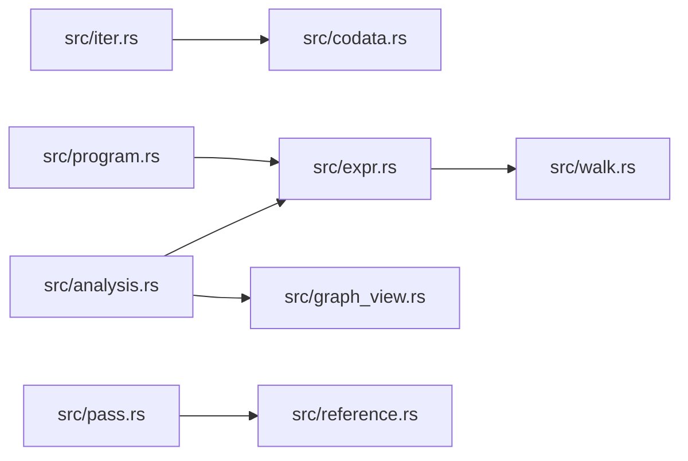

# ze-comb

> **本文件的「事实（自动生成）」一节由 `cargo verify --step docs` 生成，勿手动编辑。**
> 手写内容放在 `## 职责` 及之后的章节：生成器只替换自动区，手写区逐字节保留。
> 导航与阅读顺序见 [`docs/README.md`](../README.md)。

<!-- AUTO:BEGIN -->
## 事实（自动生成）

- 层：`kernel`（`crates/kernel`）
- 路径：`crates/kernel/ze-comb`
- 生产依赖（上游，dev-deps 不计）：`ze-graph-core`、`ze-type`
- 被依赖（下游）：`ze-func`、`ze-pod-func`、`ze-scene-core`、`zela-app`、`zela-authored`、`zela-scene-ecs`
- 源文件：10 个 · 4881 行

### 文件清单

| 文件 | 行数 | `//!` 首行 |
|---|---|---|
| `src/analysis.rs` | 169 | **表达式图分析**：`ze-graph-core` 的 SCC / reachable / dirty 在表达式 DAG 上的落点。 |
| `src/codata.rs` | 215 | codata：**生产性展开**（不是图灵完备）。 |
| `src/expr.rs` | 1243 | 表达式树：节点、字面量、通道、算子引用，以及装配期校验。 |
| `src/graph_view.rs` | 221 | **Expr DAG 图视图**：把表达式树投影成 [`ze_graph_core::Topology`]。 |
| `src/iter.rs` | 286 | 可迭代类型：**`Iter`（有穷）与 `Stream`（余归纳）是两个类型**。 |
| `src/lib.rs` | 101 | ze-comb: **领域无关的确定性计算内核**（原 `ze-func` 改名）。 |
| `src/pass.rs` | 293 | **Pass 抽象**：把已有的能力收进一个约定（不是为假想需求预付）。 |
| `src/program.rs` | 1901 | 求值：**装配期建图 → 运行期定序**，效果只能从 [`Mono`] 进。 |
| `src/reference.rs` | 287 | **参考求值器**：直接在 `Expr` 树上走一遍（tree-walking）。 |
| `src/walk.rs` | 165 | — |

### 模块内关系（`use crate::…` / `use super::…`）

### 对外 API（模块级 `pub` 项；impl 方法见源码）

| 文件 | 项 |
|---|---|
| `src/analysis.rs` | `pub fn shared_definitions(expr: &Expr) -> Vec<(&str, usize)>` |
| `src/analysis.rs` | `pub fn affected_consumers(expr: &Expr, changed: &[&str]) -> Vec<Id>` |
| `src/analysis.rs` | `pub fn unreachable(expr: &Expr, roots: &[usize]) -> Vec<usize>` |
| `src/analysis.rs` | `pub fn reference_groups(expr: &Expr) -> Vec<Vec<&str>>` |
| `src/codata.rs` | `pub struct CodataSpec` |
| `src/codata.rs` | `pub trait Unfold` |
| `src/codata.rs` | `pub enum CodataError` |
| `src/codata.rs` | `pub struct Expanded<S>` |
| `src/codata.rs` | `pub fn expand<U: Unfold>(` |
| `src/codata.rs` | `pub fn observe<U: Unfold>(` |
| `src/expr.rs` | `pub enum Node` |
| `src/expr.rs` | `pub enum Literal` |
| `src/expr.rs` | `pub enum ChannelType` |
| `src/expr.rs` | `pub enum ChannelClass` |
| `src/expr.rs` | `pub struct ChannelRef` |
| `src/expr.rs` | `pub struct ClockShape` |
| `src/expr.rs` | `pub struct ClockLinkShape` |
| `src/expr.rs` | `pub struct MethodRef` |
| `src/expr.rs` | `pub struct OpRef` |
| `src/expr.rs` | `pub struct Expr` |
| `src/expr.rs` | `pub enum ExprError` |
| `src/graph_view.rs` | `pub struct ExprGraphView<'a>` |
| `src/iter.rs` | `pub struct ValueIter` |
| `src/iter.rs` | `pub struct ValueStream` |
| `src/pass.rs` | `pub enum PassKind` |
| `src/pass.rs` | `pub enum Semantics` |
| `src/pass.rs` | `pub struct PassInfo` |
| `src/pass.rs` | `pub struct PassRegistry` |
| `src/pass.rs` | `pub enum PassRegistryError` |
| `src/pass.rs` | `pub trait AnalysisPass` |
| `src/pass.rs` | `pub trait TransformPass` |
| `src/pass.rs` | `pub struct Validate` |
| `src/pass.rs` | `pub struct Lower` |
| `src/pass.rs` | `pub struct LoweredEval<'a>` |
| `src/pass.rs` | `pub struct ReferenceEval<'a>` |
| `src/pass.rs` | `pub fn kernel_registry() -> PassRegistry` |
| `src/program.rs` | `pub enum Value` |
| `src/program.rs` | `pub struct Scalar` |
| `src/program.rs` | `pub struct ValueBytes` |
| `src/program.rs` | `pub fn hash_values(values: &[Value]) -> u64` |
| `src/program.rs` | `pub trait Mono` |
| `src/program.rs` | `pub enum EvalError` |
| `src/program.rs` | `pub struct RecCache` |
| `src/program.rs` | `pub enum Step` |
| `src/program.rs` | `pub struct CompiledExpr` |
| `src/reference.rs` | `pub fn eval_reference(expr: &Expr, mono: &dyn Mono) -> Result<Value, EvalError>` |
| `src/reference.rs` | `pub fn eval_reference_elements(` |
| `src/reference.rs` | `pub struct ReferenceEvaluator<'a>` |
| `src/walk.rs` | `pub trait ExprVisitor<'a>` |
<!-- AUTO:END -->

## 职责

`ze-comb` 是**领域无关的确定性计算内核**：只认识组合子结构（`Expr` / `Node`）、值（`Value`）、宿主单子（`Mono`）与 pass 约定（`PassInfo`）。它持有可序列化的表达式树（`SCHEMA_VERSION` 描述其编码形态）、编译后的后序程序（`CompiledExpr`）与只存元数据的 pass 注册表。

## 运行机制

装配期：`src/expr.rs` 建树并校验（悬空 `Ref` / 环 / 重复 id / 未知算子）→ `src/program.rs` 把它编译成一段**后序程序**（每个 `Step` 的实参索引都小于自身 ⇒ 运行期只是一次线性扫描，不需要运行时拓扑排序与脏传播），带 `id` 的共享定义只编译一次、广播给引用者。运行期：叶子只有字面量、通道与算子调用 —— 通道由宿主 `Mono` 读取、算子由宿主 `Mono` 调用，**宿主是唯一的不纯入口**。`src/reference.rs` 是同一语义的 tree-walking 实现，用来和 lowered 版本逐位对拍；`src/analysis.rs` 把 `ze-graph-core` 的 SCC / reachable / dirty 落到表达式 DAG 上（共享定义、受影响消费者、死代码、互引分组）；`src/codata.rs` 提供生产性展开，只 unfold / observe 到需要的深度。

内部文件分工：`expr` 是数据与装配期校验，`walk` 是遍历器，`program` 是编译与求值，`reference` 是参考求值器，`graph_view` + `analysis` 是图视图与图算法的落点，`pass` 是 pass 约定与注册表，`codata` 是余数据展开。

## 边界与不做什么

- **不知道时间 / 帧 / 事件 / 路径 / 场景 / 渲染**：领域词汇只以 `Node` 的通道叶子形式出现，值由宿主 `Mono` 注入；本 crate 没有时钟、没有全局计数、没有环境读取。
- **不做算子语义**：`zela.math` 的签名与实现在 `ze-func`；本 crate 只定义宿主 `Mono` 的调用入口。
- **不做 `fix`、不是图灵完备**：合法递归只有结构性的 `NatRec`，`Node` 的 `Ref` 仍是**非递归的 `let`**，装配期禁环。
- **分析结果不写回 IR**：类型 / 区间 / 点态性都是 side table，`Expr` 只有 `id` 与 `node`。
- **不提供调度器**：`PassRegistry` 只保存描述、不保存 trait object，各 pass 的调用点留在原处。
