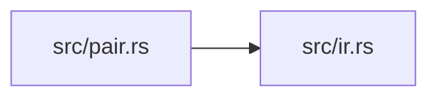

# ze-content

> **本文件的「事实（自动生成）」一节由 `cargo verify --step docs` 生成，勿手动编辑。**
> 手写内容放在 `## 职责` 及之后的章节：生成器只替换自动区，手写区逐字节保留。
> 导航与阅读顺序见 [`docs/README.md`](../README.md)。

<!-- AUTO:BEGIN -->
## 事实（自动生成）

- 层：`kernel`（`crates/kernel`）
- 路径：`crates/kernel/ze-content`
- 生产依赖（上游，dev-deps 不计）：`ze-notion`
- 被依赖（下游）：`ze-prerender`、`ze-scene-api`、`ze-scene-core`、`zela-app`、`zela-authored`、`zela-render`、`zela-scene-ecs`
- 源文件：7 个 · 1303 行

### 文件清单

| 文件 | 行数 | `//!` 首行 |
|---|---|---|
| `src/ir.rs` | 238 | — |
| `src/lib.rs` | 19 | — |
| `src/normalize.rs` | 109 | — |
| `src/pair.rs` | 204 | — |
| `src/placeholder.rs` | 169 | — |
| `src/stroke.rs` | 297 | — |
| `src/svg.rs` | 267 | — |

### 模块内关系（`use crate::…` / `use super::…`）

### 对外 API（模块级 `pub` 项；impl 方法见源码）

| 文件 | 项 |
|---|---|
| `src/ir.rs` | `pub struct ContentSource` |
| `src/ir.rs` | `pub struct Span` |
| `src/ir.rs` | `pub struct StyledPath` |
| `src/ir.rs` | `pub struct ContentIR` |
| `src/normalize.rs` | `pub fn normalize_source(raw: &str) -> String` |
| `src/normalize.rs` | `pub fn hash_source(normalized: &str) -> u64` |
| `src/pair.rs` | `pub fn pair_by_anchor(from: &ContentIR, to: &ContentIR) -> Vec<(Path2D, Path2D)>` |
| `src/pair.rs` | `pub fn degenerate_at(path: &Path2D) -> Path2D` |
| `src/placeholder.rs` | `pub struct PlaceholderOptions` |
| `src/placeholder.rs` | `pub fn generate_placeholder(raw: &str, opts: &PlaceholderOptions) -> ContentIR` |
| `src/stroke.rs` | `pub struct StrokeOutline` |
| `src/stroke.rs` | `pub fn stroke_outlines(` |
| `src/stroke.rs` | `pub fn stroke_style(item: &StyledPath, scale: f32) -> Option<(Color32, f32)>` |
| `src/stroke.rs` | `pub fn order_by_reading_order(outlines: &mut [StrokeOutline])` |
| `src/stroke.rs` | `pub fn text_literal_source(text: &str) -> String` |
| `src/svg.rs` | `pub struct SvgOptions` |
| `src/svg.rs` | `pub fn to_svg(ir: &ContentIR, opts: &SvgOptions) -> String` |
<!-- AUTO:END -->

## 职责

内容中间表示内核：把排版产物收敛成可跨引擎比较、可配对插值的内容 IR，每个路径自带样式与源码锚点。

## 运行机制

入口是 src/ir.rs：源码先经 src/normalize.rs 归一化再取哈希构成内容源，产物是带 pt 坐标、墨迹包围盒、基线信息与源码锚点的样式路径。src/pair.rs 按锚点把两份 IR 配对成 from/to 路径对，只有一侧存在时退化为一个点做淡入淡出；src/stroke.rs 把 IR 展平成世界坐标描边轮廓（按字号缩放、平移、可选取阅读顺序），src/svg.rs 做确定性序列化导出，src/placeholder.rs 在没有排版引擎时生成占位 IR。

## 边界与不做什么

- 不依赖排版引擎，typst 之类只在预渲染层接入；本 crate 只做 IR 到几何与文本的纯变换。
- 不含渲染、ECS、UI 代码，也不做字体加载。
- 不做动画求值与时间推进，配对结果交给上层插值。
