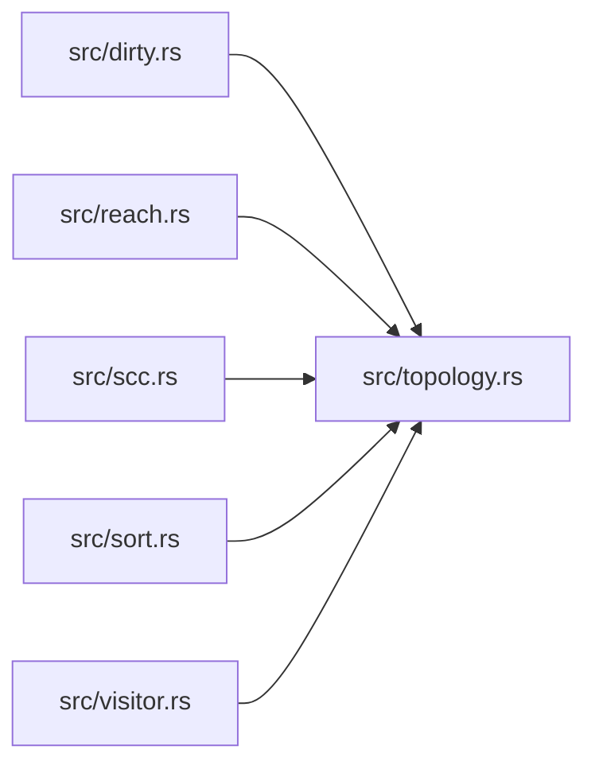

# ze-graph-core

> **本文件的「事实（自动生成）」一节由 `cargo verify --step docs` 生成，勿手动编辑。**
> 手写内容放在 `## 职责` 及之后的章节：生成器只替换自动区，手写区逐字节保留。
> 导航与阅读顺序见 [`docs/README.md`](../README.md)。

<!-- AUTO:BEGIN -->
## 事实（自动生成）

- 层：`kernel`（`crates/kernel`）
- 路径：`crates/kernel/ze-graph-core`
- 生产依赖（上游，dev-deps 不计）：（无）
- 被依赖（下游）：`ze-comb`、`ze-graph-algo`、`ze-pod-core`、`zela-render-vector`
- 源文件：7 个 · 712 行

### 文件清单

| 文件 | 行数 | `//!` 首行 |
|---|---|---|
| `src/dirty.rs` | 56 | 脏传播：沿出边 BFS，**只返回下游**（源节点不算脏），输出升序。 |
| `src/lib.rs` | 31 | ze-graph-core：**纯拓扑图算法**。 |
| `src/reach.rs` | 43 | 可达性：单向 BFS（**输出升序**）。 |
| `src/scc.rs` | 230 | 强连通分量（Kosaraju，**迭代实现** + 确定性输出）。 |
| `src/sort.rs` | 109 | Kahn 拓扑排序（**确定性**：就绪集合取最小 id）。 |
| `src/topology.rs` | 106 | 最小拓扑接口：**只认节点 id + 边**。 |
| `src/visitor.rs` | 137 | **遍历器**：把「多 pass 架构」缺的那一半补上。 |

### 模块内关系（`use crate::…` / `use super::…`）

### 对外 API（模块级 `pub` 项；impl 方法见源码）

| 文件 | 项 |
|---|---|
| `src/dirty.rs` | `pub fn dirty_downstream<T: Topology>(graph: &T, seeds: &[T::Id]) -> Vec<T::Id>` |
| `src/reach.rs` | `pub fn reachable<T: Topology>(graph: &T, from: T::Id) -> Vec<T::Id>` |
| `src/scc.rs` | `pub fn strongly_connected<T: Topology>(graph: &T) -> Vec<Vec<T::Id>>` |
| `src/scc.rs` | `pub fn find_cycle<T: Topology>(graph: &T) -> Option<Vec<T::Id>>` |
| `src/sort.rs` | `pub struct CycleNodes<Id>` |
| `src/sort.rs` | `pub fn topo_sort<T: Topology>(graph: &T) -> Result<Vec<T::Id>, CycleNodes<T::Id>>` |
| `src/topology.rs` | `pub trait Topology` |
| `src/topology.rs` | `pub struct Adjacency<Id>` |
| `src/visitor.rs` | `pub trait Visitor<Id>` |
| `src/visitor.rs` | `pub fn traverse<T, V>(graph: &T, roots: &[T::Id], visitor: &mut V) -> Vec<T::Id>` |
| `src/visitor.rs` | `pub fn preorder<T: Topology>(graph: &T, roots: &[T::Id]) -> Vec<T::Id>` |
| `src/visitor.rs` | `pub fn postorder<T: Topology>(graph: &T, roots: &[T::Id]) -> Vec<T::Id>` |
<!-- AUTO:END -->

## 职责

纯拓扑图算法层：只认节点 id 与边，提供确定性拓扑排序、强连通分量、可达性、脏传播与遍历器；本身不持有任何图，全部按引用计算。

## 运行机制

调用方为自己的图实现 src/topology.rs 的拓扑接口（枚举节点、给出边），算法据此工作；拓扑排序的就绪集合取最小 id，SCC、环、可达与脏传播的输出一律按 id 升序，同一张图跑两次逐位相同。脏传播沿出边 BFS 且只返回下游（源节点不算脏）；src/visitor.rs 在其上补前序、后序与可自定义动作的遍历，作为多 pass 架构的驱动骨架。

## 边界与不做什么

- 不认识节点、socket、类型名或编辑器交互，那些属于节点层自己的图类型。
- 不做缓存与增量重算，每次调用都从头扫描。
- 不修复环：只把环或环内节点显式报出，由上层决定报错还是提示。
