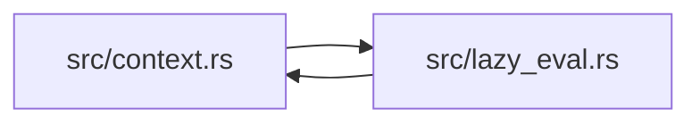

# ze-graph-eval

> **本文件的「事实（自动生成）」一节由 `cargo verify --step docs` 生成，勿手动编辑。**
> 手写内容放在 `## 职责` 及之后的章节：生成器只替换自动区，手写区逐字节保留。
> 导航与阅读顺序见 [`docs/README.md`](../README.md)。

<!-- AUTO:BEGIN -->
## 事实（自动生成）

- 层：`graph`（`crates/ze/graph`）
- 路径：`crates/ze/graph/ze-graph-eval`
- 生产依赖（上游，dev-deps 不计）：`ze-node-core`
- 被依赖（下游）：`ze-node`
- 源文件：3 个 · 828 行

### 文件清单

| 文件 | 行数 | `//!` 首行 |
|---|---|---|
| `src/context.rs` | 126 | Concrete [`ExecContext`] backing used by [`crate::LazyPullEval`]. |
| `src/lazy_eval.rs` | 688 | Lazy pull evaluation strategy. |
| `src/lib.rs` | 14 | `zela-graph-eval` — evaluation strategies for `zela-node`. |

### 模块内关系（`use crate::…` / `use super::…`）

### 对外 API（模块级 `pub` 项；impl 方法见源码）

| 文件 | 项 |
|---|---|
| `src/context.rs` | `pub struct DefaultExecContext<'a>` |
| `src/lazy_eval.rs` | `pub struct LazyPullEval` |
<!-- AUTO:END -->

## 职责

默认求值策略与它的执行上下文：按拓扑序拉取求值、只重算脏节点、错误可恢复。

## 运行机制

每次推进按拓扑排序结果遍历，命中脏集合的节点才执行；脏判据逐节点生效：总是重算、只算一次（除非被显式标记）、输入版本变化时重算、交给用户谓词。输出按输出端口缓存，节点状态与输入版本快照各由一把互斥锁持有，因此对外只需共享引用。执行器经 DefaultExecContext 读写值与端口；失败时错误带恢复句柄，调用方选定动作后由 apply_recovery 继续跑下游，按「继续其他分支 / 收集全部」策略产生的错误再由 take_errors 一次性取走。

## 边界与不做什么

- 不定义 trait 与数据类型（在 ze-node-core），只提供策略实现。
- 不做图编辑与布局，也不把缓存持久化。
- 不自己驱动时钟或帧循环：求值只在该次调用内推进。
