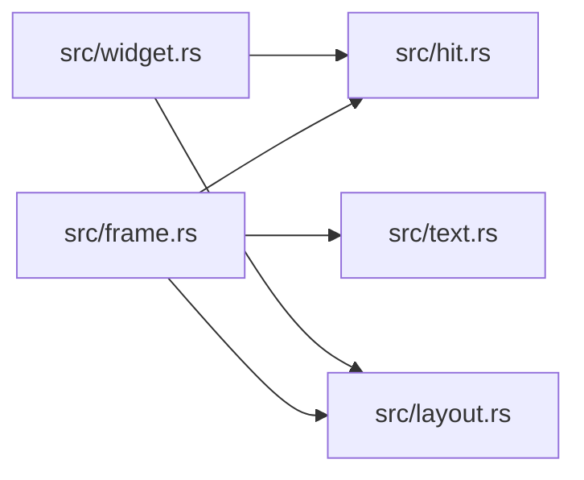

# ze-interact

> **本文件的「事实（自动生成）」一节由 `cargo verify --step docs` 生成，勿手动编辑。**
> 手写内容放在 `## 职责` 及之后的章节：生成器只替换自动区，手写区逐字节保留。
> 导航与阅读顺序见 [`docs/README.md`](../README.md)。

<!-- AUTO:BEGIN -->
## 事实（自动生成）

- 层：`kernel`（`crates/kernel`）
- 路径：`crates/kernel/ze-interact`
- 生产依赖（上游，dev-deps 不计）：`ze-notion`、`ze-render-ir`
- 被依赖（下游）：`ze-content`、`ze-prerender`、`zela-app`、`zela-authored`、`zela-node-editor`、`zela-scene-ecs`
- 源文件：8 个 · 2755 行

### 文件清单

| 文件 | 行数 | `//!` 首行 |
|---|---|---|
| `src/control.rs` | 504 | **CG-d**：控件层 —— 从「画控件」变成「描述控件」。 |
| `src/frame.rs` | 193 | **CG-c**：结构化帧（`Frame`）—— UI 的一次**快照**。 |
| `src/hit.rs` | 313 | 命中测试（CE-a）：矩形优先 + 索引接口预留。 |
| `src/layout.rs` | 482 | 布局（CE-b）：盒子 + 流式，**纯函数、无求解器**。 |
| `src/lib.rs` | 65 | `ze-interact` — 交互骨架（命中 / 布局 / 路由 / 帧）。 |
| `src/route.rs` | 205 | 路由（CE-c）：hover / focus / capture 三档。 |
| `src/text.rs` | 225 | **CG-b/c**：文本的逐字符盒（字符下标 ↔ 矩形）。 |
| `src/widget.rs` | 768 | **CL-b**：表达层定型 —— 一个控件 = 一份纯值声明 + 一个 `dyn` 实现 + 一段命令列表。 |

### 模块内关系（`use crate::…` / `use super::…`）

### 对外 API（模块级 `pub` 项；impl 方法见源码）

| 文件 | 项 |
|---|---|
| `src/control.rs` | `pub enum ControlKind` |
| `src/control.rs` | `pub struct ControlSpec` |
| `src/control.rs` | `pub enum ControlEvent` |
| `src/control.rs` | `pub enum ControlOutcome` |
| `src/control.rs` | `pub struct ControlSet` |
| `src/control.rs` | `pub fn constraints_for(specs: &[ControlSpec], max_width: f64) -> Constraints` |
| `src/frame.rs` | `pub struct Frame` |
| `src/frame.rs` | `pub struct SemanticNode` |
| `src/hit.rs` | `pub struct Point` |
| `src/hit.rs` | `pub struct Rect` |
| `src/hit.rs` | `pub struct HitId(pub u32)` |
| `src/hit.rs` | `pub enum HitRegion` |
| `src/hit.rs` | `pub struct HitTarget` |
| `src/hit.rs` | `pub trait HitIndex` |
| `src/hit.rs` | `pub enum HitFlow` |
| `src/hit.rs` | `pub struct HitChain` |
| `src/hit.rs` | `pub struct LinearHitIndex` |
| `src/hit.rs` | `pub trait CurveHitTester` |
| `src/layout.rs` | `pub struct LayoutId(pub u32)` |
| `src/layout.rs` | `pub struct Size` |
| `src/layout.rs` | `pub struct Constraints` |
| `src/layout.rs` | `pub struct LayoutItem` |
| `src/layout.rs` | `pub struct PlacedRect` |
| `src/layout.rs` | `pub trait Layout` |
| `src/layout.rs` | `pub struct BoxLayout` |
| `src/layout.rs` | `pub struct FlowLayout` |
| `src/layout.rs` | `pub fn apply_layout(` |
| `src/layout.rs` | `pub struct ConstraintSet` |
| `src/layout.rs` | `pub fn layout_for_constraints(` |
| `src/layout.rs` | `pub struct LayoutCache` |
| `src/route.rs` | `pub struct RouteKey` |
| `src/route.rs` | `pub enum RoutePhase` |
| `src/route.rs` | `pub struct Router` |
| `src/text.rs` | `pub struct CharBox` |
| `src/text.rs` | `pub struct TextRunMarker` |
| `src/text.rs` | `pub struct TextRun` |
| `src/widget.rs` | `pub struct WidgetSpecId(pub String)` |
| `src/widget.rs` | `pub struct StrategyId(pub String)` |
| `src/widget.rs` | `pub struct ThemeId(pub String)` |
| `src/widget.rs` | `pub struct LayoutTokens` |
| `src/widget.rs` | `pub struct PaintTokens` |
| `src/widget.rs` | `pub struct Theme` |
| `src/widget.rs` | `pub struct ThemeTable` |
| `src/widget.rs` | `pub struct DrawEnv` |
| `src/widget.rs` | `pub struct MeasureCtx<'a>` |
| `src/widget.rs` | `pub struct DrawCtx<'a>` |
| `src/widget.rs` | `pub enum WidgetPhase` |
| `src/widget.rs` | `pub struct WidgetState` |
| `src/widget.rs` | `pub enum HitPart` |
| `src/widget.rs` | `pub enum Intent` |
| `src/widget.rs` | `pub enum Verdict` |
| `src/widget.rs` | `pub struct WidgetDecl` |
| `src/widget.rs` | `pub struct GlyphOutline` |
| `src/widget.rs` | `pub struct WidgetProps` |
| `src/widget.rs` | `pub trait Widget2D: Send + Sync + 'static` |
| `src/widget.rs` | `pub trait Container2D: Send + Sync + 'static` |
| `src/widget.rs` | `pub struct WidgetRuntime` |
| `src/widget.rs` | `pub fn command_digest(commands: &[DrawCommand]) -> u64` |
| `src/widget.rs` | `pub fn command_bounds(commands: &[DrawCommand]) -> Option<Rect>` |
| `src/widget.rs` | `pub struct BuiltinWidget` |
<!-- AUTO:END -->

## 职责

kernel 级的交互骨架：只回答三个问题 —— **点到了谁**（矩形命中 + 线性索引）、**东西摆在哪**（盒子 / 流式布局）、**事件发给谁**（hover / focus / capture 路由）。它不是控件库：不绘制、不认 egui、不做按钮 / 滑块 / 面板，也不做文字排版。

## 运行机制

命中测试把场景坐标（内部 f64）与轴对齐矩形做半开区间比较，`LinearHitIndex` 按 z-order 降序返回（同 z 保持插入顺序，稳定排序）。CK 批把命中结果收成 `HitChain`：链上每个目标显式返回 `Consume` 或 `Continue`，冒泡到容器就是继续，规则只有一处实现。布局是纯函数：`BoxLayout` 垂直堆叠、`FlowLayout` 水平换行，`apply_layout` 统一处理「自动布局不得覆盖用户手选位置」（`auto_layout_supported() == false` 时原样返回既有位置）。`LayoutCache` 的 revision 取 `ConstraintSet::revision()`（声明按 id 排序后的哈希），不再由宿主递增。路由是一个无时间、无随机来源的状态机：指针移动更新 hover，按下建立 focus 与 capture，抬起只解除 capture；事件投递按 capture > focus > hover 取一个。路由键 = 作用域路径 + 命中目标，因此两个面板的同号控件可以区分。

`Frame` 是三条平行结构（几何 / 语义 / 文本）加一条纯值父子索引 `parent`：它让「拖进 / 拖出容器」这类结构变化也能被差分。文本的 `char_at` 与命中同口径；选区与光标由 `range_rect` / `cursor_rect` 从字符盒派生，不新建实体。

**表达层（CL-b，`widgets` feature）**：`src/widget.rs` 定义两个平级 trait（`Widget2D` / `Container2D`）、运行期 `WidgetRuntime`（`BTreeMap<WidgetId, Box<dyn Widget2D>>` + `SpecId` 工厂表）、`MeasureCtx` / `DrawCtx` 二分，以及拆成 `LayoutTokens` / `PaintTokens` 的 `Theme`。`draw` 返回 `Vec<DrawCommand>`（每条自带 `Style2D`），`command_digest` 只比 `(z, shape 变体, style)` 的纯值摘要。该 feature 会间接引入 `ze-notion` / `glam`；默认构建仍是零依赖。

## 边界与不做什么

- **不绘制**：UI 只是场景对象（线 / 圆 / 由 typst 烘焙的文字轮廓）。
- **不认 egui**：宿主把原生输入翻译成语义事件，本 crate 只消费坐标与 id。
- **不做控件外观**：`Widget2D` 只描述 measure / bounds / state / draw；内置 `BuiltinWidget` 是最小默认实现，不是控件库。
- **不做文字排版**：只留度量接口形状，实现属后续批次。
- **不算深度模型**：只做「谁在前面就先命中谁」，不解决 2D–3D 互遮挡。
- **默认零依赖 / 零 glam / 零 HashMap**：曲线求交只留 `CurveHitTester` 接口；`widgets` feature 打开表达层时会间接引入 `ze-notion` / `glam`，这是显式选择的代价。
- 布局只在**结构变化时**算（控件增删 / 文本变化），不在每帧调用。
