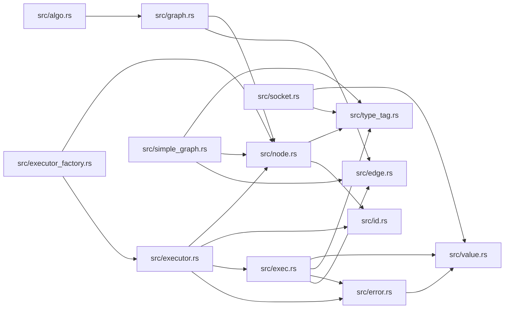

# ze-node-core

> **本文件的「事实（自动生成）」一节由 `cargo verify --step docs` 生成，勿手动编辑。**
> 手写内容放在 `## 职责` 及之后的章节：生成器只替换自动区，手写区逐字节保留。
> 导航与阅读顺序见 [`docs/README.md`](../README.md)。

<!-- AUTO:BEGIN -->
## 事实（自动生成）

- 层：`graph`（`crates/ze/graph`）
- 路径：`crates/ze/graph/ze-node-core`
- 生产依赖（上游，dev-deps 不计）：`ze-type`
- 被依赖（下游）：`ze-graph-algo`、`ze-graph-eval`、`ze-node`、`ze-node-schema`、`zela-node-editor`、`zela-node-egui`、`zela-node-egui-ui`
- 源文件：15 个 · 1729 行

### 文件清单

| 文件 | 行数 | `//!` 首行 |
|---|---|---|
| `src/algo.rs` | 48 | Graph-algorithm trait interfaces. |
| `src/edge.rs` | 120 | Edges and edge-carried data. |
| `src/error.rs` | 181 | Evaluation errors and the recovery handle protocol. |
| `src/exec.rs` | 69 | Execution context — the interface a node executor sees while a node runs. |
| `src/executor.rs` | 71 | Node executors and evaluation strategies. |
| `src/executor_factory.rs` | 65 | [`ExecutorFactory`] — a type-erased node-executor registry. |
| `src/graph.rs` | 107 | The abstract [`Graph`] trait — node/edge topology queries and mutations. |
| `src/id.rs` | 84 | Stable identifiers for nodes and sockets. |
| `src/lib.rs` | 40 | `zela-node` — node editor core trait layer. |
| `src/node.rs` | 148 | The [`Node`] trait and related metadata / dirty policy. |
| `src/presentation.rs` | 120 | **展示数据（UI side table 的载体）**。 |
| `src/simple_graph.rs` | 513 | [`SimpleGraph`] — the reference `Graph` implementation. |
| `src/socket.rs` | 102 | Socket descriptors attached to nodes. |
| `src/type_tag.rs` | 8 | Type tags and socket-level type compatibility. |
| `src/value.rs` | 53 | Type-erased, cloneable value container. |

### 模块内关系（`use crate::…` / `use super::…`）

### 对外 API（模块级 `pub` 项；impl 方法见源码）

| 文件 | 项 |
|---|---|
| `src/algo.rs` | `pub enum CycleError` |
| `src/algo.rs` | `pub trait TopoSort: Send + Sync + 'static` |
| `src/algo.rs` | `pub trait DirtyTracker: Send + Sync + 'static` |
| `src/algo.rs` | `pub trait CycleDetector: Send + Sync + 'static` |
| `src/edge.rs` | `pub struct EdgeId` |
| `src/edge.rs` | `pub trait EdgeData: fmt::Debug + Send + Sync + 'static` |
| `src/edge.rs` | `pub struct UnitEdge` |
| `src/edge.rs` | `pub struct Edge` |
| `src/error.rs` | `pub enum RecoveryAction` |
| `src/error.rs` | `pub struct RecoveryHandle` |
| `src/error.rs` | `pub struct EvalError` |
| `src/error.rs` | `pub enum EvalErrorPolicy` |
| `src/exec.rs` | `pub trait ExecContext: Send + Sync` |
| `src/executor.rs` | `pub trait NodeExecutor: Send + Sync + 'static` |
| `src/executor.rs` | `pub trait TypedNodeExecutor<N: Node>: Send + Sync + 'static` |
| `src/executor.rs` | `pub struct TypedExecutorAdapter<N: Node, E: TypedNodeExecutor<N>>` |
| `src/executor.rs` | `pub trait EvalStrategy: Send + Sync + 'static` |
| `src/executor_factory.rs` | `pub struct ExecutorFactory` |
| `src/graph.rs` | `pub enum ConnectError` |
| `src/graph.rs` | `pub trait Graph: Send + Sync + fmt::Debug` |
| `src/id.rs` | `pub struct NodeId(pub u64)` |
| `src/id.rs` | `pub struct SocketId` |
| `src/id.rs` | `pub struct InputSocketId(pub SocketId)` |
| `src/id.rs` | `pub struct OutputSocketId(pub SocketId)` |
| `src/node.rs` | `pub struct NodeMeta` |
| `src/node.rs` | `pub enum DirtyPolicy` |
| `src/node.rs` | `pub trait DirtyFn: Send + Sync + 'static` |
| `src/node.rs` | `pub trait Node: fmt::Debug + Send + Sync + 'static` |
| `src/node.rs` | `pub trait DowncastWrapper: Node` |
| `src/presentation.rs` | `pub struct NodeInteraction` |
| `src/presentation.rs` | `pub struct NodePresentation` |
| `src/simple_graph.rs` | `pub struct SimpleGraph` |
| `src/socket.rs` | `pub struct InputSocket` |
| `src/socket.rs` | `pub struct OutputSocket` |
| `src/value.rs` | `pub trait NodeValue: Any + Send + Sync + 'static` |
<!-- AUTO:END -->

## 职责

节点图的纯 trait 层：定义值容器、端口、边、节点、图与执行上下文「长什么样」，不绑定算法、存储与执行策略。

## 运行机制

15 个文件按四组分工：id / socket / edge / value / type_tag 是数据基元（节点与端口标识、边及其携带数据、类型擦除的可克隆值、类型标签与兼容判断）；node / graph / exec / executor 是行为契约（节点的元数据与脏策略、图的拓扑查询与变更、执行器在节点运行期看到的上下文、执行器与求值策略）；algo 只声明拓扑排序、脏追踪、环检测三个可替换算法接口，executor_factory 用类型擦除登记执行器，error 给出求值错误与恢复句柄协议；simple_graph 是本 crate 唯一的参考图实现，presentation 承载 UI 用的展示数据 side table。求值时执行器经执行上下文读上游端口值、写自己的输出，值以类型擦除的节点值形态传递。

## 边界与不做什么

- 只依赖 ze-type；不得依赖 zela-scene / zela-render / zela-egui / zela-app / ze-macro，以保持可独立复用、可编到 wasm。
- 不含具体图算法（在 ze-graph-algo）与求值策略（在 ze-graph-eval），也不做结果缓存。
- 不含任何 egui 与绘制概念：UI 只通过展示数据 side table 取信息。
