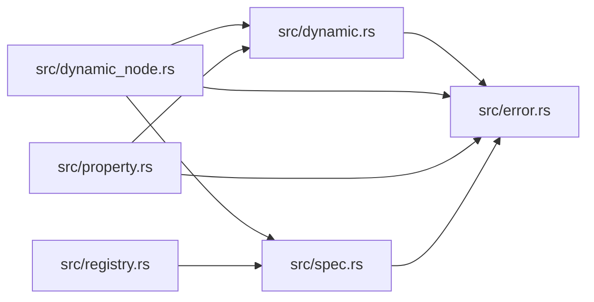

# ze-node-schema

> **本文件的「事实（自动生成）」一节由 `cargo verify --step docs` 生成，勿手动编辑。**
> 手写内容放在 `## 职责` 及之后的章节：生成器只替换自动区，手写区逐字节保留。
> 导航与阅读顺序见 [`docs/README.md`](../README.md)。

<!-- AUTO:BEGIN -->
## 事实（自动生成）

- 层：`graph`（`crates/ze/graph`）
- 路径：`crates/ze/graph/ze-node-schema`
- 生产依赖（上游，dev-deps 不计）：`ze-node-core`、`ze-node-schema-macros`
- 被依赖（下游）：`ze-node`、`zela-node-egui-ui`
- 源文件：7 个 · 1484 行

### 文件清单

| 文件 | 行数 | `//!` 首行 |
|---|---|---|
| `src/dynamic.rs` | 224 | [`DynamicObject`] — a runtime-extensible, ordered map of named properties. |
| `src/dynamic_node.rs` | 212 | [`DynamicNode`] — a node whose properties are a runtime [`DynamicObject`]. |
| `src/error.rs` | 31 | Errors raised by the property model. All operations return errors rather |
| `src/lib.rs` | 47 | `ze-node-schema` — the property model layer for zela's node graph. |
| `src/property.rs` | 608 | The property model: a serializable, UI-neutral description of every |
| `src/registry.rs` | 304 | [`NodeRegistry`] — the type-erased catalogue of `NodeSpec` node types. |
| `src/spec.rs` | 58 | [`NodeSpec`] — the declarative property interface a node exposes. |

### 模块内关系（`use crate::…` / `use super::…`）

### 对外 API（模块级 `pub` 项；impl 方法见源码）

| 文件 | 项 |
|---|---|
| `src/dynamic.rs` | `pub struct DynamicObject` |
| `src/dynamic.rs` | `pub struct DynamicField` |
| `src/dynamic_node.rs` | `pub struct DynamicNode` |
| `src/dynamic_node.rs` | `pub struct DynamicNodeBuilder` |
| `src/error.rs` | `pub enum PropertyError` |
| `src/property.rs` | `pub enum StringKind` |
| `src/property.rs` | `pub struct FunctionHandle` |
| `src/property.rs` | `pub struct BoolConfig` |
| `src/property.rs` | `pub struct StringConfig` |
| `src/property.rs` | `pub struct VecNConfig` |
| `src/property.rs` | `pub struct ColorConfig` |
| `src/property.rs` | `pub struct EnumConfig` |
| `src/property.rs` | `pub struct RangeConfig` |
| `src/property.rs` | `pub struct FunctionConfig` |
| `src/property.rs` | `pub struct DynamicConfig` |
| `src/property.rs` | `pub struct ListConfig` |
| `src/property.rs` | `pub enum Property` |
| `src/property.rs` | `pub enum PropertyValue` |
| `src/registry.rs` | `pub struct RegistryCategory` |
| `src/registry.rs` | `pub struct RegistryNodeInfo` |
| `src/registry.rs` | `pub struct NodeRegistry` |
| `src/spec.rs` | `pub trait NodeSpec: Node` |
| `src/spec.rs` | `pub fn property_value<S: NodeSpec + ?Sized>(node: &S, name: &str) -> Option<PropertyValue>` |
| `src/spec.rs` | `pub fn property_schema<S: NodeSpec + ?Sized>(node: &S, name: &str) -> Option<Property>` |
<!-- AUTO:END -->

## 职责

节点属性模型：可序列化、与 UI 无关的属性与属性值词汇表，声明式属性接口，类型擦除的节点类型目录，以及运行时可扩展的动态属性对象。

## 运行机制

属性接口在节点之上声明 schema，写回时按属性名分发；节点类型目录保存类型擦除后的构造器与元信息，因此从任意节点引用也能拿到属性接口而不必向下转型（补上 Rust 缺的 trait 上转型桥）。动态节点把属性存成有序的命名 map，用户不必重编译就能加字段；另有 builder 负责组装。派生宏在 ze-node-schema-macros 里实现，本 crate 以同名再导出，于是「派生宏在属性位置」与「trait 在类型位置」互不冲突。

## 边界与不做什么

- 只依赖 ze-node-core、serde 与属性派生宏 crate：不得依赖 egui、zela-node-editor、zela-node-egui(-ui)。
- 不含控件绘制与交互：属性长什么样由 zela-node-egui-ui 决定。
- 不做图算法、求值与调度。
