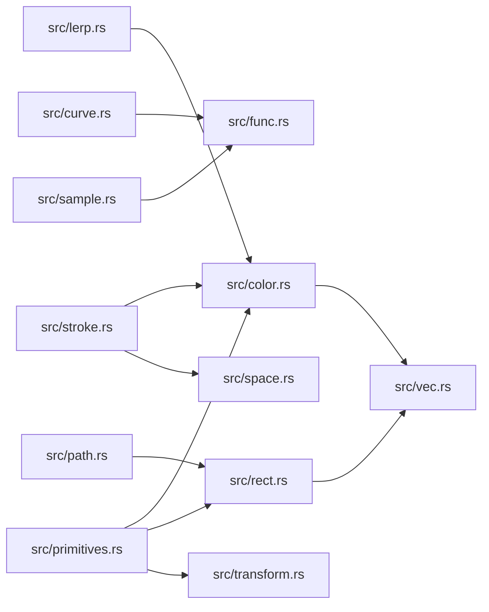

# ze-notion

> **本文件的「事实（自动生成）」一节由 `cargo verify --step docs` 生成，勿手动编辑。**
> 手写内容放在 `## 职责` 及之后的章节：生成器只替换自动区，手写区逐字节保留。
> 导航与阅读顺序见 [`docs/README.md`](../README.md)。

<!-- AUTO:BEGIN -->
## 事实（自动生成）

- 层：`kernel`（`crates/kernel`）
- 路径：`crates/kernel/ze-notion`
- 生产依赖（上游，dev-deps 不计）：（无）
- 被依赖（下游）：`ze-content`、`ze-prerender`、`ze-render-ir`、`ze-scene-api`、`ze-scene-contract`、`ze-scene-core`、`ze-time`、`zela-app`、`zela-authored`、`zela-egui`、`zela-playback`、`zela-render`、`zela-render-backends`、`zela-render-vector`、`zela-scene-ecs`
- 源文件：15 个 · 3602 行

### 文件清单

| 文件 | 行数 | `//!` 首行 |
|---|---|---|
| `src/color.rs` | 168 | — |
| `src/curve.rs` | 182 | — |
| `src/func.rs` | 321 | — |
| `src/lerp.rs` | 112 | — |
| `src/lib.rs` | 64 | — |
| `src/mat.rs` | 8 | — |
| `src/path.rs` | 1186 | — |
| `src/primitives.rs` | 829 | — |
| `src/proj.rs` | 17 | — |
| `src/rect.rs` | 129 | — |
| `src/sample.rs` | 150 | — |
| `src/space.rs` | 99 | — |
| `src/stroke.rs` | 66 | — |
| `src/transform.rs` | 236 | — |
| `src/vec.rs` | 35 | — |

### 模块内关系（`use crate::…` / `use super::…`）

### 对外 API（模块级 `pub` 项；impl 方法见源码）

| 文件 | 项 |
|---|---|
| `src/color.rs` | `pub struct Color32` |
| `src/curve.rs` | `pub struct ParameterCurveT2XY<T = f32, XY = (f32, f32)>` |
| `src/curve.rs` | `pub struct ParameterCurveT2XYZ<T, XYZ = (f32, f32, f32)>` |
| `src/func.rs` | `pub trait DynFn<X, Y>: Send + Sync + Fn(X) -> Y + std::any::Any` |
| `src/func.rs` | `pub struct FunctionX2Y<X = f32, Y = f32>` |
| `src/func.rs` | `pub struct SurfaceFn` |
| `src/lerp.rs` | `pub trait Lerp: Sized` |
| `src/path.rs` | `pub enum PathCommand` |
| `src/path.rs` | `pub struct Path2D` |
| `src/path.rs` | `pub struct Path3D` |
| `src/primitives.rs` | `pub struct Point3D` |
| `src/primitives.rs` | `pub struct Line3D` |
| `src/primitives.rs` | `pub struct Triangle2D` |
| `src/primitives.rs` | `pub struct Circle2D` |
| `src/primitives.rs` | `pub struct Ellipse2D` |
| `src/primitives.rs` | `pub struct Line2D` |
| `src/primitives.rs` | `pub struct Arrow2D` |
| `src/primitives.rs` | `pub struct Polyline2D` |
| `src/primitives.rs` | `pub struct Polygon2D` |
| `src/rect.rs` | `pub struct Rect2D` |
| `src/sample.rs` | `pub struct Sampler1D<T = f32>` |
| `src/sample.rs` | `pub struct Sampler2D<T = f32>` |
| `src/sample.rs` | `pub struct Interpolator<T = f32>` |
| `src/space.rs` | `pub enum MeasureSpace` |
| `src/space.rs` | `pub fn resolve_width(width: f32, space: MeasureSpace, scale: f32) -> f32` |
| `src/stroke.rs` | `pub struct Stroke2D` |
| `src/transform.rs` | `pub struct Transform2D` |
| `src/transform.rs` | `pub struct Transform3D` |
<!-- AUTO:END -->

## 职责

全仓唯一的数学元语出口：包装并再导出 glam，同时把颜色、矩形、路径、图元、仿射变换、插值、参数曲线与投影收敛成一组纯数学值类型。

## 运行机制

模块按值类型分工：vec 与 mat 只做 glam 再导出；color、rect、path、primitives、transform 提供几何原语与 2D/3D 仿射变换（路径的包围盒走懒计算缓存）；lerp、func、curve、sample 提供插值与参数曲线采样；proj 产出相机投影与观察矩阵；stroke 与 space 承接上层必需的描边形态与度量空间。全部为纯值：不含 ECS、GPU 或离散化产物，运算即函数调用，不隐式申请后端资源。

## 边界与不做什么

- 只依赖 glam（可选 serde），内不得出现 ECS / hecs / wgpu / egui，也不得出现面向 GPU 的顶点、索引、拓扑组织方式。
- 不产出三角化结果，那是渲染后端与顶点契约层的事。
- 本 crate 的 2D/3D 变换是数学仿射值，不是场景里的摆放组件，两者不可混用。
- 不定义相机的业务语义（中心、缩放、视口），只给投影与变换矩阵。
