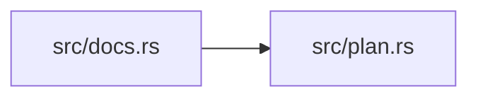

# ze-pod-binding

> **本文件的「事实（自动生成）」一节由 `cargo verify --step docs` 生成，勿手动编辑。**
> 手写内容放在 `## 职责` 及之后的章节：生成器只替换自动区，手写区逐字节保留。
> 导航与阅读顺序见 [`docs/README.md`](../README.md)。

<!-- AUTO:BEGIN -->
## 事实（自动生成）

- 层：`pod`（`crates/ze/pod`）
- 路径：`crates/ze/pod/ze-pod-binding`
- 生产依赖（上游，dev-deps 不计）：`ze-pod-core`
- 被依赖（下游）：`ze-pod`、`ze-pod-js`、`ze-pod-lua`、`ze-pod-py`、`ze-pod-tests`、`zela-app`、`zela-commands`
- 源文件：5 个 · 737 行

### 文件清单

| 文件 | 行数 | `//!` 首行 |
|---|---|---|
| `src/codec.rs` | 56 | 值与语言对象的双向转换 + 一次调用的通用编排。 |
| `src/defaults.rs` | 145 | 构造器参数的**默认值白名单**（提案 #6 C）。 |
| `src/docs.rs` | 351 | **语言无关**的文档导出：JSON 是唯一来源。 |
| `src/lib.rs` | 60 | ze-pod-binding：**语言无关**的绑定驱动。 |
| `src/plan.rs` | 125 | 能力计划：把 `C::calls()` 摊平成"函数 + 可达类型"，供任意语言适配器消费。 |

### 模块内关系（`use crate::…` / `use super::…`）

### 对外 API（模块级 `pub` 项；impl 方法见源码）

| 文件 | 项 |
|---|---|
| `src/codec.rs` | `pub trait ValueCodec` |
| `src/codec.rs` | `pub fn invoke<C: ValueCodec>(` |
| `src/defaults.rs` | `pub fn field_default(type_name: &str, field_name: &str) -> Option<PodValue>` |
| `src/defaults.rs` | `pub fn field_default_literal(type_name: &str, field_name: &str) -> Option<&'static str>` |
| `src/docs.rs` | `pub struct CapabilityDocs` |
| `src/docs.rs` | `pub fn reachable_types(` |
| `src/docs.rs` | `pub fn capabilities_json(capabilities: &[CapabilityDocs]) -> String` |
| `src/docs.rs` | `pub fn op_by_name<'a>(` |
| `src/docs.rs` | `pub fn op_by_spec<'a>(` |
| `src/docs.rs` | `pub fn component_ctor_of(` |
| `src/docs.rs` | `pub fn has_ops(capabilities: &[CapabilityDocs]) -> bool` |
| `src/lib.rs` | `pub fn channel_type_variant(spec: &ze_pod_core::TypeSpec) -> &'static str` |
| `src/plan.rs` | `pub struct BindingPlan` |
| `src/plan.rs` | `pub fn collect_types(` |
| `src/plan.rs` | `pub fn short_name(full: &'static str) -> &'static str` |
<!-- AUTO:END -->

## 职责

语言无关的绑定驱动：把能力的调用清单摊平成「函数 + 可达类型」的计划，并统一调用编排、默认值与文档导出。

## 运行机制

src/plan.rs 收集绑定计划（函数与可达类型去重），src/codec.rs 的编解码 trait 定义值与语言对象的双向转换，通用调用编排负责解码参数、分派到服务、编码返回值，语言适配器只需提供自己的编解码实现。src/docs.rs 从能力清单产出 JSON 文档（唯一来源，语言侧只做格式翻译），src/defaults.rs 给出构造器参数的默认值白名单。

## 边界与不做什么

- 不含任何具体语言运行时类型，也不依赖 Lua / Python / JS crate，因此可以进 wasm 门禁。
- 不定义能力、命名空间或版本，那些由核心抽象与领域 crate 决定。
- 不做宿主侧装配（节点声明、注入、Broker），那属于应用层。
