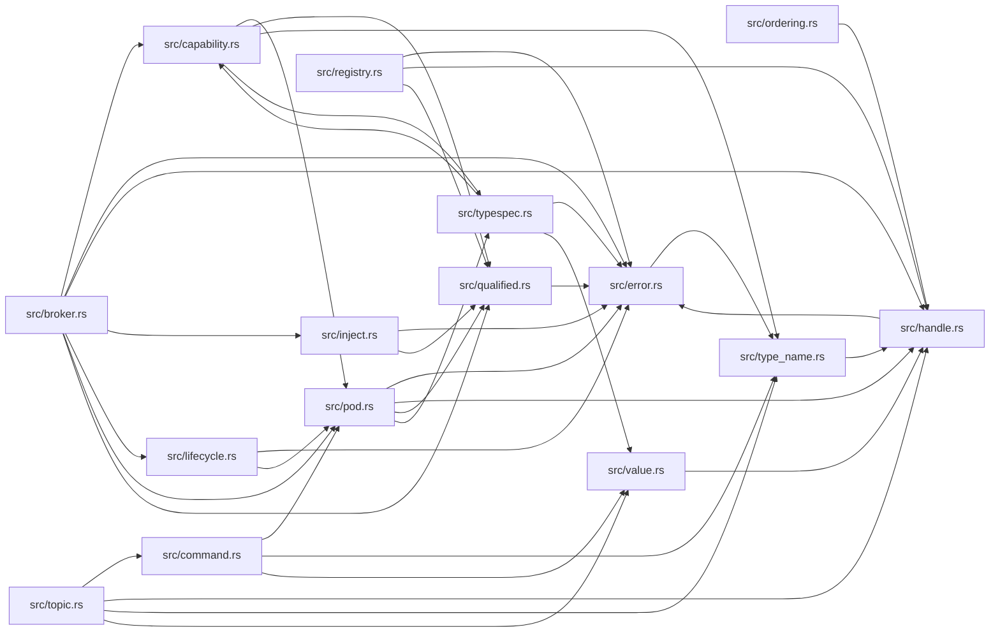

# ze-pod-core

> **本文件的「事实（自动生成）」一节由 `cargo verify --step docs` 生成，勿手动编辑。**
> 手写内容放在 `## 职责` 及之后的章节：生成器只替换自动区，手写区逐字节保留。
> 导航与阅读顺序见 [`docs/README.md`](../README.md)。

<!-- AUTO:BEGIN -->
## 事实（自动生成）

- 层：`pod`（`crates/ze/pod`）
- 路径：`crates/ze/pod/ze-pod-core`
- 生产依赖（上游，dev-deps 不计）：`ze-graph-core`、`ze-reflect`、`ze-type`
- 被依赖（下游）：`ze-pod`、`ze-pod-binding`、`ze-pod-func`、`ze-pod-js`、`ze-pod-lua`、`ze-pod-py`、`ze-pod-tests`、`ze-render-ir`、`ze-scene-api`、`ze-scene-core`、`zela-app`、`zela-egui`、`zela-gui`、`zela-playback`、`zela-scene-ecs`
- 源文件：16 个 · 4284 行

### 文件清单

| 文件 | 行数 | `//!` 首行 |
|---|---|---|
| `src/broker.rs` | 1161 | Broker：把「解释器 / 执行器 / 能力提供者」撮合成一张有向图。 |
| `src/capability.rs` | 228 | capability：运行时协商出的（typed）接口。 |
| `src/command.rs` | 403 | 命令队列 / 事件总线：**泛型 capability**（命令枚举与事件枚举由实现方注入）。 |
| `src/error.rs` | 52 | Pod 抽象的错误类型（手写，不引入 thiserror —— 零依赖）。 |
| `src/handle.rs` | 266 | 不透明句柄：大类型只在 Pod 内部存数据，跨边界只传"号"。 |
| `src/inject.rs` | 295 | 反向能力：宿主把能力注入 Pod（`Injector` / `Service`）。 |
| `src/lib.rs` | 122 | — |
| `src/lifecycle.rs` | 80 | 生命周期：**普通 capability**（不在 `Injector` 里），由宿主调用。 |
| `src/ordering.rs` | 327 | 逻辑时序（Ord）与显式 flush 边界。 |
| `src/pod.rs` | 279 | Pod trait：不透明状态机 + 函数集合 + 协商 + 快慢双路径。 |
| `src/qualified.rs` | 177 | 完整函数名（内部链接器）：`"ns::path::name(A, B) -> R"`。 |
| `src/registry.rs` | 368 | 第一 Pod：闭包注册表（内置小 Pod）。 |
| `src/topic.rs` | 60 | topic 机制：**广播降级为「查询 + 迭代单播」**。 |
| `src/type_name.rs` | 85 | 稳定类型名（与 `ze-node-core::TypeTag::type_name()` 形态同构）。 |
| `src/typespec.rs` | 49 | 类型描述（IDL schema）：**实现已迁至 `ze-type`**，本模块只做 re-export + |
| `src/value.rs` | 332 | 跨语言值（`PodValue`）与类型转换（`PodType`）。 |

### 模块内关系（`use crate::…` / `use super::…`）

### 对外 API（模块级 `pub` 项；impl 方法见源码）

| 文件 | 项 |
|---|---|
| `src/broker.rs` | `pub struct NodeSpec` |
| `src/broker.rs` | `pub struct AssemblyPlan` |
| `src/broker.rs` | `pub struct PodNode` |
| `src/broker.rs` | `pub struct AssemblyReport` |
| `src/broker.rs` | `pub enum BrokerError` |
| `src/broker.rs` | `pub struct Broker` |
| `src/capability.rs` | `pub struct CapabilityMeta` |
| `src/capability.rs` | `pub struct FnSig` |
| `src/capability.rs` | `pub fn capability_fingerprint(signatures: &[FnSig]) -> u64` |
| `src/capability.rs` | `pub struct FnDoc` |
| `src/capability.rs` | `pub struct Resolved<'a>` |
| `src/capability.rs` | `pub trait Capability<'a>: Sized` |
| `src/command.rs` | `pub struct Receipt` |
| `src/command.rs` | `pub struct CommandQueue<'a, C>` |
| `src/command.rs` | `pub struct Broadcast<'a, E>` |
| `src/command.rs` | `pub struct EventSink<'a, E>` |
| `src/error.rs` | `pub enum PodError` |
| `src/handle.rs` | `pub struct PodId(u64)` |
| `src/handle.rs` | `pub struct PodHandle(PodId)` |
| `src/handle.rs` | `pub struct Handle` |
| `src/handle.rs` | `pub struct HandleTable<T>` |
| `src/inject.rs` | `pub struct ServiceRequirement` |
| `src/inject.rs` | `pub struct Service` |
| `src/inject.rs` | `pub struct MissingRequirements` |
| `src/inject.rs` | `pub fn validate_requirements(` |
| `src/inject.rs` | `pub struct Injector<'a>` |
| `src/inject.rs` | `pub struct SyncInjector<'a>` |
| `src/lifecycle.rs` | `pub struct Lifecycle<'a>` |
| `src/ordering.rs` | `pub struct SeqKey` |
| `src/ordering.rs` | `pub struct Sequenced<T>` |
| `src/ordering.rs` | `pub struct Sequencer` |
| `src/ordering.rs` | `pub enum FlushBoundary` |
| `src/ordering.rs` | `pub struct FlushBatch<T>` |
| `src/ordering.rs` | `pub struct FlushBuffer<T>` |
| `src/pod.rs` | `pub struct ChannelDecl` |
| `src/pod.rs` | `pub struct MethodDecl` |
| `src/pod.rs` | `pub struct FunctionId` |
| `src/pod.rs` | `pub trait Pod: 'static` |
| `src/pod.rs` | `pub trait SyncPod: Pod + Send + Sync` |
| `src/pod.rs` | `pub fn negotiate_dyn<'a, C>(pod: &'a dyn Pod) -> Option<C>` |
| `src/qualified.rs` | `pub struct QualifiedName` |
| `src/registry.rs` | `pub trait ErasedCall: Send + Sync` |
| `src/registry.rs` | `pub struct RegistryPod` |
| `src/topic.rs` | `pub struct PublishReport` |
| `src/topic.rs` | `pub fn publish<E>(broker: &Broker, topic: &str, event: &E) -> Result<PublishReport, BrokerError>` |
| `src/type_name.rs` | `pub trait IntoPodTypeName` |
| `src/typespec.rs` | `pub struct ErasedFn` |
| `src/value.rs` | `pub enum ScalarValue` |
| `src/value.rs` | `pub enum PodValue` |
| `src/value.rs` | `pub struct PodBytes(pub Vec<u8>)` |
| `src/value.rs` | `pub struct PodValueError` |
| `src/value.rs` | `pub trait PodType: Sized + 'static` |
| `src/value.rs` | `pub fn field<'a>(` |
| `src/value.rs` | `pub fn expect_struct<'a>(` |
| `src/value.rs` | `pub fn expect_enum<'a>(` |
| `src/value.rs` | `pub fn describe(value: &PodValue) -> String` |
<!-- AUTO:END -->

## 职责

Pod 层的最小内核：把「**不透明状态机 + capability 能力集合 + 函数集合**」这同一个抽象，同时给解释器、节点图求值器、闭包表、进程间对端、渲染探针等使用，并把它们的装配（需求校验 / 拓扑序 / 注入 / 生命周期）收进一个 Broker。

它持有：`Pod` / `SyncPod` trait（协商 + 快慢双路径调用）、capability 的运行时协商与签名自述、完整函数名链接器、三类句柄（Pod 身份 / Pod 句柄 / 不透明值句柄）、命令队列与事件接收端、反向注入、生命周期、逻辑时序与 flush 缓冲、装配计划与 Broker、topic 扇出、跨语言值与类型代数入口，以及内置的闭包注册表 Pod。

## 运行机制

### 内部文件怎么分工

- **抽象与协商（核心）**：`src/pod.rs` 定义 Pod trait 的全部自述面（函数名集合、通道声明、方法声明、版本）与两条调用路径（按函数名解析出的裸 fn 指针走快路径，类型擦除走慢路径），并提供按完整函数名协商出具体 capability 的自由函数；`src/capability.rs` 定义 capability 的 trait 形态、函数签名与协商结果、以及用于门禁的指纹算法；`src/qualified.rs` 负责 `namespace + 名字 + 参数类型 + 返回类型` 的解析与格式化（短名与限定名互不匹配）；`src/type_name.rs` 是稳定类型名的编译期映射。
- **句柄与值**：`src/handle.rs` 是 Pod 身份与不透明句柄（显式 release、跨 Pod 传递明确报错），大类型数据留在 Pod 内部、跨边界只传号；`src/value.rs` 是跨语言值（标量 / 结构 / 枚举 / 数组 / 不透明 / 大块字节）与原生值 ↔ 跨语言值的双向转换，另含按名字取字段的助手；`src/error.rs` 是手写错误枚举（为保持零依赖不引入错误派生库）。
- **交互能力**：`src/command.rs` 是泛型的命令队列 / 广播 / 事件接收端，命令与事件在类型上是不同类型（事件无法当命令提交），回执区分「纯自旋等待」与「等待时继续推进队列」两个入口；`src/inject.rs` 是宿主 → Pod 的反向注入（需求自述 + 按 Service 注入，默认拒绝）；`src/lifecycle.rs` 是独立的销毁 / 重置能力；`src/topic.rs` 把广播降级为「查成员 + 按 PodId 升序逐个 typed 单播」；`src/ordering.rs` 是纯逻辑排序键与显式 flush 边界。
- **装配与内置实现**：`src/broker.rs` 分描述层（纯数据节点与装配计划，可脱离 Pod 单测拓扑 / 环 / 可选缺失）与执行层（校验函数级签名 → 拓扑序 → 注入 → 生命周期，并提供取节点、运行入口、销毁 / 重置）；`src/registry.rs` 是内置的小 Pod：注册「完整函数名 → 可调用」，注册 typed 时自动生成擦除版本，因此快慢两条路径调的是同一个函数。
- **类型代数的转发**：`src/typespec.rs` 只做 re-export，并把唯一属于运行时绑定入口的擦除函数留在本模块；类型描述本身的实现在类型层 crate。

### 数据怎么从入口流到出口

装配期：App 显式声明节点描述（逻辑名、提供哪些 Service、订阅哪些 topic、需要哪些宿主能力）→ 纯数据装配计划先做拓扑与环检测（此阶段不需要任何 Pod 实例）→ Broker 用真实 Pod 建图，按「需求 → 提供」连边并排序，环在注入前就被拒绝（因此不会构造出互相持有的引用）→ 对每个 Pod 尝试协商注入能力，不暴露注入能力的 Pod 自然被隔离 → 注入成功后调用生命周期入口。

调用期：宿主先协商一次拿到 capability 句柄（按完整函数名查表，装配期 / 首次取用时一次性开销），之后每帧只是一次函数指针间接调用；参数按大小分流——小标量按值、大类型只传句柄。

事件期：发布方查 topic 成员（按 Pod 身份升序），逐个协商事件接收端并 typed 单播；顺序不由发布方硬编码，投递数与顺序写入发布报告供审计。

### 关键时序

- **协商一次，调用多次**：协商是装配期成本，调用是每帧成本；这是两级协商的全部理由。
- **环在注入前失败**：拓扑排序先于注入，因此不存在「先造出互持再发现环」的窗口。
- **排序键不含墙钟**：帧号 + 发布方身份 + 帧内序号构成全序；flush 边界必须由显式逻辑事件界定，不得用「每若干毫秒 flush 一次」。
- **默认拒绝即沙箱**：拿不到注入句柄就无法注入，权限靠「有没有句柄」表达，而不是运行时检查。

## 边界与不做什么

1. **依赖铁律**：只用标准库与同仓 kernel（类型代数、句柄机制、图算法三处各只有一个来源）；禁止 hecs / egui / wgpu / 任何域 crate 与任何外部依赖，必须能编译到 wasm；并且禁止 `unsafe`。
2. **不是虚拟机，也不是脚本语言运行时**：不解析任何语言、不内嵌解释器。Lua / Python 适配器在各自的语言 crate，声明式宏在独立的 proc-macro crate（Rust 硬性要求）。
3. **Broker 不是插件框架**：没有动态加载、没有配置文件、没有版本解析、没有服务发现。Pod 集合是编译期已知、App 显式声明的有限集；这也解释了为什么装配计划是纯数据而不是运行时发现。
4. **不重复实现拓扑算法**：环检测与拓扑序由 kernel 的图算法 crate 提供，本 crate 不得再写一份 DFS。
5. **不属于本 crate 的类型代数**：类型描述（标量种类、结构 / 枚举 schema、算子签名等）定义在类型层 crate，这里只转发；同时也不允许把序列化协议的模型搬进来充当类型反射。
6. **不用墙钟定序**：排序键不得包含时间戳或 `Instant`，否则每次运行都不同且不会报错；flush 边界必须是显式的逻辑事件。
7. **默认不暴露注入**：不实现注入能力的 Pod 天然不可被注入；即使暴露，约定也是「回调只做只读查询，要改状态就产出命令」，因为导出 / 重播时宿主能力可能不存在。这条约束无法在类型层完全强制，因此以文档与用例为准。
8. **不做跨 Pod 句柄传递**：句柄第一版只在一个 Pod 内有效，跨 Pod 传递是明确错误而非静默降级。
