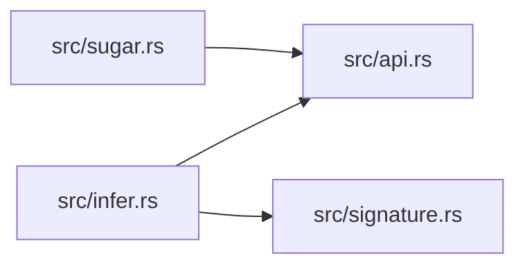

# ze-pod-func

> **本文件的「事实（自动生成）」一节由 `cargo verify --step docs` 生成，勿手动编辑。**
> 手写内容放在 `## 职责` 及之后的章节：生成器只替换自动区，手写区逐字节保留。
> 导航与阅读顺序见 [`docs/README.md`](../README.md)。

<!-- AUTO:BEGIN -->
## 事实（自动生成）

- 层：`pod`（`crates/ze/pod`）
- 路径：`crates/ze/pod/ze-pod-func`
- 生产依赖（上游，dev-deps 不计）：`ze-comb`、`ze-func`、`ze-pod-core`、`ze-pod-macro`、`ze-reflect`、`ze-type`
- 被依赖（下游）：`zela-app`、`zela-commands`、`zela-playback`、`zela-scene-ecs`
- 源文件：7 个 · 4663 行

### 文件清单

| 文件 | 行数 | `//!` 首行 |
|---|---|---|
| `src/api.rs` | 1074 | `zela.math`：表达式层的**叶子算子**能力（函子库）。 |
| `src/expr_pod.rs` | 2375 | 表达式 Pod：**表达式数据留在 Pod 内，跨边界只传 [`Handle`]**。 |
| `src/infer.rs` | 819 | **装配期类型推导**（L2）：rank-1 合一 + kind 约束 + 重载列表。 |
| `src/lib.rs` | 66 | ze-pod-func: **函子库 Pod**（namespace `zela.math`）。 |
| `src/ops.rs` | 19 | `zela.math` 算子的**接线入口**（语义实现已迁到基础函子库 `ze-func`）。 |
| `src/signature.rs` | 214 | **算子签名表的接线层**：数据面在 `ze-func`（[`OpDef`] 的唯一来源）。 |
| `src/sugar.rs` | 96 | **糖层的穿透文档**（计划 §5.5）：每个糖都必须写出等价的 core 写法。 |

### 模块内关系（`use crate::…` / `use super::…`）

### 对外 API（模块级 `pub` 项；impl 方法见源码）

| 文件 | 项 |
|---|---|
| `src/api.rs` | `pub enum ChannelTypeSpec` |
| `src/api.rs` | `pub struct ChannelSpec` |
| `src/api.rs` | `pub struct ReadSpec` |
| `src/api.rs` | `pub struct SelectSpec` |
| `src/api.rs` | `pub struct ClockLinkSpec` |
| `src/api.rs` | `pub struct ClockSpec` |
| `src/api.rs` | `pub enum PredicateSpec` |
| `src/api.rs` | `pub enum ResetSpec` |
| `src/api.rs` | `pub struct BindSpec` |
| `src/api.rs` | `pub struct ShaderSpec` |
| `src/api.rs` | `pub struct ShaderSourceSpec` |
| `src/api.rs` | `pub struct PlotSpec` |
| `src/api.rs` | `pub struct SinSpec` |
| `src/api.rs` | `pub struct CosSpec` |
| `src/api.rs` | `pub struct AddSpec` |
| `src/api.rs` | `pub struct MulSpec` |
| `src/api.rs` | `pub struct ScaleSpec` |
| `src/api.rs` | `pub struct MixSpec` |
| `src/api.rs` | `pub struct ClampSpec` |
| `src/api.rs` | `pub struct Vec2OfSpec` |
| `src/api.rs` | `pub struct Vec3OfSpec` |
| `src/api.rs` | `pub struct Vec4OfSpec` |
| `src/api.rs` | `pub struct ComponentSpec` |
| `src/api.rs` | `pub struct Rotate3Spec` |
| `src/api.rs` | `pub struct SplatSpec` |
| `src/api.rs` | `pub struct Vec3FromVec2Spec` |
| `src/api.rs` | `pub struct Vec2FromVec3Spec` |
| `src/api.rs` | `pub struct LengthSpec` |
| `src/api.rs` | `pub struct NormalizeSpec` |
| `src/api.rs` | `pub struct RoundF32Spec` |
| `src/api.rs` | `pub struct NarrowF32Spec` |
| `src/api.rs` | `pub struct DistanceSpec` |
| `src/api.rs` | `pub struct SmoothstepSpec` |
| `src/api.rs` | `pub struct FractSpec` |
| `src/api.rs` | `pub struct SumSpec` |
| `src/api.rs` | `pub struct LtSpec` |
| `src/api.rs` | `pub struct GtSpec` |
| `src/api.rs` | `pub struct LeSpec` |
| `src/api.rs` | `pub struct GeSpec` |
| `src/api.rs` | `pub struct EqSpec` |
| `src/api.rs` | `pub struct NeSpec` |
| `src/api.rs` | `pub struct AndSpec` |
| `src/api.rs` | `pub struct OrSpec` |
| `src/api.rs` | `pub struct NotSpec` |
| `src/api.rs` | `pub struct BindEachSpec` |
| `src/api.rs` | `pub struct ExistsSpec` |
| `src/api.rs` | `pub struct MethodCallSpec` |
| `src/api.rs` | `pub struct NatRecSpec` |
| `src/api.rs` | `pub struct MathApi<'a>` |
| `src/api.rs` | `pub struct SugarApi<'a>` |
| `src/api.rs` | `pub fn method_signature(name: &str) -> Option<(usize, ChannelTypeSpec)>` |
| `src/expr_pod.rs` | `pub struct PendingBindEach` |
| `src/expr_pod.rs` | `pub struct PendingBinding` |
| `src/expr_pod.rs` | `pub struct PendingShaderParam` |
| `src/expr_pod.rs` | `pub struct PendingShader` |
| `src/expr_pod.rs` | `pub struct PendingPlot` |
| `src/expr_pod.rs` | `pub struct ExprPod` |
| `src/infer.rs` | `pub struct TypeError` |
| `src/infer.rs` | `pub struct PointwiseReport` |
| `src/infer.rs` | `pub struct Inference` |
| `src/infer.rs` | `pub fn infer(expr: &Expr) -> Result<ChannelType, TypeError>` |
| `src/infer.rs` | `pub fn infer_full(expr: &Expr) -> Result<Inference, TypeError>` |
| `src/infer.rs` | `pub fn infer_pointwise(expr: &Expr) -> Result<PointwiseReport, TypeError>` |
| `src/infer.rs` | `pub fn infer_root(expr: &Expr) -> Result<ChannelType, TypeError>` |
| `src/infer.rs` | `pub fn infer_predicate(expr: &Expr) -> Result<(), TypeError>` |
| `src/infer.rs` | `pub fn register_passes(registry: &mut ze_comb::PassRegistry)` |
| `src/lib.rs` | `pub fn register_passes(registry: &mut ze_comb::PassRegistry)` |
| `src/ops.rs` | `pub fn is_known(op: &OpRef) -> bool` |
| `src/signature.rs` | `pub fn collect_op_revisions(expr: &ze_comb::Expr) -> BTreeMap<String, (u32, u32)>` |
| `src/signature.rs` | `pub fn check_op_revisions(revisions: &BTreeMap<String, (u32, u32)>) -> Result<(), String>` |
| `src/signature.rs` | `pub fn register_passes(registry: &mut ze_comb::PassRegistry)` |
| `src/sugar.rs` | `pub struct SugarDoc` |
<!-- AUTO:END -->

## 职责

`ze-pod-func` 是**函子库 Pod**（namespace `zela.math`，Broker Service 名 `expr`）：把表达式能力暴露给脚本。它持有 `ExprPod` 内部可变的状态（`HandleTable<Expr>`）、叶子算子的 capability 定义与签名表接线；表达式数据留在 Pod 内，**跨边界只传 `Handle`**。

## 运行机制

脚本调 `expr.sin` / `expr.mul` / `expr.bind` 等能力 → `src/api.rs` 的 spec 把参数收成结构化值，`src/expr_pod.rs` 在 Pod 内建 `Expr` 节点并返回句柄（不采样、不求值、不读时间）→ 导出时按树展开成 expression JSON，交给 `ze-comb` 与宿主。装配期 `src/infer.rs` 做 rank-1 合一 + kind 约束 + 重载列表推导通道类型（`infer` / `infer_full` / `infer_pointwise` / `infer_root` / `infer_predicate`），`src/signature.rs` 收集并校验算子 revision，`src/ops.rs` 只做 namespace 归属判断，`src/lib.rs` 把两条 pass 登记汇总进内核注册表。

内部文件分工：`api.rs` 是能力面（spec 结构与 `MathApi`），`expr_pod.rs` 是表达式存储与句柄，`infer.rs` 是装配期类型推导，`signature.rs` 是签名 / 版本接线，`ops.rs` 是极薄的接线入口，`lib.rs` 是命名空间常量与 pass 汇总。

## 边界与不做什么

- **不依赖任何 `zela-*`**（`JQ_POD_LAYER` 判据守住）：不认识场景与渲染实现。
- **不做算子语义**：`OPS` 与 `eval` 全部 re-export 自 `ze-func`，签名与实现只有一份，避免各说各话。
- **不采样、不求值、不读时间**：通道是零元叶子，值由宿主注入；真正的求值在 `ze-comb` + 宿主 `Mono`。
- **不做 `Ref` 折叠**：导出按树展开，同一句柄用两次会得到两棵相同子树；共享留给绑定层，现在做等于为假想需求预付。
- **不校验用户输入**：算子签名是 `fn(..) -> Handle`，脚本拿不到非法句柄；字段类型 / 缺字段由绑定层在跨边界时显式报错。
