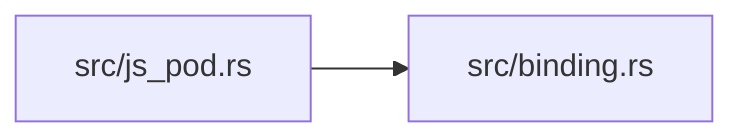

# ze-pod-js

> **本文件的「事实（自动生成）」一节由 `cargo verify --step docs` 生成，勿手动编辑。**
> 手写内容放在 `## 职责` 及之后的章节：生成器只替换自动区，手写区逐字节保留。
> 导航与阅读顺序见 [`docs/README.md`](../README.md)。

<!-- AUTO:BEGIN -->
## 事实（自动生成）

- 层：`pod`（`crates/ze/pod`）
- 路径：`crates/ze/pod/ze-pod-js`
- 生产依赖（上游，dev-deps 不计）：`ze-pod-binding`、`ze-pod-core`
- 被依赖（下游）：`ze-pod-tests`、`zela-app`、`zela-commands`
- 源文件：4 个 · 1450 行

### 文件清单

| 文件 | 行数 | `//!` 首行 |
|---|---|---|
| `src/binding.rs` | 741 | — |
| `src/export.rs` | 348 | — |
| `src/js_pod.rs` | 323 | — |
| `src/lib.rs` | 38 | JS 适配器（boa）：能力注入 + 宿主 → 脚本入口。 |

### 模块内关系（`use crate::…` / `use super::…`）

### 对外 API（模块级 `pub` 项；impl 方法见源码）

| 文件 | 项 |
|---|---|
| `src/export.rs` | `pub fn ts_type_name(spec: &'static TypeSpec) -> String` |
| `src/export.rs` | `pub fn d_ts(capabilities: &[CapabilityDocs]) -> String` |
| `src/export.rs` | `pub fn export_docs(dir: &Path, capabilities: &[CapabilityDocs]) -> io::Result<[PathBuf; 2]>` |
| `src/js_pod.rs` | `pub struct JsPod` |
<!-- AUTO:END -->

## 职责

JS 适配器：用纯 Rust 的 boa 引擎做能力注入与宿主到脚本入口，与 Lua、Python 两侧同形状。

## 运行机制

脚本 Pod 持有引擎上下文与注入的服务，经脚本运行入口执行源码，入口服务的重置与收尾函数交接产物；绑定层把绑定计划的每个函数包成原生函数，宿主状态挂进上下文的自定义数据，闭包只捕获下标，句柄、结构体与枚举用带隐藏属性的对象作令牌。导出层生成 TypeScript 声明文件；整数在 JS 侧只有一种数值类型，越界由绑定层显式校验。

## 边界与不做什么

- 不新增能力，也不改场景与内容的命名空间与版本。
- host-js feature 在非 wasm 目标下编译期报错、在 wasm 下显式声明尚未接线，不回退到宿主引擎。
- 不依赖任何 zela-*。
