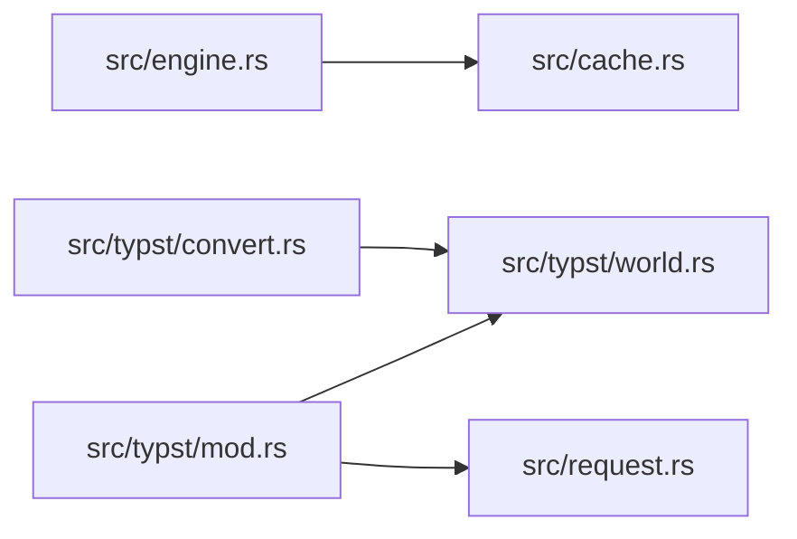

# ze-prerender

> **本文件的「事实（自动生成）」一节由 `cargo verify --step docs` 生成，勿手动编辑。**
> 手写内容放在 `## 职责` 及之后的章节：生成器只替换自动区，手写区逐字节保留。
> 导航与阅读顺序见 [`docs/README.md`](../README.md)。

<!-- AUTO:BEGIN -->
## 事实（自动生成）

- 层：`kernel`（`crates/kernel`）
- 路径：`crates/kernel/ze-prerender`
- 生产依赖（上游，dev-deps 不计）：`ze-content`、`ze-notion`
- 被依赖（下游）：`ze-scene-api`、`ze-scene-core`、`zela-app`、`zela-authored`、`zela-scene-ecs`
- 源文件：8 个 · 1416 行

### 文件清单

| 文件 | 行数 | `//!` 首行 |
|---|---|---|
| `src/cache.rs` | 55 | — |
| `src/engine.rs` | 192 | — |
| `src/lib.rs` | 67 | — |
| `src/placeholder.rs` | 64 | — |
| `src/request.rs` | 77 | — |
| `src/typst/convert.rs` | 482 | — |
| `src/typst/mod.rs` | 220 | — |
| `src/typst/world.rs` | 259 | — |

### 模块内关系（`use crate::…` / `use super::…`）

### 对外 API（模块级 `pub` 项；impl 方法见源码）

| 文件 | 项 |
|---|---|
| `src/cache.rs` | `pub struct ContentCache` |
| `src/engine.rs` | `pub trait ContentEngine: Send + Sync` |
| `src/engine.rs` | `pub struct InMemoryEngine` |
| `src/placeholder.rs` | `pub fn compile(src: &ContentSource, cfg: &ContentConfig) -> ContentResult` |
| `src/placeholder.rs` | `pub fn engine() -> InMemoryEngine` |
| `src/request.rs` | `pub struct ContentHandle(pub NonZeroU64)` |
| `src/request.rs` | `pub struct ContentConfig` |
| `src/request.rs` | `pub enum ContentStatus` |
| `src/request.rs` | `pub enum ContentError` |
| `src/request.rs` | `pub struct CacheKey` |
| `src/typst/convert.rs` | `pub fn frame_to_ir(` |
| `src/typst/mod.rs` | `pub fn compile(` |
| `src/typst/mod.rs` | `pub fn engine() -> Result<InMemoryEngine, ContentError>` |
| `src/typst/world.rs` | `pub struct TypstWorld` |
<!-- AUTO:END -->

## 职责

排版引擎接入层：把内容源码编译成内容 IR，并对调用方暴露统一形状的异步接口（当前是同步实现）。

## 运行机制

src/engine.rs 定义请求 → 查询 → 取走三步：请求立即返回句柄，查询报状态，取走是 Gone 语义（第二次取返回 None）；内存引擎统一管句柄槽位、注入的编译函数与 src/cache.rs 的内容哈希缓存（键 = 归一化源码哈希 + 配置哈希，命中直接克隆 IR 返回）。src/placeholder.rs 提供不依赖重引擎的实现；打开 typst feature 后，src/typst/mod.rs 包装源码并驱动 src/typst/world.rs（只管字体与内存源、不读真实文件系统），再由 src/typst/convert.rs 把排版 Frame 的文本、形状与组递归转成 IR 并回填源码锚点。

## 边界与不做什么

- 不得依赖 graph / render / ui / app，也不依赖任何 zela-*。
- 重引擎依赖必须在 feature 之后，默认关闭时仍能独立编译。
- 不做场景装配与屏幕空间换算，只产出标称字号下的 pt 坐标 IR。
- 不做后台线程与缓存淘汰，缓存只在引擎内部按内容哈希去重。
