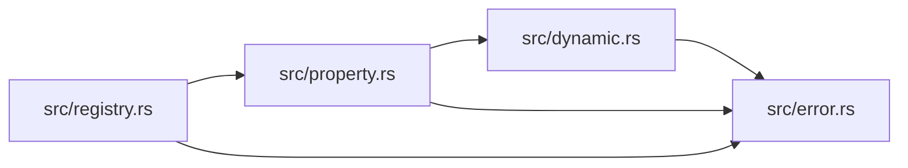

# ze-property

> **本文件的「事实（自动生成）」一节由 `cargo verify --step docs` 生成，勿手动编辑。**
> 手写内容放在 `## 职责` 及之后的章节：生成器只替换自动区，手写区逐字节保留。
> 导航与阅读顺序见 [`docs/README.md`](../README.md)。

<!-- AUTO:BEGIN -->
## 事实（自动生成）

- 层：`kernel`（`crates/kernel`）
- 路径：`crates/kernel/ze-property`
- 生产依赖（上游，dev-deps 不计）：（无）
- 被依赖（下游）：`ze-node-schema`、`ze-scene-core`、`zela-egui`、`zela-scene-ecs`
- 源文件：5 个 · 1112 行

### 文件清单

| 文件 | 行数 | `//!` 首行 |
|---|---|---|
| `src/dynamic.rs` | 225 | [`DynamicObject`] — a runtime-extensible, ordered map of named properties. |
| `src/error.rs` | 31 | Errors raised by the property model. All operations return errors rather |
| `src/lib.rs` | 39 | `ze-property` — the kernel-level property model: schema + value + constraints. |
| `src/property.rs` | 613 | The property model: a serializable, UI-neutral description of every |
| `src/registry.rs` | 204 | [`ParameterRegistry`] — the enumerable side table of tunable parameters. |

### 模块内关系（`use crate::…` / `use super::…`）

### 对外 API（模块级 `pub` 项；impl 方法见源码）

| 文件 | 项 |
|---|---|
| `src/dynamic.rs` | `pub struct DynamicObject` |
| `src/dynamic.rs` | `pub struct DynamicField` |
| `src/error.rs` | `pub enum PropertyError` |
| `src/property.rs` | `pub enum StringKind` |
| `src/property.rs` | `pub struct FunctionHandle` |
| `src/property.rs` | `pub struct BoolConfig` |
| `src/property.rs` | `pub struct StringConfig` |
| `src/property.rs` | `pub struct VecNConfig` |
| `src/property.rs` | `pub struct ColorConfig` |
| `src/property.rs` | `pub struct EnumConfig` |
| `src/property.rs` | `pub struct RangeConfig` |
| `src/property.rs` | `pub struct FunctionConfig` |
| `src/property.rs` | `pub struct DynamicConfig` |
| `src/property.rs` | `pub struct ListConfig` |
| `src/property.rs` | `pub enum Property` |
| `src/property.rs` | `pub enum PropertyValue` |
| `src/registry.rs` | `pub struct ParameterEntry<'a>` |
| `src/registry.rs` | `pub struct ParameterRegistry` |
<!-- AUTO:END -->

## 职责

kernel 级的属性模型：可序列化、与 UI / 节点 / 渲染都无关的参数词汇表（`Property` / `PropertyValue` / `PropertyError`）、运行时可扩展的命名属性集合（`DynamicObject`），以及可枚举的参数注册表（`ParameterRegistry`）。

## 运行机制

每个 `Property` 同时携带 schema（label / 类型 / min / max / step）与当前值，写回统一走 `set_value` 做类型与范围校验（NaN、越界、错误枚举项都显式报错，不 panic）。`DynamicObject` 复用同一套词汇表，字段按插入顺序排列，可运行时增删改名。`ParameterRegistry` 用 `BTreeMap` 把「参数地址 → Property」组织成**升序** side table：装配期写入、运行期只读，顺序即 UI 控件顺序（不用 `HashMap`，避免顺序随哈希种子漂移）。

## 边界与不做什么

- 只依赖 `serde` + `thiserror` + `std`：不得依赖 `egui`、`glam`、节点 / 图 / 场景 / 渲染任何一层。
- 不画控件、不做布局：控件由 UI 层按 `Property` 的 kind 自行生成。
- 不持有宿主语义：`FunctionHandle.node` 只是宿主引用槽位，节点栈用它指 `NodeId`，场景侧可指 `ObjectId`。
- 不做求值、调度与持久化格式：注册表是派生量，不进产物 payload。
