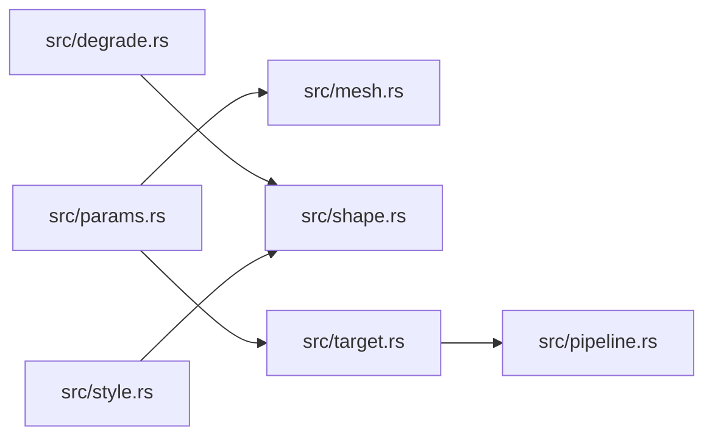

# ze-render-ir

> **本文件的「事实（自动生成）」一节由 `cargo verify --step docs` 生成，勿手动编辑。**
> 手写内容放在 `## 职责` 及之后的章节：生成器只替换自动区，手写区逐字节保留。
> 导航与阅读顺序见 [`docs/README.md`](../README.md)。

<!-- AUTO:BEGIN -->
## 事实（自动生成）

- 层：`kernel`（`crates/kernel`）
- 路径：`crates/kernel/ze-render-ir`
- 生产依赖（上游，dev-deps 不计）：`ze-notion`、`ze-pod-core`、`ze-vertex`
- 被依赖（下游）：`ze-scene-api`、`ze-scene-contract`、`ze-scene-core`、`zela-app`、`zela-authored`、`zela-playback`、`zela-render`、`zela-render-backends`、`zela-render-vector`、`zela-scene-bundle`、`zela-scene-ecs`、`zela-web`
- 源文件：14 个 · 3260 行

### 文件清单

| 文件 | 行数 | `//!` 首行 |
|---|---|---|
| `src/bind.rs` | 263 | — |
| `src/caps.rs` | 425 | — |
| `src/degrade.rs` | 40 | — |
| `src/draw.rs` | 111 | — |
| `src/layer.rs` | 30 | — |
| `src/lib.rs` | 77 | — |
| `src/mesh.rs` | 64 | — |
| `src/paint.rs` | 317 | — |
| `src/params.rs` | 417 | — |
| `src/pipeline.rs` | 383 | — |
| `src/shape.rs` | 400 | — |
| `src/style.rs` | 344 | — |
| `src/target.rs` | 114 | — |
| `src/uniform.rs` | 275 | — |

### 模块内关系（`use crate::…` / `use super::…`）

### 对外 API（模块级 `pub` 项；impl 方法见源码）

| 文件 | 项 |
|---|---|
| `src/bind.rs` | `pub struct GroupSymbol` |
| `src/bind.rs` | `pub struct BindSymbols` |
| `src/bind.rs` | `pub enum BindSymbolError` |
| `src/caps.rs` | `pub fn signatures_of(namespace: &str) -> Option<&'static [FnSig]>` |
| `src/caps.rs` | `pub fn fingerprints() -> [(&'static str, u64); 4]` |
| `src/caps.rs` | `pub enum MeshForm` |
| `src/caps.rs` | `pub struct MeshForms` |
| `src/caps.rs` | `pub struct MeshFormError` |
| `src/caps.rs` | `pub struct RenderCapabilitySet` |
| `src/caps.rs` | `pub struct CapabilityNegotiationError` |
| `src/caps.rs` | `pub fn negotiate(` |
| `src/degrade.rs` | `pub trait ToShape2D` |
| `src/draw.rs` | `pub struct ZOrder(pub i32)` |
| `src/draw.rs` | `pub struct DrawCommand` |
| `src/layer.rs` | `pub struct LayerId(pub u32)` |
| `src/layer.rs` | `pub enum LayerBlend` |
| `src/mesh.rs` | `pub enum PrimitiveTopology` |
| `src/mesh.rs` | `pub struct TextureHandle(u64)` |
| `src/mesh.rs` | `pub enum UvProjection` |
| `src/mesh.rs` | `pub enum ShaderVariant` |
| `src/paint.rs` | `pub struct Gradient` |
| `src/paint.rs` | `pub struct Dash` |
| `src/paint.rs` | `pub struct SecondPaint` |
| `src/paint.rs` | `pub struct BackgroundStroke` |
| `src/paint.rs` | `pub struct CurveWindow` |
| `src/paint.rs` | `pub struct PathOptions` |
| `src/paint.rs` | `pub struct ShaderPaint` |
| `src/paint.rs` | `pub struct ShaderParam` |
| `src/paint.rs` | `pub enum ShaderParamKind` |
| `src/params.rs` | `pub enum TextureFilter` |
| `src/params.rs` | `pub enum Msaa` |
| `src/params.rs` | `pub enum ToneCurve` |
| `src/params.rs` | `pub struct ToneMapping` |
| `src/params.rs` | `pub struct Bloom` |
| `src/params.rs` | `pub struct AmbientOcclusion` |
| `src/params.rs` | `pub struct RenderParams` |
| `src/params.rs` | `pub enum RenderParamError` |
| `src/pipeline.rs` | `pub enum CullMode` |
| `src/pipeline.rs` | `pub struct PipelineDesc` |
| `src/pipeline.rs` | `pub struct ShaderRequirements` |
| `src/pipeline.rs` | `pub fn vs_requirements(entry: &str) -> Option<ShaderRequirements>` |
| `src/pipeline.rs` | `pub fn vs_entry_for(topology: PrimitiveTopology) -> &'static str` |
| `src/pipeline.rs` | `pub fn vs_requirements_for(topology: PrimitiveTopology) -> ShaderRequirements` |
| `src/pipeline.rs` | `pub enum PassDepth` |
| `src/pipeline.rs` | `pub struct PassDesc` |
| `src/pipeline.rs` | `pub enum ColorFormat` |
| `src/pipeline.rs` | `pub enum DepthFormat` |
| `src/pipeline.rs` | `pub struct PostCaps` |
| `src/pipeline.rs` | `pub struct Capabilities` |
| `src/pipeline.rs` | `pub enum CapabilityError` |
| `src/shape.rs` | `pub struct SpecId(Cow<'static, str>)` |
| `src/shape.rs` | `pub struct CustomSpec` |
| `src/shape.rs` | `pub struct CustomSpecs` |
| `src/shape.rs` | `pub struct CustomShapeData` |
| `src/shape.rs` | `pub struct Style2D` |
| `src/shape.rs` | `pub enum Shape2D` |
| `src/style.rs` | `pub enum StrokeCap` |
| `src/style.rs` | `pub enum StrokeJoin` |
| `src/style.rs` | `pub struct StrokeShape` |
| `src/style.rs` | `pub struct StrokeSolid` |
| `src/style.rs` | `pub struct FillSolid` |
| `src/style.rs` | `pub struct Opacity(pub f32)` |
| `src/style.rs` | `pub enum FillStyle` |
| `src/style.rs` | `pub enum StrokeStyle` |
| `src/style.rs` | `pub trait ResolveStyle` |
| `src/style.rs` | `pub fn fill_style(fill: &FillSolid) -> Style2D` |
| `src/style.rs` | `pub fn stroke_style_raw(stroke: &StrokeSolid) -> Style2D` |
| `src/target.rs` | `pub struct RenderTargetDesc` |
| `src/target.rs` | `pub enum TargetDescError` |
| `src/uniform.rs` | `pub enum UniformType` |
| `src/uniform.rs` | `pub struct UniformField` |
| `src/uniform.rs` | `pub enum UniformLayoutError` |
| `src/uniform.rs` | `pub struct UniformLayout` |
| `src/uniform.rs` | `pub fn cube_uniforms_layout() -> UniformLayout` |
| `src/uniform.rs` | `pub fn cube_lights_layout() -> UniformLayout` |
<!-- AUTO:END -->

## 职责

图元的中间表示层：逻辑图元、绘制样式与样式组件，加上「对象 → IR」的降级 trait；上游只产出 IR，后端只消费 IR。

## 运行机制

src/degrade.rs 的降级接口吃调用点算好的仿射矩阵而不是相机，避免与场景对象层成环；src/style.rs 把填充与描边组件解析成样式，并在该处唯一一次结合缩放换算描边宽度；src/draw.rs 用层序 + 图元 + 样式组成绘制命令，排序只比层序、同层序保持插入序。src/caps.rs 声明四个命名空间的能力签名与指纹供全有或全无的协商，src/pipeline.rs 用纯数据描述管线意图与通道，src/uniform.rs 给出 uniform 布局，src/target.rs 描述离屏目标，src/paint.rs 与 src/params.rs 承载渐变、虚线、色调映射等额外参数；后端只负责把声明翻译成 GPU 状态。

## 边界与不做什么

- 不含 wgpu / egui / ECS 类型，也不依赖任何 zela-* 或场景对象层。
- 不做三角化与合批，那是渲染管线的动作；本层不产生顶点数据。
- 不定义相机：降级接口只接收矩阵，相机属于场景对象层。
- 能力签名只是契约，不含实现；后端能力不足时返回显式协商错误，不自动降级。
