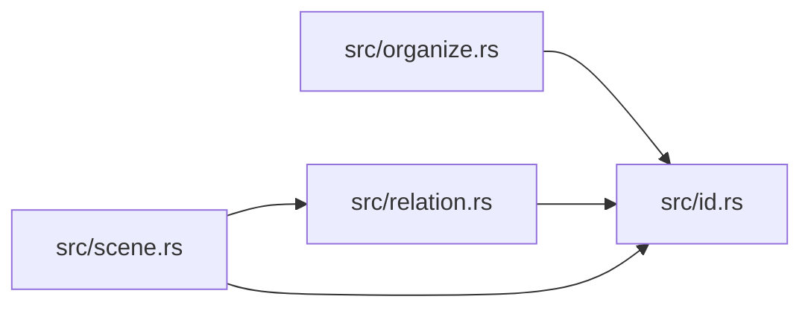

# ze-scene-contract

> **本文件的「事实（自动生成）」一节由 `cargo verify --step docs` 生成，勿手动编辑。**
> 手写内容放在 `## 职责` 及之后的章节：生成器只替换自动区，手写区逐字节保留。
> 导航与阅读顺序见 [`docs/README.md`](../README.md)。

<!-- AUTO:BEGIN -->
## 事实（自动生成）

- 层：`kernel`（`crates/kernel`）
- 路径：`crates/kernel/ze-scene-contract`
- 生产依赖（上游，dev-deps 不计）：`ze-notion`、`ze-render-ir`
- 被依赖（下游）：`ze-scene-api`、`ze-scene-core`、`ze-scene-hecs`、`zela-render`、`zela-scene-ecs`
- 源文件：7 个 · 887 行

### 文件清单

| 文件 | 行数 | `//!` 首行 |
|---|---|---|
| `src/descriptor.rs` | 196 | — |
| `src/id.rs` | 91 | — |
| `src/lib.rs` | 40 | — |
| `src/lifetime.rs` | 17 | — |
| `src/organize.rs` | 289 | — |
| `src/relation.rs` | 80 | — |
| `src/scene.rs` | 174 | — |

### 模块内关系（`use crate::…` / `use super::…`）

### 对外 API（模块级 `pub` 项；impl 方法见源码）

| 文件 | 项 |
|---|---|
| `src/descriptor.rs` | `pub trait Describable` |
| `src/descriptor.rs` | `pub struct StrokeDesc` |
| `src/descriptor.rs` | `pub struct FillDesc` |
| `src/descriptor.rs` | `pub struct MaterialDesc` |
| `src/descriptor.rs` | `pub fn theme_style(slot_mask: u8) -> Style2D` |
| `src/descriptor.rs` | `pub fn apply_stroke_desc(d: &StrokeDesc, style: &mut Style2D)` |
| `src/descriptor.rs` | `pub fn apply_fill_desc(d: &FillDesc, style: &mut Style2D)` |
| `src/id.rs` | `pub struct ObjectId` |
| `src/lifetime.rs` | `pub struct LifetimeTracked` |
| `src/organize.rs` | `pub struct Name(pub String)` |
| `src/organize.rs` | `pub struct GroupId(pub u32)` |
| `src/organize.rs` | `pub struct Group(pub GroupId)` |
| `src/organize.rs` | `pub enum VisibilityTag` |
| `src/organize.rs` | `pub struct Visibility` |
| `src/organize.rs` | `pub struct GroupVisibility` |
| `src/relation.rs` | `pub struct Parent(pub ObjectId)` |
| `src/relation.rs` | `pub struct Children(pub Vec<ObjectId>)` |
| `src/scene.rs` | `pub trait Component: Send + Sync + 'static` |
| `src/scene.rs` | `pub trait SceneRead` |
| `src/scene.rs` | `pub trait Scene: SceneRead` |
<!-- AUTO:END -->

## 职责

场景抽象契约层：身份、组织、关系与样式描述符；持有对象 id、名字 / 分组 / 可见性、父子关系与只读、可写两套场景 trait。

## 运行机制

上层只按 trait 访问场景：src/scene.rs 的只读视图用访客式回调（批量遍历与按 id 取组件），借用守卫限制在回调内，可写场景在其上扩展；src/id.rs 的对象 id 由 index + generation 组成，实现方与渲染层据此互转。src/descriptor.rs 的描边与填充描述符经合并函数与主题默认值合成尚未换算的样式，src/organize.rs 与 src/relation.rs 提供分组、可见性与父子组件，src/lifetime.rs 标记需要生命周期跟踪的对象。

## 边界与不做什么

- 不得出现 hecs / ECS / GPU / egui，也不依赖任何 zela-* 或场景对象层；具体实现放在 ECS 实现方。
- 不持有场景数据，只声明接口与组件类型。
- 不做世界到屏幕的换算：描述符合并只做声明合并，产物的宽度与度量空间原样带出。
- 不定义具体图元（圆、线段、相机），那是场景对象层的职责。
