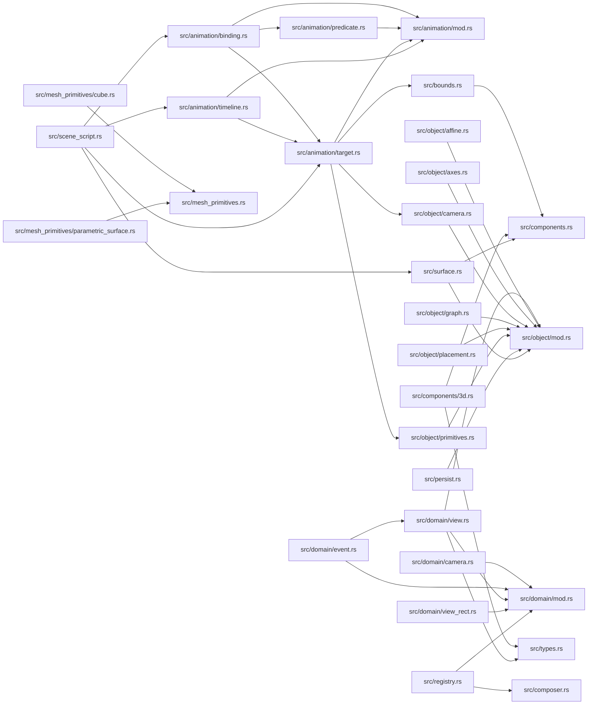

# ze-scene-core

> **本文件的「事实（自动生成）」一节由 `cargo verify --step docs` 生成，勿手动编辑。**
> 手写内容放在 `## 职责` 及之后的章节：生成器只替换自动区，手写区逐字节保留。
> 导航与阅读顺序见 [`docs/README.md`](../README.md)。

<!-- AUTO:BEGIN -->
## 事实（自动生成）

- 层：`scene`（`crates/scene`）
- 路径：`crates/scene/ze-scene-core`
- 生产依赖（上游，dev-deps 不计）：`ze-comb`、`ze-content`、`ze-func`、`ze-macro`、`ze-notion`、`ze-pod-core`、`ze-prerender`、`ze-reflect`、`ze-render-ir`、`ze-scene-contract`、`ze-scene-macros`、`ze-time`
- 被依赖（下游）：`ze-scene-api`、`zela-app`、`zela-authored`、`zela-egui`、`zela-playback`、`zela-render`、`zela-render-backends`、`zela-scene-ecs`
- 源文件：41 个 · 9724 行

### 文件清单

| 文件 | 行数 | `//!` 首行 |
|---|---|---|
| `src/animation/binding.rs` | 293 | — |
| `src/animation/mod.rs` | 27 | — |
| `src/animation/predicate.rs` | 729 | predicate → **区间集合**（AH-06）+ `last_active` 反算（AH-07）。 |
| `src/animation/target.rs` | 1154 | — |
| `src/animation/timeline.rs` | 601 | — |
| `src/bounds.rs` | 197 | — |
| `src/camera_input.rs` | 160 | — |
| `src/components/3d.rs` | 402 | — |
| `src/components.rs` | 196 | — |
| `src/composer.rs` | 146 | — |
| `src/content.rs` | 39 | — |
| `src/domain/camera.rs` | 121 | — |
| `src/domain/config.rs` | 76 | — |
| `src/domain/event.rs` | 167 | — |
| `src/domain/mod.rs` | 24 | — |
| `src/domain/view.rs` | 263 | — |
| `src/domain/view_rect.rs` | 38 | — |
| `src/lib.rs` | 72 | — |
| `src/math_pod.rs` | 107 | — |
| `src/mesh_primitives/cube.rs` | 196 | — |
| `src/mesh_primitives/parametric_surface.rs` | 193 | — |
| `src/mesh_primitives.rs` | 12 | 内置 3D 图元生成器。 |
| `src/object/affine.rs` | 135 | — |
| `src/object/axes.rs` | 422 | — |
| `src/object/camera.rs` | 617 | — |
| `src/object/content_texture.rs` | 21 | — |
| `src/object/graph.rs` | 291 | — |
| `src/object/layer.rs` | 32 | — |
| `src/object/mod.rs` | 33 | — |
| `src/object/placement.rs` | 195 | — |
| `src/object/primitives.rs` | 475 | — |
| `src/object/zorder.rs` | 15 | — |
| `src/persist.rs` | 160 | — |
| `src/registry.rs` | 217 | — |
| `src/scene_script.rs` | 912 | — |
| `src/scene_write.rs` | 77 | — |
| `src/surface.rs` | 585 | — |
| `src/time_state.rs` | 34 | — |
| `src/transform.rs` | 221 | — |
| `src/types.rs` | 14 | — |
| `src/world_transforms.rs` | 55 | — |

### 模块内关系（`use crate::…` / `use super::…`）

### 对外 API（模块级 `pub` 项；impl 方法见源码）

| 文件 | 项 |
|---|---|
| `src/animation/binding.rs` | `pub enum ResetBehavior` |
| `src/animation/binding.rs` | `pub enum SeekKind` |
| `src/animation/binding.rs` | `pub enum BindingDriver` |
| `src/animation/binding.rs` | `pub struct LibraryRef` |
| `src/animation/binding.rs` | `pub struct Binding` |
| `src/animation/binding.rs` | `pub struct BindingTable` |
| `src/animation/predicate.rs` | `pub struct Bound` |
| `src/animation/predicate.rs` | `pub struct Interval` |
| `src/animation/predicate.rs` | `pub struct IntervalSet` |
| `src/animation/predicate.rs` | `pub struct MultiIntervalSet` |
| `src/animation/predicate.rs` | `pub fn analyze(expr: &Expr) -> Option<MultiIntervalSet>` |
| `src/animation/predicate.rs` | `pub fn register_passes(registry: &mut ze_comb::PassRegistry)` |
| `src/animation/target.rs` | `pub enum TargetError` |
| `src/animation/target.rs` | `pub trait Target: Send + Sync + std::fmt::Debug + 'static` |
| `src/animation/target.rs` | `pub trait TargetCtor: Send + Sync + 'static` |
| `src/animation/target.rs` | `pub struct FieldSpec` |
| `src/animation/target.rs` | `pub struct FieldTarget` |
| `src/animation/target.rs` | `pub struct MethodSpec` |
| `src/animation/target.rs` | `pub fn method_entry(name: &str) -> Option<&'static MethodSpec>` |
| `src/animation/target.rs` | `pub struct TargetEntry` |
| `src/animation/target.rs` | `pub fn target_entry(name: &str) -> Option<&'static TargetEntry>` |
| `src/animation/target.rs` | `pub fn target_ctor_by_name(name: &str) -> Option<(fn(ObjectId) -> Arc<dyn Target>, &'static str)>` |
| `src/animation/target.rs` | `pub fn channel_home(component: &'static str) -> &'static str` |
| `src/animation/target.rs` | `pub enum TransformChannel` |
| `src/animation/target.rs` | `pub struct TransformChannelValue` |
| `src/animation/timeline.rs` | `pub struct StillTimeReport` |
| `src/animation/timeline.rs` | `pub struct Timeline` |
| `src/bounds.rs` | `pub trait Bounds2D` |
| `src/bounds.rs` | `pub fn object_bounds(scene: &dyn SceneRead, id: ObjectId) -> Option<Rect2D>` |
| `src/camera_input.rs` | `pub fn apply_pan_zoom(view: &mut Framing2D, command: CameraCommand)` |
| `src/camera_input.rs` | `pub fn apply_orbit(camera: &mut Camera3D, command: CameraCommand)` |
| `src/camera_input.rs` | `pub fn apply_fps(view: &mut FpsView, camera: &mut Camera3D, command: CameraCommand)` |
| `src/camera_input.rs` | `pub fn apply_command_2d(view: &mut Framing2D, mode: CameraMode, command: CameraCommand)` |
| `src/camera_input.rs` | `pub fn apply_command_3d(` |
| `src/components/3d.rs` | `pub struct MeshGeometry` |
| `src/components/3d.rs` | `pub struct Material3D` |
| `src/components/3d.rs` | `pub struct Light` |
| `src/components/3d.rs` | `pub enum LightKind` |
| `src/components.rs` | `pub struct PhaseAnim` |
| `src/components.rs` | `pub struct MorphShape` |
| `src/components.rs` | `pub struct ContentTextureItem` |
| `src/components.rs` | `pub struct Reveal` |
| `src/composer.rs` | `pub struct Composer` |
| `src/composer.rs` | `pub struct ComposerQueue` |
| `src/composer.rs` | `pub fn full_recompute(scene: &impl SceneRead) -> Vec<ObjectId>` |
| `src/content.rs` | `pub fn build_ir(engine: &InMemoryEngine, source: &str) -> Option<ContentIR>` |
| `src/content.rs` | `pub fn compile(` |
| `src/domain/camera.rs` | `pub enum CameraMode` |
| `src/domain/camera.rs` | `pub enum CameraCommand` |
| `src/domain/config.rs` | `pub enum ViewportCamera` |
| `src/domain/config.rs` | `pub struct UiConfig` |
| `src/domain/event.rs` | `pub struct WidgetId(pub u32)` |
| `src/domain/event.rs` | `pub enum SceneEvent` |
| `src/domain/event.rs` | `pub struct InputEvents` |
| `src/domain/view.rs` | `pub struct ContentHandle(u64)` |
| `src/domain/view.rs` | `pub struct LayerDescriptor` |
| `src/domain/view.rs` | `pub struct ContentTextureSpec` |
| `src/domain/view.rs` | `pub struct ContentTextureSpecs(pub Vec<ContentTextureSpec>)` |
| `src/domain/view.rs` | `pub fn content_layer_id(surface: ObjectId) -> LayerId` |
| `src/domain/view.rs` | `pub fn content_texture_handle(surface: ObjectId) -> TextureHandle` |
| `src/domain/view.rs` | `pub fn content_texture_specs(` |
| `src/domain/view.rs` | `pub struct SceneView` |
| `src/domain/view_rect.rs` | `pub struct ViewRect` |
| `src/math_pod.rs` | `pub fn function_from_pod<X, Y>(pod: &SharedPod, name: &str) -> Option<FunctionX2Y<X, Y>>` |
| `src/math_pod.rs` | `pub fn math_pod() -> &'static SharedPod` |
| `src/math_pod.rs` | `pub fn builtin_f32(name: &str) -> Option<FunctionX2Y<f32, f32>>` |
| `src/math_pod.rs` | `pub fn rebind_components(components: &mut ze_scene_contract::Components)` |
| `src/mesh_primitives/cube.rs` | `pub fn wireframe_cube(half_extent: f32) -> MeshGeometry` |
| `src/mesh_primitives/cube.rs` | `pub fn solid_cube(half_extent: f32) -> MeshGeometry` |
| `src/mesh_primitives/parametric_surface.rs` | `pub fn parametric_surface(surface: SurfaceFn, u_steps: usize, v_steps: usize) -> MeshGeometry` |
| `src/object/affine.rs` | `pub fn uniform_scale(t: &Transform2D) -> f32` |
| `src/object/affine.rs` | `pub fn map_path_affine(path: &Path2D, t: &Transform2D) -> Path2D` |
| `src/object/axes.rs` | `pub struct TickSpec` |
| `src/object/axes.rs` | `pub struct AxesLine` |
| `src/object/axes.rs` | `pub struct Axes2D` |
| `src/object/camera.rs` | `pub struct Camera2D` |
| `src/object/camera.rs` | `pub struct Framing2D` |
| `src/object/camera.rs` | `pub struct Camera2DHandle(pub ObjectId)` |
| `src/object/camera.rs` | `pub fn spawn_camera2d<S: Scene>(scene: &mut S, framing: Framing2D) -> Option<Camera2DHandle>` |
| `src/object/camera.rs` | `pub struct FpsView` |
| `src/object/camera.rs` | `pub struct Camera3DHandle(pub ObjectId)` |
| `src/object/camera.rs` | `pub fn spawn_camera3d<S: Scene>(scene: &mut S, camera: Camera3D) -> Option<Camera3DHandle>` |
| `src/object/camera.rs` | `pub enum Projection` |
| `src/object/camera.rs` | `pub struct Camera3D` |
| `src/object/graph.rs` | `pub struct FunctionGraph` |
| `src/object/layer.rs` | `pub enum LayerKind` |
| `src/object/placement.rs` | `pub struct Transform` |
| `src/object/primitives.rs` | `pub struct Circle(pub Circle2D)` |
| `src/object/primitives.rs` | `pub struct Path(pub Path2D)` |
| `src/object/primitives.rs` | `pub struct Line(pub Line2D)` |
| `src/object/primitives.rs` | `pub struct Arrow(pub Arrow2D)` |
| `src/object/primitives.rs` | `pub struct Rect(pub Rect2D)` |
| `src/persist.rs` | `pub enum PersistError` |
| `src/persist.rs` | `pub struct TaggedComponent` |
| `src/persist.rs` | `pub fn serialize_components(components: &Components) -> Result<Vec<TaggedComponent>, PersistError>` |
| `src/persist.rs` | `pub fn deserialize_components(tagged: Vec<TaggedComponent>) -> Result<Components, PersistError>` |
| `src/registry.rs` | `pub fn known_type_name<T: 'static>() -> Option<&'static str>` |
| `src/registry.rs` | `pub fn known_type_name_of(c: &dyn std::any::Any) -> Option<&'static str>` |
| `src/registry.rs` | `pub fn known_component_type_id(name: &str) -> Option<std::any::TypeId>` |
| `src/registry.rs` | `pub fn clone_known(` |
| `src/registry.rs` | `pub fn serialize_component(` |
| `src/registry.rs` | `pub fn deserialize_component(` |
| `src/scene_script.rs` | `pub enum ExprBindError` |
| `src/scene_script.rs` | `pub fn duration_predicate(duration: f64) -> Expr` |
| `src/scene_script.rs` | `pub struct Handle(pub usize)` |
| `src/scene_script.rs` | `pub fn is_handle_ref(id: ObjectId) -> bool` |
| `src/scene_script.rs` | `pub struct SceneEncoder` |
| `src/scene_script.rs` | `pub struct HandleRange` |
| `src/scene_script.rs` | `pub struct SceneRecipe` |
| `src/scene_script.rs` | `pub enum ScriptError` |
| `src/scene_script.rs` | `pub struct SceneScript` |
| `src/scene_script.rs` | `pub fn register_passes(registry: &mut ze_comb::PassRegistry)` |
| `src/scene_write.rs` | `pub trait SceneWrite` |
| `src/scene_write.rs` | `pub trait SceneRead` |
| `src/scene_write.rs` | `pub fn with_component<T, F>(scene: &mut dyn SceneWrite, id: ObjectId, f: F) -> bool` |
| `src/scene_write.rs` | `pub fn read_component<T, R>(scene: &dyn SceneRead, id: ObjectId, f: impl FnOnce(&T) -> R) -> Option<R>` |
| `src/surface.rs` | `pub struct Surface` |
| `src/surface.rs` | `pub enum SurfaceMapping` |
| `src/surface.rs` | `pub enum SurfaceRenderer` |
| `src/surface.rs` | `pub struct SurfaceTexture` |
| `src/surface.rs` | `pub struct SurfaceTextureRef(pub ObjectId)` |
| `src/surface.rs` | `pub struct SurfaceOwner` |
| `src/surface.rs` | `pub enum SurfaceError` |
| `src/surface.rs` | `pub fn resolve_surface_texture(` |
| `src/surface.rs` | `pub fn resolve_surface(` |
| `src/time_state.rs` | `pub struct TimeState` |
| `src/transform.rs` | `pub trait Transform2D` |
| `src/transform.rs` | `pub trait Transform2DInto` |
| `src/world_transforms.rs` | `pub struct WorldTransforms` |
<!-- AUTO:END -->

## 职责

`ze-scene-core` 是场景的**概念侧**：场景对象、组件与纯逻辑，不认识 ECS，也不认识任何 `zela-*` 实现层。它持有动画目标表（`TARGETS` / `METHODS`）、组件登记表（`known_component_table!`）、Binding 表与 Timeline、脚本命令序列（`SceneEncoder` / `SceneScript`）以及世界矩阵容器 `WorldTransforms` —— 全是数据结构与纯函数。

## 运行机制

控制流分装配期与运行期两条。装配期：脚本经 `SceneEncoder` 录命令（句柄只是录制内的局部下标）→ `finish` 得到不可变的 `SceneScript` → `commit` 提交进**已有** Scene，此时局部下标才映射为 `ObjectId`，组件里的句柄引用在唯一改写点统一解析 / 偏移。运行期：动画是纯函数 `f(t)`（由 `ze-time` 的曲线采样保证不累积状态），`src/animation/binding.rs` 的 Binding 表经 `src/scene_write.rs` 的类型擦除接口写入场景，驱动 System 留在 ECS 层；时间与帧号由 `TimeState` 统一给出。`registry` 用一张表同时展开类型名反查、克隆、serde 与 ECS 侧的类型擦除分发。

内部文件分工：
- `src/object/`：场景对象 —— 图元 newtype、摆放与层序（`Transform` / `ZOrder`）、2D/3D 相机与 FpsView、装配对象（`Axes2D` / `FunctionGraph`）；
- `src/animation/`：动画词汇与数据 —— `target.rs` 是目标表与 `FieldSpec` 的唯一来源，`binding.rs` 是 Binding 表，`timeline.rs` 是时序，`predicate.rs` 把谓词化成区间集合；
- `src/domain/`：UI 与场景之间的纯数据契约（`SceneView` 向下声明图层、`SceneEvent` 向上表达输入、`CameraCommand` / `UiConfig`），红线是不得出现 egui 类型；
- `src/components.rs` + `src/components/3d.rs`：组件定义（`Reveal` / `MorphShape` / `PhaseAnim` / `ContentTextureItem` / `MeshGeometry` / `Material3D` / `Light`）；
- `src/mesh_primitives/`：内置 3D 图元网格生成（立方体 / 参数曲面）；
- `src/scene_script.rs` + `src/registry.rs` + `src/persist.rs`：命令录制、组件登记表、持久化，三者共用同一张表；
- `src/surface.rs` + `src/composer.rs`：2D/3D 融合的归属边界（沿 `Parent` 链解析、带环检测）与合成器的派生态；
- `src/bounds.rs` / `src/transform.rs` / `src/camera_input.rs` / `src/world_transforms.rs` / `src/time_state.rs` / `src/math_pod.rs` / `src/content.rs` / `src/types.rs`：纯工具与宿主适配（包围盒、仿射、相机命令 → 相机状态、世界矩阵容器、时间状态、内置数学 Pod 与持久化名字回绑、内容编译适配、理念层数学类型转发）。

## 边界与不做什么

- **零 hecs、零 `zela-*`**（`JQ_SCENE_LAYERS` 判据守住）：world / 资源 / System 接线与生命周期都在 `zela-scene-ecs`，本 crate 只留数据与纯逻辑。
- **不得包含任何 egui 类型**（`domain` 模块红线）：UI 适配的唯一入口在 `zela-egui` 的 host。
- **不做渲染**：不建 GPU 资源、不产 `DrawQueue`、不做三角化；绘制参数（`Gradient` / `Dash` / `SecondPaint` / `CurveWindow`）定义在 `ze-render-ir`，这里只登记与转发。
- **不做表达式类型推导**：那是 `ze-pod-func` 的 `infer`；本 crate 只提供表达式绑定的数据面（Binding 表与目标构造器）。
- **不做排版**：`src/content.rs` 只把 `ze-prerender` 的 request / take 包成函数，IR → 描边轮廓的唯一实现在 `ze-content`。
- **不做调度**：没有 System、没有帧循环，推进由 `zela-schedule` / ECS 层负责。
