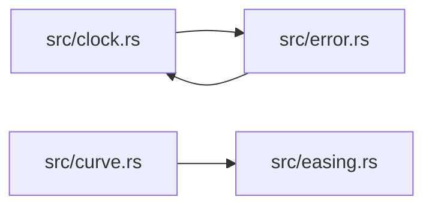

# ze-time

> **本文件的「事实（自动生成）」一节由 `cargo verify --step docs` 生成，勿手动编辑。**
> 手写内容放在 `## 职责` 及之后的章节：生成器只替换自动区，手写区逐字节保留。
> 导航与阅读顺序见 [`docs/README.md`](../README.md)。

<!-- AUTO:BEGIN -->
## 事实（自动生成）

- 层：`kernel`（`crates/kernel`）
- 路径：`crates/kernel/ze-time`
- 生产依赖（上游，dev-deps 不计）：`ze-notion`
- 被依赖（下游）：`ze-scene-api`、`ze-scene-core`、`zela-authored`、`zela-scene-ecs`
- 源文件：6 个 · 1520 行

### 文件清单

| 文件 | 行数 | `//!` 首行 |
|---|---|---|
| `src/clock.rs` | 500 | — |
| `src/curve.rs` | 609 | — |
| `src/director.rs` | 236 | — |
| `src/easing.rs` | 143 | — |
| `src/error.rs` | 14 | — |
| `src/lib.rs` | 18 | — |

### 模块内关系（`use crate::…` / `use super::…`）

### 对外 API（模块级 `pub` 项；impl 方法见源码）

| 文件 | 项 |
|---|---|
| `src/clock.rs` | `pub struct ClockId(pub u32)` |
| `src/clock.rs` | `pub enum PlayMode` |
| `src/clock.rs` | `pub struct ClockNode` |
| `src/clock.rs` | `pub struct ClockLink` |
| `src/clock.rs` | `pub struct ClockProgram` |
| `src/clock.rs` | `pub struct ClockForest` |
| `src/curve.rs` | `pub enum AnimValue` |
| `src/curve.rs` | `pub enum Interp` |
| `src/curve.rs` | `pub enum Curve` |
| `src/director.rs` | `pub struct Director` |
| `src/easing.rs` | `pub enum Easing` |
| `src/error.rs` | `pub enum TimeError` |
<!-- AUTO:END -->

## 职责

纯逻辑时间层：时钟树、动画曲线与时间推进器；所有求值函数都是纯函数，不持有渲染或场景状态。

## 运行机制

src/clock.rs 用父指针、局部偏移、速率、区间与回放模式（步进 / 循环 / 乒乓 / 冻结）描述时钟节点，构造期检测父链成环，求值不修改任何游标；脚本侧的扁平时钟程序在编译期展开成节点链，运行期复用同一套求值。src/director.rs 是唯一推进时间的对象，全局时间由帧号与基准派生（基准时间 + 帧差 × 步长 × 速率），变速、定位与步长变化都只移动基准，长片不累积漂移；src/curve.rs 的曲线与插值模式、src/easing.rs 的缓动负责取值，src/error.rs 给出显式错误。

## 边界与不做什么

- 只依赖数学元语层，不依赖内容层：语义配对的知识留在外层。
- 不自带计时器或线程，时间由调用方每帧喂步长推进。
- 不产出渲染数据，只给数值；也不做系统调度与副作用分发。
