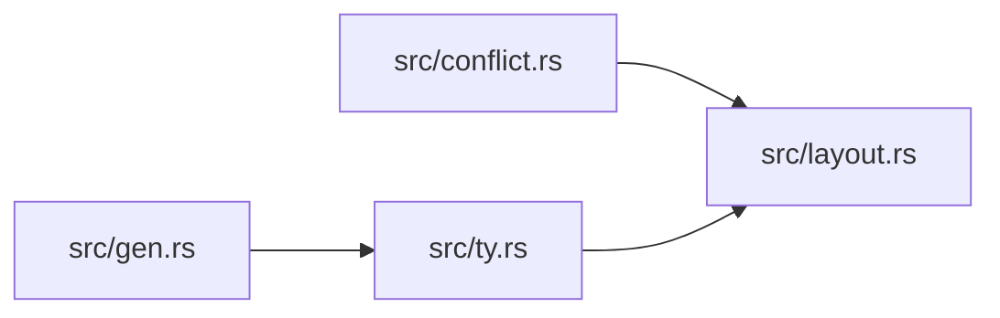

# ze-type

> **本文件的「事实（自动生成）」一节由 `cargo verify --step docs` 生成，勿手动编辑。**
> 手写内容放在 `## 职责` 及之后的章节：生成器只替换自动区，手写区逐字节保留。
> 导航与阅读顺序见 [`docs/README.md`](../README.md)。

<!-- AUTO:BEGIN -->
## 事实（自动生成）

- 层：`kernel`（`crates/kernel`）
- 路径：`crates/kernel/ze-type`
- 生产依赖（上游，dev-deps 不计）：（无）
- 被依赖（下游）：`ze-comb`、`ze-func`、`ze-node-core`、`ze-pod-core`、`ze-pod-func`、`ze-reflect`
- 源文件：7 个 · 2050 行

### 文件清单

| 文件 | 行数 | `//!` 首行 |
|---|---|---|
| `src/conflict.rs` | 250 | **冲突诊断**：五类冲突收敛为一个类型。 |
| `src/gen.rs` | 256 | 泛型实例化：**按需单态化 + 上界**。 |
| `src/layout.rs` | 540 | **Layout**：定长类型的字节描述（size / align / 字段偏移）。 |
| `src/lib.rs` | 42 | ze-type：**纯代数类型层**。 |
| `src/tag.rs` | 163 | Type tags and socket-level type compatibility（阶段 4：收敛到 `ze-type`）。 |
| `src/ty.rs` | 419 | 类型描述（IDL schema）：语言无关、零依赖、编译期常量。 |
| `src/unify.rs` | 380 | 合一 / 子类型 / 布局计算 —— **纯代数**，无缓存、无注册表。 |

### 模块内关系（`use crate::…` / `use super::…`）

### 对外 API（模块级 `pub` 项；impl 方法见源码）

| 文件 | 项 |
|---|---|
| `src/conflict.rs` | `pub enum NameKind` |
| `src/conflict.rs` | `pub enum Blame` |
| `src/conflict.rs` | `pub enum ReflectError` |
| `src/gen.rs` | `pub struct MonoInstance` |
| `src/gen.rs` | `pub fn monomorphize(sig: &OpSig) -> Result<Vec<MonoInstance>, ReflectError>` |
| `src/gen.rs` | `pub fn lift(kind: Kind) -> &'static [TypeSpec]` |
| `src/gen.rs` | `pub fn cartesian(groups: &[&'static [TypeSpec]]) -> Option<Vec<Vec<TypeSpec>>>` |
| `src/layout.rs` | `pub enum Endian` |
| `src/layout.rs` | `pub enum FieldTy` |
| `src/layout.rs` | `pub struct FieldLayout` |
| `src/layout.rs` | `pub struct Layout` |
| `src/layout.rs` | `pub enum LayoutError` |
| `src/layout.rs` | `pub enum Scalar` |
| `src/layout.rs` | `pub struct Record` |
| `src/layout.rs` | `pub enum Transcode` |
| `src/layout.rs` | `pub fn encode_record(record: &Record, layout: Option<Layout>) -> Result<Vec<u8>, LayoutError>` |
| `src/layout.rs` | `pub fn decode_record(ty: &str, bytes: &[u8], layout: Option<Layout>) -> Result<Record, LayoutError>` |
| `src/layout.rs` | `pub fn encode_path(points: &[[f32; 2]], closed: bool) -> Vec<u8>` |
| `src/layout.rs` | `pub fn decode_path(bytes: &[u8]) -> Result<(Vec<[f32; 2]>, bool), LayoutError>` |
| `src/tag.rs` | `pub trait TypeTag: fmt::Debug + Send + Sync + 'static` |
| `src/tag.rs` | `pub struct NamedTypeTag` |
| `src/tag.rs` | `pub enum CastError` |
| `src/tag.rs` | `pub trait TypeCast: Send + Sync + 'static` |
| `src/tag.rs` | `pub struct DefaultTypeCast` |
| `src/tag.rs` | `pub fn describe_cast(from: &dyn TypeTag, to: &dyn TypeTag) -> String` |
| `src/ty.rs` | `pub enum ScalarKind` |
| `src/ty.rs` | `pub enum TypeSpec` |
| `src/ty.rs` | `pub struct Field` |
| `src/ty.rs` | `pub struct Variant` |
| `src/ty.rs` | `pub enum Kind` |
| `src/ty.rs` | `pub struct OpSig` |
| `src/ty.rs` | `pub enum RetType` |
| `src/ty.rs` | `pub enum Target` |
| `src/ty.rs` | `pub struct OpDef` |
| `src/ty.rs` | `pub fn render_type(spec: &TypeSpec, vars: &[(&'static str, Kind)]) -> String` |
| `src/ty.rs` | `pub struct ParamSpec` |
| `src/ty.rs` | `pub struct FnIo` |
| `src/unify.rs` | `pub fn layout_error(error: LayoutError) -> ReflectError` |
<!-- AUTO:END -->

## 职责

`ze-type` 是**纯代数类型层**：只回答「一个类型长什么样、两个类型能否合一 / 谁是子类型、冲突怎么描述」三件事，且只回答一次。它持有类型描述（`TypeSpec` / `Kind` / `OpSig` / `OpDef`）、定长类型的字节布局（`Layout` / `FieldLayout`）与单态化上界（`MAX_INSTANCES`），本身**零运行时状态**：没有 interning、没有注册表、没有缓存。

## 运行机制

`src/ty.rs` 定义语言无关的 IDL schema（全部是编译期常量）；`src/unify.rs` 在其上做合一、子类型与布局计算 —— 名义类型，同名但字段或布局不同即判冲突，`layout: None` 不报错而是走序列化慢路径；`src/layout.rs` 把定长类型算成 size / align / 字段偏移，并提供 record 与 path 的编解码；`src/gen.rs` 按 `Kind` 约束做按需单态化（`lift` + 笛卡尔积，超过 `MAX_INSTANCES` 是显式错误而不是静默截断）；`src/conflict.rs` 把重名 / 类型 / 布局 / 版本 / 能力五类冲突收敛成 `ReflectError` 并带 `Blame` 污染源；`src/tag.rs` 是 socket 级的 `TypeTag` / `TypeCast` 兼容判断与描述。

内部文件分工：`ty` 是数据（schema），`unify` 是判定（合一 / 子类型 / 布局），`layout` 是字节编码，`gen` 是实例化计划（只产计划，不建缓存），`conflict` 是诊断，`tag` 是类型擦除边界上的兼容描述。依赖方向也是这个顺序：`unify` → `layout` + `conflict`，`gen` → `ty`，`ty` → `layout`，没有反向边。

## 边界与不做什么

- **不持有运行时状态**：不做 interning、不做注册表、不做缓存。快形式（`TypeId` / 符号槽位 / 单态化缓存）在 `ze-reflect`，本 crate 只负责慢形式（`TypeSpec` 结构比对）的语义。
- **不依赖 pod / kernel / 场景**：生产依赖为空，只 `alloc`（`no_std`）。这样代码生成后端只想算个布局时，不必被迫拉进 arena。
- **不做算子语义与求值**：`OpDef` / `OpSig` 只是描述；唯一目录在 `ze-func`，求值在 `ze-comb` + 宿主单子。
- **不做错误呈现**：`ReflectError` 只是诊断数据类型，怎么报给用户、要不要降级由上层决定。
