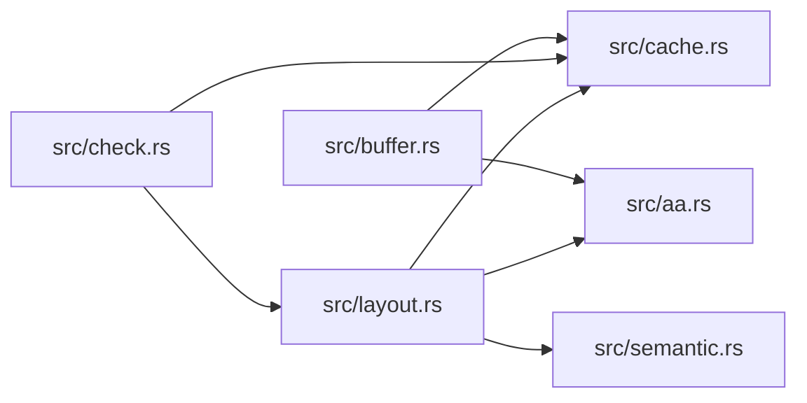

# ze-vertex

> **本文件的「事实（自动生成）」一节由 `cargo verify --step docs` 生成，勿手动编辑。**
> 手写内容放在 `## 职责` 及之后的章节：生成器只替换自动区，手写区逐字节保留。
> 导航与阅读顺序见 [`docs/README.md`](../README.md)。

<!-- AUTO:BEGIN -->
## 事实（自动生成）

- 层：`kernel`（`crates/kernel`）
- 路径：`crates/kernel/ze-vertex`
- 生产依赖（上游，dev-deps 不计）：（无）
- 被依赖（下游）：`ze-render-ir`、`zela-render`、`zela-render-backends`
- 源文件：7 个 · 1749 行

### 文件清单

| 文件 | 行数 | `//!` 首行 |
|---|---|---|
| `src/aa.rs` | 178 | — |
| `src/buffer.rs` | 168 | — |
| `src/cache.rs` | 123 | — |
| `src/check.rs` | 254 | — |
| `src/layout.rs` | 827 | — |
| `src/lib.rs` | 37 | — |
| `src/semantic.rs` | 162 | — |

### 模块内关系（`use crate::…` / `use super::…`）

### 对外 API（模块级 `pub` 项；impl 方法见源码）

| 文件 | 项 |
|---|---|
| `src/aa.rs` | `pub enum AaModel` |
| `src/aa.rs` | `pub enum AttribSemantic` |
| `src/aa.rs` | `pub struct AaSlotSemantics` |
| `src/buffer.rs` | `pub struct VertexBufferData` |
| `src/buffer.rs` | `pub enum VertexBufferError` |
| `src/buffer.rs` | `pub fn bytes_of<T: Copy>(data: &[T]) -> &[u8]` |
| `src/cache.rs` | `pub enum CacheStrategy` |
| `src/check.rs` | `pub fn hash_bytes(data: &[u8]) -> u64` |
| `src/check.rs` | `pub fn hash_bytes_sampled(data: &[u8]) -> u64` |
| `src/check.rs` | `pub struct StaticConsistencyChecker` |
| `src/layout.rs` | `pub enum StepMode` |
| `src/layout.rs` | `pub enum AttribType` |
| `src/layout.rs` | `pub struct VertexAttrib` |
| `src/layout.rs` | `pub struct VertexLayout` |
| `src/layout.rs` | `pub enum VertexLayoutError` |
| `src/layout.rs` | `pub struct VertexInputDesc` |
| `src/semantic.rs` | `pub enum Semantic` |
<!-- AUTO:END -->

## 职责

顶点格式契约：只声明顶点布局、抗锯齿槽语义、缓存策略与一致性校验，不生产顶点数据。

## 运行机制

src/layout.rs 用属性加 buffer 描述顶点格式（步进模式区分顶点与实例；2D 固定 position 加三个通用槽，3D 由 standard_3d 声明 position、uv 与 shading_normal），src/aa.rs 给出抗锯齿模型到三个通用槽语义的纯数据映射表，src/cache.rs 用缓存策略声明数据变化频率，src/buffer.rs 只做字节视图与错误类型。src/check.rs 在 debug 构建下对声明为静态的格式做跨帧哈希比对（FNV-1a，可选采样哈希），不一致直接 panic 指认是哪种格式说了谎；release 下所有方法为空操作。消费方是三角化器、管线与缓存层。

## 边界与不做什么

- 不得引用任何 wgpu 类型，翻译成后端顶点布局的代码在渲染后端 crate。
- 不做三角化、不计算抗锯齿覆盖，只声明格式与语义。
- 顶点布局是跨着色风格的不变契约：新增风格只能加 shader 变体与管线，不得改格式。
