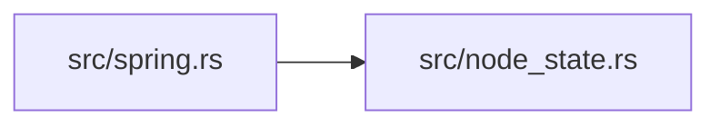

# zela-authored

> **本文件的「事实（自动生成）」一节由 `cargo verify --step docs` 生成，勿手动编辑。**
> 手写内容放在 `## 职责` 及之后的章节：生成器只替换自动区，手写区逐字节保留。
> 导航与阅读顺序见 [`docs/README.md`](../README.md)。

<!-- AUTO:BEGIN -->
## 事实（自动生成）

- 层：`app`（`crates/app`）
- 路径：`crates/app/zela-authored`
- 生产依赖（上游，dev-deps 不计）：`ze-comb`、`ze-content`、`ze-node-core`、`ze-node-lower`、`ze-node-schema`、`ze-notion`、`ze-prerender`、`ze-render-ir`、`ze-scene-core`、`ze-time`、`zela-scene-ecs`
- 被依赖（下游）：`zela-app`
- 源文件：7 个 · 1793 行

### 文件清单

| 文件 | 行数 | `//!` 首行 |
|---|---|---|
| `src/capability_demo.rs` | 247 | — |
| `src/demo3d.rs` | 135 | — |
| `src/lib.rs` | 19 | — |
| `src/node_state.rs` | 464 | **CF-d**：节点状态 → 场景 `State` 的映射与校验（D1 / D4 的兑现点）。 |
| `src/panels.rs` | 167 | **CE-e 作品**：两个 View + 两个参数面板（场景对象）。 |
| `src/spring.rs` | 240 | **CF-d 作品**：节点编辑器里的弹簧（Vec2 状态）→ 场景 `State`。 |
| `src/storyboard.rs` | 521 | — |

### 模块内关系（`use crate::…` / `use super::…`）

### 对外 API（模块级 `pub` 项；impl 方法见源码）

| 文件 | 项 |
|---|---|
| `src/capability_demo.rs` | `pub struct CapabilityDemo` |
| `src/capability_demo.rs` | `pub fn build(scene: &mut Scene) -> CapabilityDemo` |
| `src/demo3d.rs` | `pub struct Demo3D` |
| `src/demo3d.rs` | `pub fn build(scene: &mut Scene, engine: &InMemoryEngine) -> Demo3D` |
| `src/node_state.rs` | `pub fn state_shape(type_name: &str) -> Option<StateShape>` |
| `src/node_state.rs` | `pub struct NodeState` |
| `src/node_state.rs` | `pub enum NodeStateError` |
| `src/node_state.rs` | `pub fn verify_states(` |
| `src/panels.rs` | `pub struct Panels` |
| `src/panels.rs` | `pub fn build(scene: &mut Scene) -> Panels` |
| `src/spring.rs` | `pub struct SpringNode` |
| `src/spring.rs` | `pub struct SpringExecutor` |
| `src/spring.rs` | `pub fn rule_spring(node: &dyn Node, inputs: &[Expr]) -> Result<Vec<Expr>, RuleError>` |
| `src/spring.rs` | `pub fn lowering() -> Lowering` |
| `src/storyboard.rs` | `pub struct Storyboard` |
| `src/storyboard.rs` | `pub fn build(scene: &mut Scene, engine: &InMemoryEngine) -> Storyboard` |
<!-- AUTO:END -->

## 职责

内置作品的场景作者：三件内置作品（分镜故事板、能力演示、3D 场景）的对象、时钟与绑定都声明在这里。

## 运行机制

每件作品提供一个构建入口，接收调用方传入的场景（部分还需要排版引擎），把对象与绑定直接建进去，返回持有各自句柄的结构。入口由 zela-app 的作品清单按 id 引用，GUI 下拉与 headless 都从这里取场景。分镜故事板同时是 Lua 与 Python 版脚本的等价性参照基准，生产路径仍走脚本。

## 边界与不做什么

- 不依赖 app、回放与渲染后端：只往场景里写内容。
- 不做装配、命令提交、事件订阅与渲染。
- 不是用户脚本通道，也不解析脚本。
