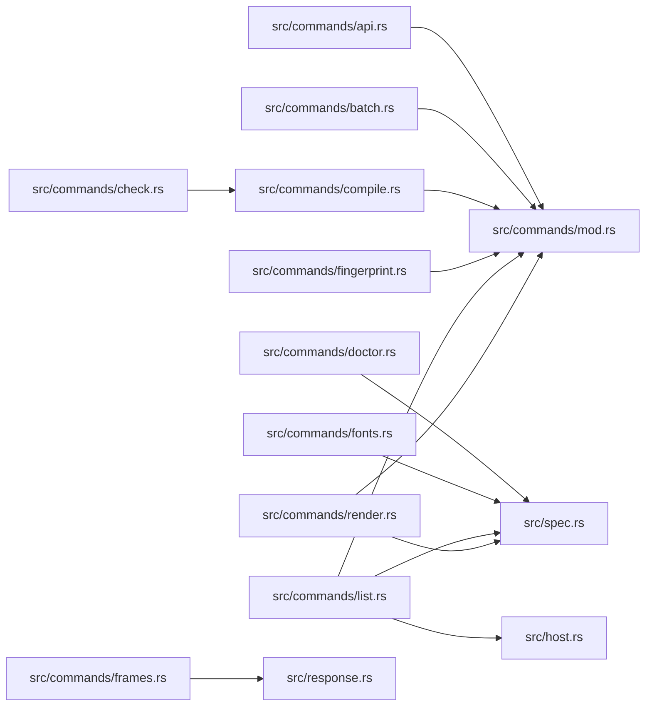

# zela-commands

> **本文件的「事实（自动生成）」一节由 `cargo verify --step docs` 生成，勿手动编辑。**
> 手写内容放在 `## 职责` 及之后的章节：生成器只替换自动区，手写区逐字节保留。
> 导航与阅读顺序见 [`docs/README.md`](../README.md)。

<!-- AUTO:BEGIN -->
## 事实（自动生成）

- 层：`app`（`crates/app`）
- 路径：`crates/app/zela-commands`
- 生产依赖（上游，dev-deps 不计）：`ze-pod-binding`、`ze-pod-core`、`ze-pod-func`、`ze-pod-js`、`ze-pod-lua`、`ze-pod-py`、`zela-app`、`zela-playback`、`zela-render-backends`、`zela-render-vector`、`zela-scene-bundle`、`zela-scene-ecs`、`zela-schedule`
- 被依赖（下游）：`zela-cli`
- 源文件：17 个 · 3752 行

### 文件清单

| 文件 | 行数 | `//!` 首行 |
|---|---|---|
| `src/bin/zela-verify.rs` | 264 | `zela-verify`：批量对拍的**命令行壳**（参数解析 + GPU 上下文 + 退出码）。 |
| `src/commands/api.rs` | 141 | `api`：导出 domain 能力的机器可读文档（JSON 唯一来源 + LuaLS + TypeScript + `.pyi`）。 |
| `src/commands/batch.rs` | 720 | `batch`：**批量渲染 + 对拍**（门禁用；也是批量出片的一等能力）。 |
| `src/commands/check.rs` | 56 | `check`：只做装配期检查、不渲染。 |
| `src/commands/compile.rs` | 187 | `compile`：脚本 → ZSB 装配产物（不渲染、不需要 GPU）。 |
| `src/commands/doctor.rs` | 141 | `doctor`：环境自检（本批最值钱的发现之一）。 |
| `src/commands/fingerprint.rs` | 458 | `fingerprint`：跨运行时对拍的指纹工具（单帧 / 结构清单 / 目录对拍）。 |
| `src/commands/fonts.rs` | 193 | 确定字体（`fonts`）：下载 + SHA-256 校验 `tools/typst-fonts.txt` 的清单。 |
| `src/commands/frames.rs` | 76 | `frames`：PNG 序列帧导出（`render --frames` 的一等入口）。 |
| `src/commands/inspect.rs` | 92 | `inspect`：读取 `.zsb` 的 Meta（container 版本 / payload 格式 / 能力 / 降级 / 来源）。 |
| `src/commands/list.rs` | 54 | `list`：内置作品清单（GUI 下拉与 CLI 共用同一份定义）。 |
| `src/commands/mod.rs` | 16 | 命令帧体（每条命令一个模块）。 |
| `src/commands/render.rs` | 565 | `render`：脚本 / ZSB → 帧（唯一帧体）。 |
| `src/host.rs` | 134 | 宿主接缝：进度 / 取消 / 诊断 + 帧 sink。 |
| `src/lib.rs` | 30 | `zela-commands`：**命令帧体（唯一实现）**。 |
| `src/response.rs` | 180 | 结构化返回值。 |
| `src/spec.rs` | 445 | 声明式命令描述：`CommandSpec` / `ArgSpec`。 |

### 模块内关系（`use crate::…` / `use super::…`）

### 对外 API（模块级 `pub` 项；impl 方法见源码）

| 文件 | 项 |
|---|---|
| `src/commands/api.rs` | `pub fn output_dir(args: &CommandArgs) -> PathBuf` |
| `src/commands/api.rs` | `pub fn default_dir() -> PathBuf` |
| `src/commands/api.rs` | `pub fn run(host: &dyn CommandHost, dir: &std::path::Path) -> Result<Response, String>` |
| `src/commands/batch.rs` | `pub struct Work` |
| `src/commands/batch.rs` | `pub struct BatchOptions` |
| `src/commands/batch.rs` | `pub struct WorkOutcome` |
| `src/commands/batch.rs` | `pub fn run_batch(ctx: &RenderContext, options: &BatchOptions) -> Result<Vec<WorkOutcome>, String>` |
| `src/commands/batch.rs` | `pub fn run_sink_bypass(` |
| `src/commands/check.rs` | `pub fn script_from_args(args: &CommandArgs) -> Result<PathBuf, String>` |
| `src/commands/check.rs` | `pub fn run(host: &dyn CommandHost, script: &std::path::Path) -> Result<Response, String>` |
| `src/commands/compile.rs` | `pub struct CompileOptions` |
| `src/commands/compile.rs` | `pub struct Compiled` |
| `src/commands/compile.rs` | `pub fn compile(source: &str, language: ScriptLanguage) -> Result<Compiled, String>` |
| `src/commands/compile.rs` | `pub fn read_script(script: &std::path::Path) -> Result<(String, ScriptLanguage), String>` |
| `src/commands/compile.rs` | `pub fn run(host: &dyn CommandHost, options: &CompileOptions) -> Result<Response, String>` |
| `src/commands/doctor.rs` | `pub fn run(host: &dyn CommandHost) -> Result<Response, String>` |
| `src/commands/fingerprint.rs` | `pub enum Invocation` |
| `src/commands/fingerprint.rs` | `pub fn invocation_from_args(args: &CommandArgs) -> Result<Invocation, String>` |
| `src/commands/fingerprint.rs` | `pub fn run(host: &dyn CommandHost, invocation: &Invocation) -> Result<Response, String>` |
| `src/commands/fonts.rs` | `pub struct FontSet` |
| `src/commands/fonts.rs` | `pub fn manifest() -> Result<FontSet, String>` |
| `src/commands/fonts.rs` | `pub fn verify_file(dir: &Path, name: &str, expected: &str) -> bool` |
| `src/commands/fonts.rs` | `pub fn detect() -> Result<(FontSet, Vec<String>), String>` |
| `src/commands/fonts.rs` | `pub fn ensure_font_dir() -> Option<PathBuf>` |
| `src/commands/fonts.rs` | `pub fn run(host: &dyn CommandHost) -> Result<Response, String>` |
| `src/commands/frames.rs` | `pub fn options_from_args(args: &CommandArgs) -> Result<RenderOptions, String>` |
| `src/commands/frames.rs` | `pub fn run(` |
| `src/commands/inspect.rs` | `pub fn file_from_args(args: &CommandArgs) -> Result<PathBuf, String>` |
| `src/commands/inspect.rs` | `pub fn run(host: &dyn CommandHost, file: &std::path::Path) -> Result<Response, String>` |
| `src/commands/list.rs` | `pub fn run(host: &dyn CommandHost) -> Result<Response, String>` |
| `src/commands/render.rs` | `pub struct RenderOptions` |
| `src/commands/render.rs` | `pub fn run(` |
| `src/host.rs` | `pub enum Level` |
| `src/host.rs` | `pub trait CommandHost` |
| `src/host.rs` | `pub trait FrameSink` |
| `src/host.rs` | `pub trait FrameSinkFactory` |
| `src/host.rs` | `pub struct MemoryHost` |
| `src/host.rs` | `pub struct CollectSink` |
| `src/response.rs` | `pub struct DemoRow` |
| `src/response.rs` | `pub struct RenderSummary` |
| `src/response.rs` | `pub struct ListSummary` |
| `src/response.rs` | `pub enum Fact` |
| `src/response.rs` | `pub enum Response` |
| `src/spec.rs` | `pub enum ArgType` |
| `src/spec.rs` | `pub struct ArgSpec` |
| `src/spec.rs` | `pub struct CommandSpec` |
| `src/spec.rs` | `pub enum ArgValue` |
| `src/spec.rs` | `pub struct CommandArgs` |
<!-- AUTO:END -->

## 职责

宿主无关的**命令帧体**：同一条命令被 `zela`（CLI）与 GUI / 未来编辑器共同消费。

- `CommandSpec` / `ArgSpec`：声明式参数描述（CLI → clap，GUI → 表单控件）；
- `CommandArgs`：两条宿主前端（手写解析、clap）落到同一份类型化参数；
- `CommandHost`：进度 / 取消 / 结构化诊断；
- `FrameSink` / `FrameSinkFactory`：帧的落点（PNG / mp4 / 纹理）；
- `Response`：结构化返回值（CLI 负责格式化，GUI 负责显示）；
- 阶段 1 的命令：`render`、`list`；其余命令在后续阶段迁入。

## 边界与不做什么

- **不依赖 clap / egui / eframe**：`Cargo.toml` 不得出现这三个依赖（`cargo verify --step structure` 守住）；
- **不另写帧循环**：渲染唯一实现是 `zela_app::frame_loop::run_frames`；
- 不打印结果字符串：命令返回 `Response`，格式化属于宿主；
- 不做 UI 布局 / 事件循环：那些是 `zela-gui` 与 `zela-egui` 的职责。

## 运行机制

`zela render` 的调用链：CLI 用 `CommandSpec` 生成 clap → 解析出 `CommandArgs` →
`RenderOptions::from_args` → `render::run(host, factory, options)` → `run_frames` →
每帧回调依次查询取消、装填输入流、写 sink、报进度 → 返回 `RenderSummary`。

取消语义：宿主请求取消后立即停止推进，已渲帧保留（`summary.cancelled = true`），
这是断点续渲的前置。
