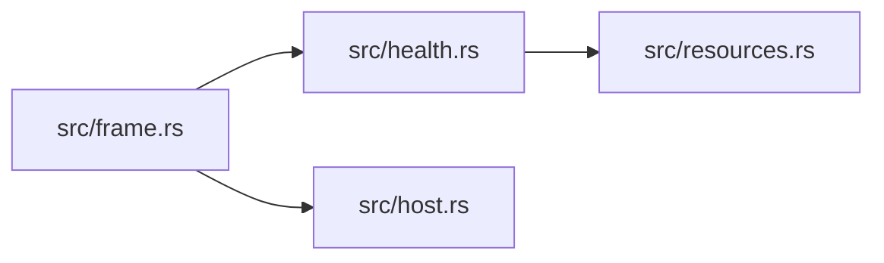

# zela-egui

> **本文件的「事实（自动生成）」一节由 `cargo verify --step docs` 生成，勿手动编辑。**
> 手写内容放在 `## 职责` 及之后的章节：生成器只替换自动区，手写区逐字节保留。
> 导航与阅读顺序见 [`docs/README.md`](../README.md)。

<!-- AUTO:BEGIN -->
## 事实（自动生成）

- 层：`ui`（`crates/ui`）
- 路径：`crates/ui/zela-egui`
- 生产依赖（上游，dev-deps 不计）：`ze-macro`、`ze-notion`、`ze-pod-core`、`ze-scene-core`、`zela-render`、`zela-render-backends`、`zela-scene-ecs`、`zela-schedule`
- 被依赖（下游）：`zela-gui`
- 源文件：6 个 · 1456 行

### 文件清单

| 文件 | 行数 | `//!` 首行 |
|---|---|---|
| `src/frame.rs` | 165 | — |
| `src/health.rs` | 193 | — |
| `src/host.rs` | 888 | — |
| `src/lib.rs` | 35 | — |
| `src/progress.rs` | 90 | — |
| `src/resources.rs` | 85 | — |

### 模块内关系（`use crate::…` / `use super::…`）

### 对外 API（模块级 `pub` 项；impl 方法见源码）

| 文件 | 项 |
|---|---|
| `src/frame.rs` | `pub fn install_visuals(ctx: &egui::Context)` |
| `src/frame.rs` | `pub fn window_options() -> eframe::NativeOptions` |
| `src/frame.rs` | `pub struct FrameBegin` |
| `src/frame.rs` | `pub struct SceneFrame` |
| `src/health.rs` | `pub struct HealthOverlay` |
| `src/host.rs` | `pub struct EguiSceneHost` |
| `src/progress.rs` | `pub struct FrameProgress` |
| `src/resources.rs` | `pub fn post_filters(cfg: &UiConfig) -> PostFilterChain` |
<!-- AUTO:END -->

## 职责

egui 与场景之间的唯一适配层：持有画面宿主、帧体进出、面板 chrome 与健康检查叠加。

## 运行机制

每帧由帧体类型划出开始与结束边界：宿主把 egui 的指针与键盘输入翻译成场景事件、把视口矩形写给场景、提交内容，并绘制时间与参数面板的 chrome；资源模块按界面配置生成后处理链，健康模块在画面上叠加检查信息，进度模块报告配帧进度。红线是除宿主文件外本 crate 不出现 egui 类型，因此场景逻辑仍可 headless 测试。

## 边界与不做什么

- 不含场景逻辑：相机输入、录制、时间与参数消费都已归位到场景层。
- 不依赖 zela-app，也不建运行时 —— 组装与 eframe 壳在 zela-gui。
- 不写第二套帧循环：渲染帧体仍来自渲染层与后端。
