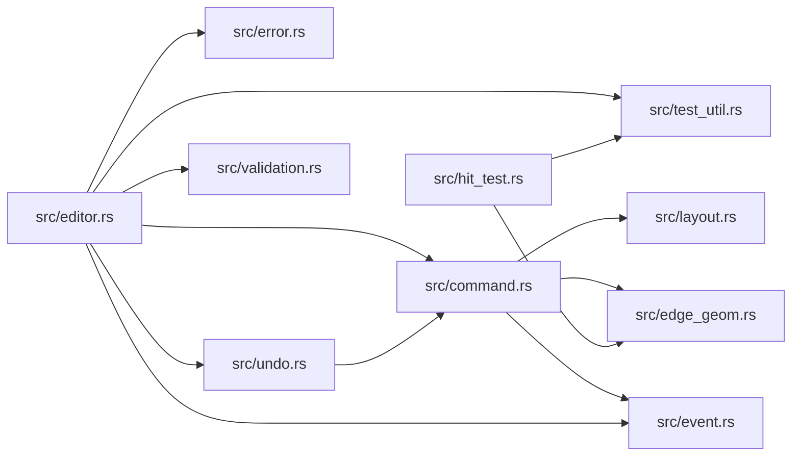

# zela-node-editor

> **本文件的「事实（自动生成）」一节由 `cargo verify --step docs` 生成，勿手动编辑。**
> 手写内容放在 `## 职责` 及之后的章节：生成器只替换自动区，手写区逐字节保留。
> 导航与阅读顺序见 [`docs/README.md`](../README.md)。

<!-- AUTO:BEGIN -->
## 事实（自动生成）

- 层：`ui`（`crates/ui`）
- 路径：`crates/ui/zela-node-editor`
- 生产依赖（上游，dev-deps 不计）：`ze-graph-algo`、`ze-node-core`
- 被依赖（下游）：`zela-node-egui`
- 源文件：14 个 · 2575 行

### 文件清单

| 文件 | 行数 | `//!` 首行 |
|---|---|---|
| `src/command.rs` | 143 | Atomic state-change commands — the only contract between the UI layer and |
| `src/edge_geom.rs` | 257 | Edge path geometry: a renderer-agnostic intermediate representation plus |
| `src/editor.rs` | 1037 | The [`Editor`] state machine: graph, layout, edge geometry, selection and |
| `src/error.rs` | 16 | Editor-level errors. |
| `src/event.rs` | 39 | Logical events emitted by the editor after applying commands. |
| `src/geometry.rs` | 112 | Pure geometry types shared by the editor state machine and the UI layer. |
| `src/hit_test.rs` | 348 | Pluggable hit-testing: resolving a graph-local pointer position to a |
| `src/layout.rs` | 144 | Node placement strategies. |
| `src/lib.rs` | 60 | `zela-node-editor` — pure-logic node editor state machine. |
| `src/presentation.rs` | 59 | **UI side table**：`type_name → NodePresentation`。 |
| `src/socket_layout.rs` | 149 | Socket geometry inside a node card. |
| `src/test_util.rs` | 61 | Minimal node doubles for editor tests. Test-only. |
| `src/undo.rs` | 60 | Undo/redo stacks holding inverse [`Command`](crate::Command)s by value. |
| `src/validation.rs` | 90 | Connection validation: socket type compatibility and cycle detection. |

### 模块内关系（`use crate::…` / `use super::…`）

### 对外 API（模块级 `pub` 项；impl 方法见源码）

| 文件 | 项 |
|---|---|
| `src/command.rs` | `pub enum Command` |
| `src/edge_geom.rs` | `pub enum EdgePath` |
| `src/edge_geom.rs` | `pub trait EdgeGeometry: Send + Sync + 'static` |
| `src/edge_geom.rs` | `pub struct BezierGeometry` |
| `src/edge_geom.rs` | `pub struct OrthogonalGeometry` |
| `src/editor.rs` | `pub struct PendingConnection` |
| `src/editor.rs` | `pub struct Editor` |
| `src/error.rs` | `pub enum EditorError` |
| `src/event.rs` | `pub enum EditorEvent` |
| `src/geometry.rs` | `pub struct Rect` |
| `src/geometry.rs` | `pub enum HitTarget` |
| `src/hit_test.rs` | `pub struct HitTestContext<'a>` |
| `src/hit_test.rs` | `pub trait HitTestPolicy: Send + Sync + 'static` |
| `src/hit_test.rs` | `pub struct DefaultHitTestPolicy` |
| `src/layout.rs` | `pub trait LayoutStrategy: Send + Sync + 'static` |
| `src/layout.rs` | `pub struct FreeLayout` |
| `src/presentation.rs` | `pub struct PresentationTable` |
| `src/socket_layout.rs` | `pub trait SocketLayout: Send + Sync + 'static` |
| `src/socket_layout.rs` | `pub struct DefaultSocketLayout` |
| `src/undo.rs` | `pub struct UndoStack` |
| `src/validation.rs` | `pub struct ConnectionValidator` |
<!-- AUTO:END -->

## 职责

纯逻辑的节点编辑器状态机：持有图引用、布局、边几何、选择与撤销栈，一切坐标都是图局部坐标。

## 运行机制

14 个文件按职责分层：几何、布局、端口布局、边几何四者只算数据（卡片矩形、端口偏移、贝塞尔或正交路径）；命令是 UI 与状态机之间唯一的契约，原子且可逆，撤销栈按值保存其逆操作；编辑器状态机应用命令并产出逻辑事件，同时把命中结果与待连接状态留在自身；命中测试把指针位置解析成命中目标，连接校验做端口类型兼容与成环检查，展示数据表存类型名到节点外观的映射。视口平移缩放不在本 crate。

## 边界与不做什么

- 绝不依赖 egui / eframe，也不依赖场景、渲染与 app 层。
- 不做屏幕与图坐标的变换，也不绘制任何东西（在 zela-node-egui）。
- 不拥有节点数据本身：图与节点仍由节点核心 trait 提供。
