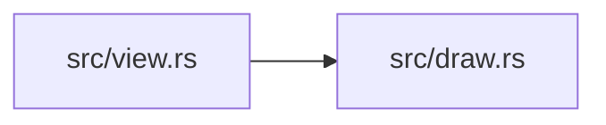

# zela-node-egui-ui

> **本文件的「事实（自动生成）」一节由 `cargo verify --step docs` 生成，勿手动编辑。**
> 手写内容放在 `## 职责` 及之后的章节：生成器只替换自动区，手写区逐字节保留。
> 导航与阅读顺序见 [`docs/README.md`](../README.md)。

<!-- AUTO:BEGIN -->
## 事实（自动生成）

- 层：`ui`（`crates/ui`）
- 路径：`crates/ui/zela-node-egui-ui`
- 生产依赖（上游，dev-deps 不计）：`ze-node-core`、`ze-node-schema`、`zela-node-egui`
- 被依赖（下游）：（无）
- 源文件：4 个 · 383 行

### 文件清单

| 文件 | 行数 | `//!` 首行 |
|---|---|---|
| `src/draw.rs` | 252 | `draw_property` — enum-dispatched mapping from a [`Property`] schema to the |
| `src/lib.rs` | 24 | `zela-node-egui-ui` — egui widget mappings for `zela-node-ui` property nodes. |
| `src/menu.rs` | 25 | Right-click spawn menu built from a [`NodeRegistry`]. |
| `src/view.rs` | 82 | `PropertyNodeView` — a generic [`NodeView`] that renders every property of |

### 模块内关系（`use crate::…` / `use super::…`）

### 对外 API（模块级 `pub` 项；impl 方法见源码）

| 文件 | 项 |
|---|---|
| `src/draw.rs` | `pub fn draw_property(ui: &mut Ui, prop: &mut Property) -> Option<PropertyValue>` |
| `src/menu.rs` | `pub fn spawn_menu(ui: &mut Ui, registry: &NodeRegistry) -> Option<String>` |
| `src/view.rs` | `pub struct PropertyNodeView` |
<!-- AUTO:END -->

## 职责

属性节点的 egui 控件映射：把属性枚举画成对应控件、按节点属性列表自动渲染节点体、从节点类型目录生成右键生成菜单。

## 运行机制

绘制入口按属性的变体分派到具体控件并返回可选的属性值，宿主据此调用节点的属性写回接口，全链路不出现向下转型；通用节点视图遍历节点的属性列表逐项调用该入口，拼出节点体；菜单入口按类型目录的分类与节点信息拼出可生成项。

## 边界与不做什么

- egui 只在这一层及以上出现：本 crate 依赖属性模型与节点 egui 视图，不被它们反向依赖。
- 不定义属性模型，也不负责属性写回（在 ze-node-schema 与宿主）。
- 不提供画布、输入处理与整体场景绘制（在 zela-node-egui）。
