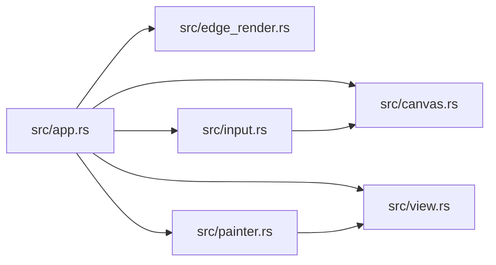

# zela-node-egui

> **本文件的「事实（自动生成）」一节由 `cargo verify --step docs` 生成，勿手动编辑。**
> 手写内容放在 `## 职责` 及之后的章节：生成器只替换自动区，手写区逐字节保留。
> 导航与阅读顺序见 [`docs/README.md`](../README.md)。

<!-- AUTO:BEGIN -->
## 事实（自动生成）

- 层：`ui`（`crates/ui`）
- 路径：`crates/ui/zela-node-egui`
- 生产依赖（上游，dev-deps 不计）：`ze-node-core`、`zela-node-editor`
- 被依赖（下游）：`zela-node-egui-ui`
- 源文件：7 个 · 1151 行

### 文件清单

| 文件 | 行数 | `//!` 首行 |
|---|---|---|
| `src/app.rs` | 78 | Per-frame driver tying together viewport, input handling and painting. |
| `src/canvas.rs` | 118 | Viewport transform: pan/zoom lives exclusively in the UI layer. |
| `src/edge_render.rs` | 250 | Edge painting: bezier / orthogonal renderers, styles and arrowheads. |
| `src/input.rs` | 270 | Translates egui pointer/keyboard input into editor `Command`s. |
| `src/lib.rs` | 41 | `zela-node-egui` — egui rendering and interaction for `zela-node-editor`. |
| `src/painter.rs` | 324 | Full-scene painting: background grid, edges, node cards, sockets and the |
| `src/view.rs` | 70 | Node card appearance: titles, header colors and per-node body widgets. |

### 模块内关系（`use crate::…` / `use super::…`）

### 对外 API（模块级 `pub` 项；impl 方法见源码）

| 文件 | 项 |
|---|---|
| `src/app.rs` | `pub struct NodeGraphApp` |
| `src/canvas.rs` | `pub struct GraphCanvas` |
| `src/edge_render.rs` | `pub enum StrokeKind` |
| `src/edge_render.rs` | `pub enum ArrowStyle` |
| `src/edge_render.rs` | `pub struct EdgeStyle` |
| `src/edge_render.rs` | `pub trait EdgeRenderer: Send + Sync + 'static` |
| `src/edge_render.rs` | `pub struct BezierRenderer` |
| `src/edge_render.rs` | `pub struct OrthogonalRenderer` |
| `src/input.rs` | `pub struct InputHandler` |
| `src/painter.rs` | `pub struct GraphPainter<'a>` |
| `src/view.rs` | `pub trait NodeView: Send + Sync + 'static` |
| `src/view.rs` | `pub struct DefaultNodeView` |
<!-- AUTO:END -->

## 职责

节点编辑器的 egui 渲染与交互层：全仓唯一知道视口变换（平移缩放）并把编辑器数据画成卡片与边的地方。

## 运行机制

输入处理把指针与键盘翻成编辑器的命令，状态机应用后产出事件；画布持有视口变换，绘制器按它依次画背景网格、边、节点卡片与端口，卡片外观由节点视图决定，边由贝塞尔或正交渲染器画（含线型与箭头样式）；每帧驱动器把「输入 → 命令 → 绘制」串成一轮。本 crate 还把卡片几何常量再导出，供下游属性控件对齐端口与控件位置。

## 边界与不做什么

- 不得依赖场景、渲染、app 层与通用派生宏 crate。
- 不含编辑器状态逻辑与撤销：状态机在 zela-node-editor。
- 不含属性控件与生成菜单：那在 zela-node-egui-ui。
