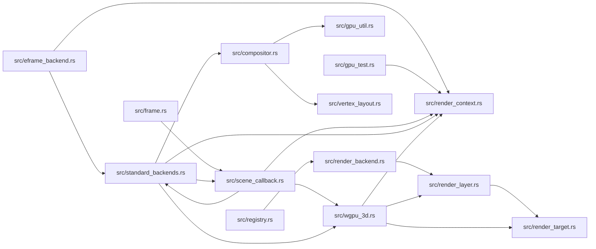

# zela-render-backends

> **本文件的「事实（自动生成）」一节由 `cargo verify --step docs` 生成，勿手动编辑。**
> 手写内容放在 `## 职责` 及之后的章节：生成器只替换自动区，手写区逐字节保留。
> 导航与阅读顺序见 [`docs/README.md`](../README.md)。

<!-- AUTO:BEGIN -->
## 事实（自动生成）

- 层：`render`（`crates/render`）
- 路径：`crates/render/zela-render-backends`
- 生产依赖（上游，dev-deps 不计）：`ze-notion`、`ze-render-ir`、`ze-resource`、`ze-scene-core`、`ze-vertex`、`zela-render`
- 被依赖（下游）：`zela-app`、`zela-egui`、`zela-gui`、`zela-playback`、`zela-web`
- 源文件：21 个 · 13833 行

### 文件清单

| 文件 | 行数 | `//!` 首行 |
|---|---|---|
| `src/compositor.rs` | 1703 | — |
| `src/diagnostics.rs` | 156 | — |
| `src/eframe_backend.rs` | 176 | — |
| `src/frame.rs` | 66 | — |
| `src/gpu_test.rs` | 196 | — |
| `src/gpu_timing.rs` | 281 | GPU 时间归因（B12 Step 4）：timestamp query 的**唯一**入口。 |
| `src/gpu_util.rs` | 142 | — |
| `src/lib.rs` | 141 | — |
| `src/registry.rs` | 609 | — |
| `src/render_backend.rs` | 148 | — |
| `src/render_context.rs` | 422 | — |
| `src/render_layer.rs` | 58 | — |
| `src/render_pod_probe.rs` | 615 | — |
| `src/render_target.rs` | 120 | — |
| `src/resource_cache.rs` | 261 | — |
| `src/routing.rs` | 683 | — |
| `src/scene_callback.rs` | 1026 | — |
| `src/standard_backends.rs` | 560 | — |
| `src/vertex_layout.rs` | 323 | — |
| `src/wgpu_2d.rs` | 2720 | — |
| `src/wgpu_3d.rs` | 3427 | — |

### 模块内关系（`use crate::…` / `use super::…`）

### 对外 API（模块级 `pub` 项；impl 方法见源码）

| 文件 | 项 |
|---|---|
| `src/compositor.rs` | `pub struct CompositeOp` |
| `src/compositor.rs` | `pub fn fit_rect(` |
| `src/compositor.rs` | `pub fn rect_to_ndc(rect: (f32, f32, f32, f32), viewport: (f32, f32)) -> [f32; 4]` |
| `src/compositor.rs` | `pub enum Conversion` |
| `src/compositor.rs` | `pub struct CompositeFrame` |
| `src/compositor.rs` | `pub struct Compositor` |
| `src/compositor.rs` | `pub struct PostBlit` |
| `src/diagnostics.rs` | `pub fn take_frame_skipped() -> usize` |
| `src/diagnostics.rs` | `pub fn total_skipped() -> usize` |
| `src/diagnostics.rs` | `pub struct CacheTotals` |
| `src/diagnostics.rs` | `pub fn take_cache_totals() -> CacheTotals` |
| `src/diagnostics.rs` | `pub fn textures_created() -> usize` |
| `src/eframe_backend.rs` | `pub fn install_standard_backends(rs: &egui_wgpu::RenderState) -> RenderContext` |
| `src/eframe_backend.rs` | `pub struct EframeWgpuBackend` |
| `src/frame.rs` | `pub fn build_scene_callback(input: FrameInputs<'_>) -> Option<SceneCompositorCallback>` |
| `src/gpu_test.rs` | `pub struct GpuGuard` |
| `src/gpu_test.rs` | `pub fn require_gpu() -> Option<(GpuGuard, RenderContext)>` |
| `src/gpu_test.rs` | `pub fn require_gpu_named(name: impl Into<String>) -> Option<(GpuGuard, RenderContext)>` |
| `src/gpu_timing.rs` | `pub enum GpuTimingState` |
| `src/gpu_timing.rs` | `pub struct GpuTimingSupport` |
| `src/gpu_timing.rs` | `pub fn probe(adapter: &wgpu::Adapter) -> GpuTimingSupport` |
| `src/gpu_timing.rs` | `pub fn ticks_to_ms(period_ns: f32, begin: u64, end: u64) -> Result<f64, String>` |
| `src/gpu_timing.rs` | `pub struct GpuSpan` |
| `src/gpu_util.rs` | `pub fn bytes_of<T: Copy>(data: &[T]) -> &[u8]` |
| `src/gpu_util.rs` | `pub struct UniformArena` |
| `src/registry.rs` | `pub enum BackendKind` |
| `src/registry.rs` | `pub struct AdapterFacts` |
| `src/registry.rs` | `pub struct BackendFeatures` |
| `src/registry.rs` | `pub enum BackendRegistryError` |
| `src/registry.rs` | `pub struct BackendRegistry` |
| `src/registry.rs` | `pub struct BackendAvailability` |
| `src/render_backend.rs` | `pub trait RenderBackend` |
| `src/render_backend.rs` | `pub trait RenderBackend3D` |
| `src/render_backend.rs` | `pub fn implemented_capabilities() -> ze_render_ir::caps::RenderCapabilitySet` |
| `src/render_backend.rs` | `pub fn negotiate_capabilities(` |
| `src/render_context.rs` | `pub enum RenderContextError` |
| `src/render_context.rs` | `pub struct RenderContext` |
| `src/render_layer.rs` | `pub struct RenderLayer` |
| `src/render_pod_probe.rs` | `pub struct ProbeBatch` |
| `src/render_pod_probe.rs` | `pub struct ProbeDraw` |
| `src/render_pod_probe.rs` | `pub enum ProbeShape` |
| `src/render_pod_probe.rs` | `pub struct ProbeFrame` |
| `src/render_pod_probe.rs` | `pub struct RenderProbePod` |
| `src/render_target.rs` | `pub struct RenderTarget` |
| `src/render_target.rs` | `pub fn to_wgpu_format(format: ze_render_ir::ColorFormat) -> wgpu::TextureFormat` |
| `src/render_target.rs` | `pub fn color_format_of(format: wgpu::TextureFormat) -> Option<ze_render_ir::ColorFormat>` |
| `src/routing.rs` | `pub enum LoopBackend` |
| `src/routing.rs` | `pub struct FrameContent` |
| `src/routing.rs` | `pub struct RoutingDecision` |
| `src/routing.rs` | `pub fn route_with_order(` |
| `src/routing.rs` | `pub fn route(` |
| `src/scene_callback.rs` | `pub struct SceneCompositorFrame` |
| `src/scene_callback.rs` | `pub struct SceneCompositorCallback` |
| `src/standard_backends.rs` | `pub struct ScreenParams` |
| `src/standard_backends.rs` | `pub trait BackendStore` |
| `src/standard_backends.rs` | `pub struct StandardBackends` |
| `src/standard_backends.rs` | `pub struct RenderTiming` |
| `src/standard_backends.rs` | `pub struct HeadlessTiming` |
| `src/standard_backends.rs` | `pub fn render_frame_to_view(` |
| `src/standard_backends.rs` | `pub fn render_frame_to_view_timed(` |
| `src/standard_backends.rs` | `pub struct HeadlessTarget` |
| `src/standard_backends.rs` | `pub fn render_frame_headless(` |
| `src/standard_backends.rs` | `pub fn render_frame_headless_cached(` |
| `src/standard_backends.rs` | `pub fn render_frame_headless_cached_timed(` |
| `src/standard_backends.rs` | `pub fn render_frame_headless_to_target(` |
| `src/standard_backends.rs` | `pub fn render_single_frame(` |
| `src/vertex_layout.rs` | `pub fn to_wgpu<'a>(` |
| `src/vertex_layout.rs` | `pub fn to_wgpu_buffers<'a>(` |
| `src/wgpu_2d.rs` | `pub struct Frame2DGeometry` |
| `src/wgpu_2d.rs` | `pub struct Recorded2D` |
| `src/wgpu_2d.rs` | `pub fn snapshot_queue(queue: &DrawQueue) -> Vec<Recorded2D>` |
| `src/wgpu_2d.rs` | `pub struct FrameCacheStats` |
| `src/wgpu_2d.rs` | `pub struct Frame2DData` |
| `src/wgpu_2d.rs` | `pub struct WgpuBackend2D` |
| `src/wgpu_3d.rs` | `pub struct PreparedDraw3D` |
| `src/wgpu_3d.rs` | `pub struct Frame3DData` |
| `src/wgpu_3d.rs` | `pub struct Layer3DFrame` |
| `src/wgpu_3d.rs` | `pub struct WgpuBackend3D` |
<!-- AUTO:END -->

## 职责

具体 **GPU 后端 + 会话装配**层：用 wgpu（可选 egui-wgpu / eframe）实现 2D 离屏 + MSAA 后端、3D 管线、N 图层合成与合成后滤镜链，并让 **headless 与 egui 两条宿主路径跑同一份帧体**；同时持有后端注册 / 路由 / GPU 计时 / 资源缓存 / 诊断这些装配设施。

它持有：`RenderContext`（device / queue / 目标格式）、`WgpuBackend2D` / `WgpuBackend3D`（各自的离屏目标、pipeline、uniform arena、资源缓存）、`Compositor` 与滤镜链的 GPU 侧、唯一的 `SceneCompositorCallback`（一帧渲染请求）、`StandardBackends`（不依赖 egui 的后端自持有装配），以及 `BackendRegistry` / 路由决策 / GPU 计时三态。

## 运行机制

### 内部文件怎么分工

- **2D / 3D 后端（实现类）**：`src/wgpu_2d.rs` 是唯一的 2D 路径——把三角化结果上传、渲染到离屏非 sRGB 纹理（MSAA 4x 后 resolve），按图层 id 分别持有目标，顶点布局来自契约而非硬编码，几何缓冲按内容哈希缓存；`src/wgpu_3d.rs` 持有三角 / 线两条管线、按图层持有的颜色与深度目标、材质绑定组缓存、动态 uniform arena，mesh 缓存按「几何 id + version」失效、line 缓存按端点内容哈希。
- **合成与后处理**：`src/compositor.rs` 按**声明顺序**把 N 张图层纹理混进主 pass，混合方式预建三组 pipeline（wgpu 不支持动态 blend），不透明度走 uniform，滤镜链在合成之后做一次全屏 post。
- **帧体（唯一入口）**：`src/scene_callback.rs` 是合并后的单回调——`prepare_frame` 逐层渲染到各自离屏纹理并收集合成项，一次性交给合成器；`paint_frame` 一次合成。合并的原因写在文件头：回调资源是全局 TypeMap，每层一个回调会互相覆盖。
- **宿主接线**：`src/frame.rs` 把后端中立的帧输入（含图层顺序翻转）构造成回调；`src/standard_backends.rs` 让三个后端有「自持有」的第二个家，并用一个后端取用 trait 把 egui 与 headless 统一；`src/eframe_backend.rs` 把标准后端装进 egui 的回调资源，并提供 eframe 的后端实现。
- **契约与装配**：`src/render_context.rs`（上下文构造与错误）、`src/render_backend.rs`（后端 trait + 已实现能力声明与协商）、`src/render_layer.rs`（相机 + 视口 + 队列 + 目标的提交单元）、`src/render_target.rs`（纹理视图持有 / 借用）、`src/vertex_layout.rs`（顶点契约 → wgpu 的纯函数翻译）、`src/resource_cache.rs`（纯数据转发）、`src/registry.rs`（后端种类自述，系统能力 = 已注册后端之并）、`src/routing.rs`（帧内容 + adapter 事实 ⇒ 选后端，回退带理由）。
- **诊断与测试设施**：`src/gpu_timing.rs` 是 timestamp query 的唯一入口（三态：未开启 / 不支持带理由 / 已测出）；`src/diagnostics.rs` 是跳绘计数；`src/gpu_util.rs` 提供字节视图与对齐的 uniform arena；`src/gpu_test.rs` 提供 GPU 用例守卫；`src/render_pod_probe.rs` 是仅测试构建的契约探针，不进生产路径。

### 数据怎么从入口流到出口

装配期：先建 `RenderContext`（headless 或从宿主渲染状态提取），再由 `StandardBackends` 构造三个后端（或装进 egui 的 TypeMap）；注册表记录各后端自述的命名空间，路由按帧内容与 adapter 事实选出后端，协商失败即报错。

每帧：把帧输入构造成回调 → `prepare_frame`：2D 后端逐层渲染（视口层与内容纹理层各自独立后端实例，避免 uniform arena 互相覆盖），3D 后端准备每个 mesh / line（缓存命中时不重建缓冲）→ 收集合成项（保持声明序）→ 合成器生成合成帧（滤镜链非空时附带后处理 blit）→ `paint_frame` 一次把全部图层混到主目标。

### 关键时序

- **一次 prepare、一次 paint**：全部图层在一帧内一次合成，避免「同帧双画」与 TypeMap 寻址冲突。
- **缓存按内容或版本失效**：动画内容每帧哈希不同 → 帧末回收 + 延迟销毁，保证有界；静态几何帧间命中。
- **滤镜在合成之后**：几何重映射类滤镜只在这一层才有意义，代价是多一张中间纹理与一次全屏 pass。
- **GPU 计时只给帧级**：主帧提交前后各一个空 pass 写 timestamp，不支持时显式声明，不给 0。

## 边界与不做什么

1. **生产依赖不得包含场景实现**：不得依赖 `zela-scene` / `zela-scene-ecs`，后端只吃渲染无关层的类型；场景相关 crate 只出现在 dev-dependencies。理由：这条依赖边一旦成立，后端就会吸回场景语义，且 headless 与浏览器会各自漂移。
2. **不做场景语义与录制**：不读 ECS 组件、不判可见性 / 不透明度 / 图层归属，也不决定画什么——那由渲染无关层的录制 System 产出。后端只消费队列与图层声明。
3. **不做窗口与事件循环**：surface 交换链、宿主生命周期、UI 面板都在宿主（GUI / UI / Web 侧）；本 crate 只要求「给我一帧的输入，我还你一帧像素」。
4. **不做逐 pass 的 GPU 归因**：只测帧级 span，且默认关闭（需要显式请求 device feature）。逐 pass 计时需要改每一处 pass，本层明确不做。
5. **不静默降级**：路由、注册、能力协商、GPU 计时不可用时都返回错误或带理由的回退，不猜、不给 0、不换一个后端了事。
6. **不重排图层**：合成项的索引顺序就是绘制顺序，合成器不得做 z 排序或去重。
7. **矢量后端不在这里**：另一个后端 crate 承载；本 crate 的矢量后端种类只是注册与路由的占位，未实现即注册会显式报错。
