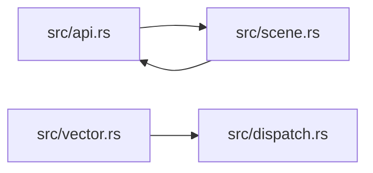

# zela-render-vector

> **本文件的「事实（自动生成）」一节由 `cargo verify --step docs` 生成，勿手动编辑。**
> 手写内容放在 `## 职责` 及之后的章节：生成器只替换自动区，手写区逐字节保留。
> 导航与阅读顺序见 [`docs/README.md`](../README.md)。

<!-- AUTO:BEGIN -->
## 事实（自动生成）

- 层：`render`（`crates/render`）
- 路径：`crates/render/zela-render-vector`
- 生产依赖（上游，dev-deps 不计）：`ze-graph-core`、`ze-notion`、`ze-render-ir`
- 被依赖（下游）：`zela-app`、`zela-commands`、`zela-gui`、`zela-playback`、`zela-web`
- 源文件：12 个 · 14517 行

### 文件清单

| 文件 | 行数 | `//!` 首行 |
|---|---|---|
| `src/api.rs` | 3311 | 宿主适配层：`FilledPath` → 上游 `Upload::path` + `Record::filled` → 离屏一帧。 |
| `src/bloom.rs` | 133 | A 3D view's bloom (`Camera.bloom`): the glow a lens and a sensor spread around the light they take in, which keeps |
| `src/dispatch.rs` | 452 | `workgroup_size` 的单一来源，以及 dispatch 形状的描述。 |
| `src/environment.rs` | 798 | Environments: light from all around a 3D view, a picture of its surroundings (an equirectangular Radiance image, |
| `src/lib.rs` | 142 | `zela-render-vector` — 矢量后端（移植自 manimgx 的 `rust/engine`，SHA 见 `UPSTREAM.md`）。 |
| `src/mesh.rs` | 105 | A mesh prepared for drawing or recording. Geometry is evaluated in its input precision; |
| `src/occlusion.rs` | 155 | A 3D view's ambient occlusion (`Camera.ambient_occlusion`): how much of the light from all around reaches the |
| `src/passes.rs` | 1869 | pass 声明化与资源槽位（BN 批）。 |
| `src/render.rs` | 4541 | ManimGX's player: draws blends of shapes — every kind, 2D and 3D — and encodes them to MP4. |
| `src/scene.rs` | 1069 | 场景适配：`Shape2D` + `Transform2D` + `Style2D` → 上游的填充记录。 |
| `src/shadow.rs` | 201 | Shadows: each sun and spot of a 3D view that casts them draws what casts them (its meshes' depth, then its paths' |
| `src/vector.rs` | 1741 | A view's paths, drawn with analytic segment coverage (see `vector.wgsl`): flattened per |

### 模块内关系（`use crate::…` / `use super::…`）

### 对外 API（模块级 `pub` 项；impl 方法见源码）

| 文件 | 项 |
|---|---|
| `src/api.rs` | `pub fn add_environment(id: u32, width: u32, height: u32, rgbe: &[u8]) -> Result<(), String>` |
| `src/api.rs` | `pub struct FilledPath` |
| `src/api.rs` | `pub enum ParamKind` |
| `src/api.rs` | `pub struct ParamGeometry` |
| `src/api.rs` | `pub struct ViewOptions` |
| `src/api.rs` | `pub struct MeshRecord` |
| `src/api.rs` | `pub enum TextureSource` |
| `src/api.rs` | `pub struct StrokedPath` |
| `src/api.rs` | `pub enum Light` |
| `src/api.rs` | `pub struct View3` |
| `src/api.rs` | `pub fn render_3d(view: &View3, records: &[PathRecord]) -> Result<Vec<u8>, String>` |
| `src/api.rs` | `pub fn render_3d_with(` |
| `src/api.rs` | `pub enum PathRecord` |
| `src/api.rs` | `pub struct PointsRecord` |
| `src/api.rs` | `pub struct CameraView` |
| `src/api.rs` | `pub fn render_2d(` |
| `src/api.rs` | `pub fn render_2d_with(` |
| `src/api.rs` | `pub fn render_2d_to_texture(` |
| `src/api.rs` | `pub fn render_3d_to_texture(` |
| `src/dispatch.rs` | `pub fn workgroup(entry: &str) -> (u32, u32, u32)` |
| `src/dispatch.rs` | `pub enum GroupSize` |
| `src/dispatch.rs` | `pub struct Extent` |
| `src/dispatch.rs` | `pub enum Dispatch` |
| `src/dispatch.rs` | `pub fn groups_for(shape: Dispatch, extent: Extent) -> [u32; 3]` |
| `src/environment.rs` | `pub fn read_hdr(data: &[u8]) -> Result<(u32, u32, Vec<u8>), String>` |
| `src/lib.rs` | `pub fn forget_player_targets()` |
| `src/lib.rs` | `pub fn digest<'a>(parts: impl IntoIterator<Item = &'a [u8]>) -> u64` |
| `src/passes.rs` | `pub enum ImageKind` |
| `src/passes.rs` | `pub struct ImageSlot` |
| `src/passes.rs` | `pub fn image_slot(name: &str) -> u32` |
| `src/passes.rs` | `pub enum RenderTargetId` |
| `src/passes.rs` | `pub enum PassStage` |
| `src/passes.rs` | `pub struct EnabledWhen(pub u32)` |
| `src/passes.rs` | `pub struct PassDecl` |
| `src/passes.rs` | `pub enum PlanError` |
| `src/passes.rs` | `pub fn validate(plan: PassPlan) -> Result<(), PlanError>` |
| `src/passes.rs` | `pub enum ScheduleError` |
| `src/passes.rs` | `pub struct PassSchedule` |
| `src/passes.rs` | `pub trait PassProvider` |
| `src/passes.rs` | `pub struct BuiltinPasses` |
| `src/passes.rs` | `pub enum ProviderError` |
| `src/passes.rs` | `pub fn negotiate(` |
| `src/render.rs` | `pub struct ResourceTotals` |
| `src/render.rs` | `pub fn resource_totals() -> ResourceTotals` |
| `src/render.rs` | `pub fn take_store_upload_bytes() -> usize` |
| `src/render.rs` | `pub fn take_resource_totals() -> ResourceTotals` |
| `src/render.rs` | `pub struct OverflowTotals` |
| `src/render.rs` | `pub fn take_overflow_totals() -> OverflowTotals` |
| `src/render.rs` | `pub struct ShadowTotals` |
| `src/render.rs` | `pub fn take_shadow_totals() -> ShadowTotals` |
| `src/render.rs` | `pub fn set_shadow_state(on: bool)` |
| `src/render.rs` | `pub fn set_sample_override(samples: u32)` |
| `src/render.rs` | `pub fn set_skip(mask: u32)` |
| `src/render.rs` | `pub struct ShaderFill` |
| `src/render.rs` | `pub fn init_gpu(` |
| `src/render.rs` | `pub fn init_gpu(` |
| `src/render.rs` | `pub fn msaa_samples(adapter: &wgpu::Adapter) -> u32` |
| `src/scene.rs` | `pub struct SceneItem<'a>` |
| `src/scene.rs` | `pub enum SceneMapError` |
| `src/scene.rs` | `pub fn fill_paths(` |
| `src/scene.rs` | `pub fn scene_records(` |
| `src/scene.rs` | `pub fn param_records(` |
| `src/scene.rs` | `pub fn morph_records(` |
| `src/scene.rs` | `pub fn window_records(` |
| `src/scene.rs` | `pub fn grow_records(` |
| `src/scene.rs` | `pub fn render_scene_2d(` |
<!-- AUTO:END -->

## 职责

`zela-render-vector` 是**矢量后端**：把宿主给的「视图字节 + 每条记录字节」离屏渲染成 RGBA8（含 3D 的阴影 / 环境光 / 环境遮蔽 / 泛光），移植自 manimgx 的 `rust/engine`。它持有一个 GPU player（`Gpu` / `Player`、`Upload` / `Record` 表、复用中的离屏目标）、进程级计数（资源创建、链表溢出、阴影）与宿主上传的环境图表。

## 运行机制

数据流是「形状上传一次、每帧每对象一条记录」：`src/scene.rs` 先把场景的 `Shape2D` + `Transform2D` + `Style2D` 映射成 `FilledPath` / `StrokedPath` / `PathRecord`（屏幕坐标 → 上游以画面中心为原点的世界坐标，y 取负，换算在 CPU 侧一次完成并烘进控制点）；`src/api.rs` 再把路径打包成上游的 `Upload`、把对象打包成 `Record`（形状 key、两个 3×4 矩阵、reveal 窗口、颜色、线宽、flag），经 `init_gpu` 建 / 复用 player，渲染到离屏目标并读回。同一套绘制在 native 上同步读回，wasm32 上只提供异步形式的入口。

内部文件分工：
- `src/render.rs`：GPU 装配与帧调度（device / queue、`Upload` / `Record`、目标复用、计数器、3D 管线与合成）；
- `src/vector.rs`：2D 路径光栅 —— 逐像素解析覆盖，曲线每帧按实际绘制尺寸在 GPU 展平，按深度（2D 即绘制序）合成；
- `src/mesh.rs`：网格准备，几何在输入精度下求值；
- `src/shadow.rs` / `src/bloom.rs` / `src/occlusion.rs`：3D 视图的阴影、泛光、环境遮蔽；
- `src/environment.rs`：环境光照（等距柱状 Radiance 图、预过滤、程序化内置影棚、`.hdr` 解码）；
- `src/api.rs`：宿主适配与公开入口（`View3` / `PathRecord` / `render_2d` / `render_3d` / 离屏纹理）；
- `src/scene.rs`：zela 场景类型 → 后端记录；
- `src/lib.rs`：上游凭据（SHA / 仓库名）、内置影棚 id、`digest` 与记录头常量。

## 边界与不做什么

- **不依赖场景 / ECS / UI 实现**：工作区依赖只有 `ze-notion` 与 `ze-render-ir` 两个 crate；它不认识 `DrawQueue`、场景队列与任何 `zela-*`，录制在 `zela-playback`。
- **同步读回只在 native**：同步版本用 `pollster` 阻塞等 GPU；浏览器侧只暴露 `render_2d_async` / `render_3d_with_async` / `*_to_texture_async`（B15，`futures-channel` 仅在 wasm32 依赖里）。`zela-web` 直接依赖本 crate，所以它并非「编不到 wasm32」；不在 xtask 的 wasm 名单里，是因为那份名单只覆盖 kernel / facade 组。
- **不含上游未移植的模块**：python / typeset / text / export / mp4 / audio / window / web / player / take / encode 等一并未移植（逐文件归属见 `UPSTREAM.md`），因此本 crate 不产 MP4，也没有窗口与事件循环。
- **不定义绘制参数类型**：`Gradient` / `Dash` / `SecondPaint` / `PathOptions` 定义在 `ze-render-ir` 的 paint 模块，这里只 re-export。
- **不降级**：`src/scene.rs` 只映射填充族，`Custom` 图元返回 `SceneMapError` 的 `Unsupported`；形变两端曲线数不一致返回 `UnalignedMorph`。
