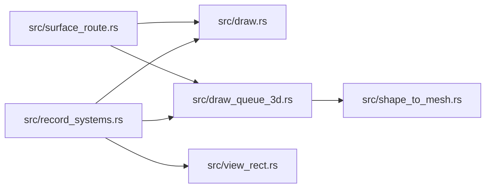

# zela-render

> **本文件的「事实（自动生成）」一节由 `cargo verify --step docs` 生成，勿手动编辑。**
> 手写内容放在 `## 职责` 及之后的章节：生成器只替换自动区，手写区逐字节保留。
> 导航与阅读顺序见 [`docs/README.md`](../README.md)。

<!-- AUTO:BEGIN -->
## 事实（自动生成）

- 层：`render`（`crates/render`）
- 路径：`crates/render/zela-render`
- 生产依赖（上游，dev-deps 不计）：`ze-content`、`ze-notion`、`ze-render-ir`、`ze-resource`、`ze-scene-contract`、`ze-scene-core`、`ze-scene-hecs`、`ze-vertex`、`zela-schedule`
- 被依赖（下游）：`zela-app`、`zela-egui`、`zela-playback`、`zela-render-backends`
- 源文件：17 个 · 7202 行

### 文件清单

| 文件 | 行数 | `//!` 首行 |
|---|---|---|
| `src/components.rs` | 45 | — |
| `src/content_ir.rs` | 236 | — |
| `src/draw.rs` | 1824 | — |
| `src/draw_queue_3d.rs` | 340 | — |
| `src/filters.rs` | 243 | — |
| `src/frame.rs` | 348 | — |
| `src/lib.rs` | 133 | — |
| `src/light_queue.rs` | 104 | — |
| `src/painter_2d.rs` | 30 | — |
| `src/painter_3d.rs` | 72 | — |
| `src/record_systems.rs` | 1087 | — |
| `src/shape_to_mesh.rs` | 328 | — |
| `src/surface_route.rs` | 340 | — |
| `src/tessellate.rs` | 1654 | — |
| `src/vertex_record.rs` | 344 | — |
| `src/view_rect.rs` | 7 | — |
| `src/viewport.rs` | 67 | — |

### 模块内关系（`use crate::…` / `use super::…`）

### 对外 API（模块级 `pub` 项；impl 方法见源码）

| 文件 | 项 |
|---|---|
| `src/content_ir.rs` | `pub struct ContentDrawCmd` |
| `src/content_ir.rs` | `pub fn ir_to_draw_cmds<'a>(` |
| `src/draw.rs` | `pub trait Painter2D` |
| `src/draw.rs` | `pub enum DrawItem` |
| `src/draw.rs` | `pub struct DrawQueue` |
| `src/draw.rs` | `pub struct ContentTextureQueue(pub std::collections::BTreeMap<ze_render_ir::LayerId, DrawQueue>)` |
| `src/draw.rs` | `pub struct MorphItem` |
| `src/draw.rs` | `pub struct MorphQueue(pub Vec<MorphItem>)` |
| `src/draw.rs` | `pub struct RevealItem` |
| `src/draw.rs` | `pub struct RevealQueue(pub Vec<RevealItem>)` |
| `src/draw.rs` | `pub trait Drawable` |
| `src/draw.rs` | `pub fn record_drawables<D: Drawable, I>(queue: &mut DrawQueue, t: &Affine2D, scale: f32, items: I)` |
| `src/draw.rs` | `pub struct SceneRender<T: Painter2D>` |
| `src/draw.rs` | `pub fn visible_for<S: SceneRead>(` |
| `src/draw.rs` | `pub fn opacity_of<S: SceneRead>(scene: &S, id: ObjectId) -> Opacity` |
| `src/draw.rs` | `pub fn apply_opacity(style: &mut Style2D, opacity: Opacity)` |
| `src/draw.rs` | `pub fn record_scene<S: SceneRead>(scene: &S, camera: &Camera2D, queue: &mut DrawQueue)` |
| `src/draw.rs` | `pub fn record_scene_tagged<S: SceneRead>(` |
| `src/draw.rs` | `pub fn record_scene_tagged_with<S: SceneRead>(` |
| `src/draw.rs` | `pub fn record_scene_for_surface<S: SceneRead>(` |
| `src/draw.rs` | `pub fn record_path_stroke(` |
| `src/draw.rs` | `pub fn push_morph_item(` |
| `src/draw.rs` | `pub fn push_reveal_item(` |
| `src/draw_queue_3d.rs` | `pub struct MeshDraw` |
| `src/draw_queue_3d.rs` | `pub struct LineDraw` |
| `src/filters.rs` | `pub enum FilterKind` |
| `src/filters.rs` | `pub struct FilterSlot` |
| `src/filters.rs` | `pub struct PostFilterChain` |
| `src/frame.rs` | `pub struct SceneLayer` |
| `src/frame.rs` | `pub struct FrameOptions` |
| `src/frame.rs` | `pub fn build_scene_view(` |
| `src/frame.rs` | `pub fn end_frame(res: &mut Resources)` |
| `src/frame.rs` | `pub struct FrameInputs<'a>` |
| `src/frame.rs` | `pub fn build_frame_inputs<'a>(` |
| `src/frame.rs` | `pub fn draw_call_count(res: &Resources) -> usize` |
| `src/light_queue.rs` | `pub struct DirectionalLightRecord` |
| `src/light_queue.rs` | `pub struct PointLightRecord` |
| `src/light_queue.rs` | `pub struct LightQueue` |
| `src/painter_2d.rs` | `pub trait Painter2DTarget` |
| `src/painter_3d.rs` | `pub trait Painter3D` |
| `src/record_systems.rs` | `pub struct SceneRecordSystem` |
| `src/record_systems.rs` | `pub struct MorphRecordSystem` |
| `src/record_systems.rs` | `pub struct RevealRecordSystem` |
| `src/record_systems.rs` | `pub struct ContentTextureRecordSystem` |
| `src/record_systems.rs` | `pub struct SceneRecord3DSystem` |
| `src/record_systems.rs` | `pub struct SceneRecordAllSystem` |
| `src/record_systems.rs` | `pub fn register_record_systems(scheduler: &mut zela_schedule::scheduler::Scheduler)` |
| `src/shape_to_mesh.rs` | `pub enum ShapeMeshError` |
| `src/shape_to_mesh.rs` | `pub struct DerivedMesh` |
| `src/shape_to_mesh.rs` | `pub fn derive_mesh(` |
| `src/surface_route.rs` | `pub enum SurfaceRoute` |
| `src/surface_route.rs` | `pub enum SurfaceRecordError` |
| `src/surface_route.rs` | `pub fn surface_route<S: SceneRead>(` |
| `src/tessellate.rs` | `pub struct Vertex2D` |
| `src/tessellate.rs` | `pub enum TessKind` |
| `src/tessellate.rs` | `pub struct Tessellation2D` |
| `src/tessellate.rs` | `pub fn tessellation_layout() -> VertexLayout` |
| `src/tessellate.rs` | `pub fn tolerance_for_scale(scale: f32) -> f32` |
| `src/tessellate.rs` | `pub enum TessellateError` |
| `src/tessellate.rs` | `pub fn tessellate(` |
| `src/tessellate.rs` | `pub fn tessellate_with(` |
| `src/tessellate.rs` | `pub fn tessellate_reveal(` |
| `src/tessellate.rs` | `pub fn position_on_path_of(v: &Vertex2D) -> Vec2` |
| `src/tessellate.rs` | `pub fn contour_position_of(v: &Vertex2D, stroke_width: f32) -> Vec2` |
| `src/tessellate.rs` | `pub fn total_area(t: &Tessellation2D, stroke_width: f32) -> f32` |
| `src/vertex_record.rs` | `pub enum VertexRecordError` |
| `src/vertex_record.rs` | `pub struct TessellatedBuffer` |
| `src/vertex_record.rs` | `pub fn tessellate_to_buffers(` |
| `src/vertex_record.rs` | `pub fn tessellate_path_to_buffers(` |
| `src/vertex_record.rs` | `pub fn tessellate_reveal_to_buffer(` |
| `src/vertex_record.rs` | `pub struct MorphEndpointBuffers` |
| `src/vertex_record.rs` | `pub fn morph_endpoint_buffers(` |
| `src/vertex_record.rs` | `pub fn layout_3d() -> VertexLayout` |
| `src/vertex_record.rs` | `pub fn interleaved_pos_uv_normal(` |
| `src/vertex_record.rs` | `pub fn fallback_uvs(positions: &[Vec3], projection: UvProjection) -> Vec<Vec2>` |
| `src/vertex_record.rs` | `pub fn mesh_vertex_buffer(` |
| `src/vertex_record.rs` | `pub fn line_vertex_buffer(start: Vec3, end: Vec3) -> Result<VertexBufferData, VertexRecordError>` |
| `src/viewport.rs` | `pub struct Viewport` |
<!-- AUTO:END -->

## 职责

**渲染无关**的管线层：把场景（只经契约层的只读接口）录制成后端中立的绘制队列，做纯 CPU 的三角化与顶点生产，并给出帧体声明；不含 wgpu、不含 egui、不认识 ECS 实现。

它持有：统一的 `DrawQueue`（2D 图元与 3D mesh / line 共存，共用 `ZOrder`）、`MorphQueue` / `RevealQueue` / `ContentTextureQueue` / `LightQueue`、三角化结果与顶点缓冲生产逻辑、`FrameInputs` 与图层声明、合成后滤镜链的纯数据，以及把场景写进这些队列的全部录制 System。

## 运行机制

### 内部文件怎么分工

- **队列与数据模型（数据结构类）**：`src/draw.rs` 是核心——`DrawQueue` / `DrawItem` / `Drawable` 与 `record_scene` 一族，负责世界 → 屏幕的落地、描边宽度的**唯一换算点**、图元与样式的组合，以及稳定排序（同 `ZOrder` 保持插入序）；`src/draw_queue_3d.rs` 定义 `MeshDraw` / `LineDraw`，并让 3D 队列成为统一队列的类型别名；`src/light_queue.rs` 是本帧光源快照（颜色归一化、点光位置由世界矩阵解析）；`src/filters.rs` 是固定 4 槽的滤镜链纯数据；`src/viewport.rs` 与 `src/view_rect.rs` 是视口 / 目标矩形的纯数据；`src/components.rs` 是有意的兼容 facade，把组件与样式从各层转发出来。
- **录制（场景 → 队列，系统类）**：`src/record_systems.rs` 提供 2D / 3D / 形变 / 写入动画 / 内容纹理几个录制 System，全部在 `RenderCommit` 相位，写集互不相交，因此可同相注册；`src/surface_route.rs` 判定 2D 图元是否因所属 Surface 走 Direct（派生成 3D 网格），失败写入队列的 `surface_errors` 而不静默。
- **几何生产（纯 CPU）**：`src/tessellate.rs` 是 lyon 适配层，产出顶点（路径点 / 法线 / side / 归一化 advance）与索引；描边宽度**不进几何**，由着色器现场补偿；`src/vertex_record.rs` 把三角化结果打成 `VertexBufferData`（2D 与 3D 两套布局，另含形变两端缓冲）；`src/shape_to_mesh.rs` 是 2D 图元 → 3D 平面网格的派生桥。
- **入口与帧体**：`src/frame.rs` 负责「场景 + 资源 → 后端中立输入」（图层声明、`FrameInputs`、帧末清队列、绘制数统计），不含 egui，也不构造任何后端类型；`src/content_ir.rs` 把内容 IR 展平为形状 + 样式 + 变换；`src/painter_2d.rs` / `src/painter_3d.rs` 是后端实现预留的绘制 trait。
- **转发**：crate 根把顶点契约与图元 / 样式体系以转发模块保留原路径，真实定义在 kernel 层。

### 数据怎么从入口流到出口

每帧 `RenderCommit` 相位：录制 System 读契约层场景与相机 / 视口 / 组可见性资源 → 把对象组合成形状 + 样式写进 `DrawQueue`（同时清空上一帧，并记录 Surface 路由错误）、把形变与写入动画以「两端几何 + t」的原样形态写进各自队列、把光源写进 `LightQueue`、把内容纹理写进按图层索引的队列。

随后 `build_frame_inputs` 把这些队列与图层声明打包成后端中立输入；其后端交接由后端 crate 完成——回调构造在 backends 的 `frame` 模块。渲染阶段才调用三角化与顶点生产（因为容差依赖相机缩放，相机此时才确定），产物直接上传 GPU。

### 关键时序

- **录制期只做语义降级**：场景组件 → 形状 + 样式 + 屏幕空间变换，宽度在此解析为屏幕像素；三角化不在录制期。
- **形变与写入动画走原样队列**：两端几何与 t 无关，故三角化与 GPU 缓冲帧间命中，每帧只写一个 t / 区间 uniform。
- **队列顺序即绘制顺序**：排序稳定，同层保插入序；3D 层序与 2D 共用一个 `ZOrder`。
- **帧末清空**：队列被呈现消费后由帧体清空，避免跨帧累积。

## 边界与不做什么

1. **不得依赖 wgpu / egui / 任何具体后端**：本 crate 是渲染无关层。GPU 侧契约（渲染目标、渲染层、后端 trait、资源缓存）都在后端 crate；这里只保留纯数据类型与转发路径。理由：依赖方向是「渲染无关层 ← 具体后端」，反过来会让 headless 与浏览器各自分叉。
2. **不得依赖场景的 ECS 实现**：只通过契约层的只读接口取场景数据，hecs 只出现在 dev-dependencies。理由：换场景实现时只需换适配器，而不是重写录制。
3. **不做图层合成 / 离屏纹理 / MSAA / 滤镜管线**：合成顺序、混合方式、后处理 pass 都在后端 crate；这里只有滤镜链的**数据**描述。
4. **不定义组件与图元的真值**：图元 newtype、样式组件、`ZOrder` 都定义在场景对象层与渲染 IR 层，本 crate 只转发路径，不另立第二份。
5. **不做帧编排**：输入、面板、呈现循环属于宿主 / UI 层；本 crate 只提供「场景 → 帧输入」这一段。
6. **不做文本排版与内容编译**：内容 IR 由内容层产出，这里只做展平与统一缩放换算（描边宽度与几何乘同一 scale）。
7. **`Painter2D` 目前不作生产承诺**：它的生产实现已被删除，只剩测试 mock 使用；真实路径是后端直接消费队列。保留 trait 是为了将来接非 GPU 后端时有落点。
