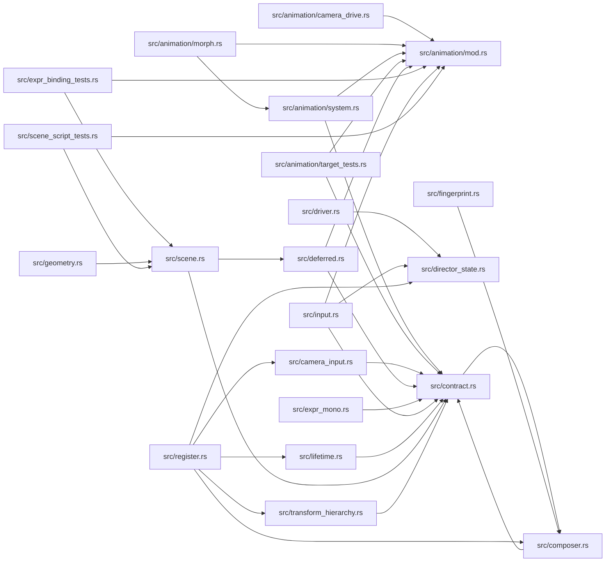

# zela-scene-ecs

> **本文件的「事实（自动生成）」一节由 `cargo verify --step docs` 生成，勿手动编辑。**
> 手写内容放在 `## 职责` 及之后的章节：生成器只替换自动区，手写区逐字节保留。
> 导航与阅读顺序见 [`docs/README.md`](../README.md)。

<!-- AUTO:BEGIN -->
## 事实（自动生成）

- 层：`scene`（`crates/scene`）
- 路径：`crates/scene/zela-scene-ecs`
- 生产依赖（上游，dev-deps 不计）：`ze-comb`、`ze-content`、`ze-func`、`ze-macro`、`ze-notion`、`ze-pod-core`、`ze-pod-func`、`ze-pod-macro`、`ze-prerender`、`ze-render-ir`、`ze-scene-api`、`ze-scene-contract`、`ze-scene-core`、`ze-scene-hecs`、`ze-time`、`zela-schedule`
- 被依赖（下游）：`zela-app`、`zela-authored`、`zela-egui`、`zela-gui`、`zela-playback`、`zela-scene-bundle`
- 源文件：24 个 · 8602 行

### 文件清单

| 文件 | 行数 | `//!` 首行 |
|---|---|---|
| `src/animation/camera_drive.rs` | 527 | — |
| `src/animation/mod.rs` | 26 | — |
| `src/animation/morph.rs` | 115 | — |
| `src/animation/system.rs` | 748 | — |
| `src/animation/target_tests.rs` | 397 | — |
| `src/camera_input.rs` | 667 | — |
| `src/composer.rs` | 306 | — |
| `src/contract.rs` | 772 | — |
| `src/deferred.rs` | 434 | — |
| `src/director_state.rs` | 51 | — |
| `src/driver.rs` | 420 | Driver pod：**命令驱动**的场景推进器（P4）。 |
| `src/errors.rs` | 53 | — |
| `src/expr_binding_tests.rs` | 632 | S3 验收（ECS 侧）：表达式绑定从声明到**真实组件写入**的整条链路。 |
| `src/expr_mono.rs` | 587 | 表达式求值的**宿主单子 `M`**（S3）。 |
| `src/fingerprint.rs` | 373 | — |
| `src/geometry.rs` | 254 | — |
| `src/input.rs` | 298 | — |
| `src/lib.rs` | 102 | — |
| `src/lifetime.rs` | 403 | — |
| `src/register.rs` | 72 | — |
| `src/scene.rs` | 234 | — |
| `src/scene_script_tests.rs` | 696 | — |
| `src/transform_hierarchy.rs` | 375 | — |
| `src/utils.rs` | 60 | — |

### 模块内关系（`use crate::…` / `use super::…`）

### 对外 API（模块级 `pub` 项；impl 方法见源码）

| 文件 | 项 |
|---|---|
| `src/animation/camera_drive.rs` | `pub struct CameraDriveSystem` |
| `src/animation/morph.rs` | `pub struct MorphApplySystem` |
| `src/animation/system.rs` | `pub struct BindingApplySystem` |
| `src/camera_input.rs` | `pub struct CameraInputSystem` |
| `src/composer.rs` | `pub struct ComposerSystem` |
| `src/contract.rs` | `pub fn find_by_name(scene: &impl SceneRead, name: &str) -> Option<ObjectId>` |
| `src/contract.rs` | `pub struct WorldScene<'a>` |
| `src/deferred.rs` | `pub enum DeferredCmd` |
| `src/deferred.rs` | `pub struct DeferredCommands` |
| `src/deferred.rs` | `pub struct DynamicObjects` |
| `src/deferred.rs` | `pub struct DeferredApplySystem` |
| `src/deferred.rs` | `pub struct ReplaySystem` |
| `src/director_state.rs` | `pub struct DirectorState` |
| `src/director_state.rs` | `pub struct DirectorAdvanceSystem` |
| `src/driver.rs` | `pub enum DriverCommand` |
| `src/driver.rs` | `pub enum DriverEvent` |
| `src/driver.rs` | `pub struct DriverPod` |
| `src/driver.rs` | `pub fn command_type_name() -> &'static str` |
| `src/driver.rs` | `pub fn event_type_name() -> &'static str` |
| `src/errors.rs` | `pub enum Error` |
| `src/expr_mono.rs` | `pub struct SceneMono<'a>` |
| `src/expr_mono.rs` | `pub fn anim_value(value: &Value) -> Option<AnimValue>` |
| `src/fingerprint.rs` | `pub struct StructureFingerprint` |
| `src/fingerprint.rs` | `pub fn sequence_digest(frames: &[StructureFingerprint]) -> u64` |
| `src/fingerprint.rs` | `pub struct WorldRead<'a>` |
| `src/fingerprint.rs` | `pub fn fingerprint_world(` |
| `src/geometry.rs` | `pub struct AxesRefreshSystem` |
| `src/geometry.rs` | `pub struct FunctionGraphRefreshSystem` |
| `src/input.rs` | `pub struct TimeControlSystem` |
| `src/input.rs` | `pub struct ParamPanelSystem` |
| `src/lifetime.rs` | `pub enum LifetimeEventKind` |
| `src/lifetime.rs` | `pub struct LifetimeEvent` |
| `src/lifetime.rs` | `pub struct LifetimeEvents` |
| `src/lifetime.rs` | `pub struct LifetimeTracker` |
| `src/lifetime.rs` | `pub struct LifetimeFlushSystem` |
| `src/register.rs` | `pub fn register_systems(` |
| `src/scene.rs` | `pub struct Scene` |
| `src/transform_hierarchy.rs` | `pub struct TransformHierarchyError` |
| `src/transform_hierarchy.rs` | `pub struct TransformHierarchySystem` |
<!-- AUTO:END -->

## 职责

场景层的 **ECS 实现**：把 `ze-scene-core` 的纯数据（对象 / 组件 / 动画词汇 / 脚本数据 / 持久化 / 合成器数据）落进 hecs 世界，并把每帧该做的事拆成按相位注册的 System。

它持有：`Scene`（hecs World + 按 TypeId 存的 Resource 表 + 装配期延迟命令队列）、契约层适配器 `WorldScene` / `WorldView`（唯一与 `ze-scene-contract` 接触的面）、场景自有的全部 System 实现、结构指纹（纯数值回归判据），以及 `DriverPod`（把 Scheduler 包成 Pod、由命令驱动推进）。

## 运行机制

### 内部文件怎么分工

- **容器与契约适配**：`src/scene.rs` 是装配期的场景容器（world / resources / deferred）；`src/contract.rs` 是 hecs 与契约层的唯一接触面，负责 `ObjectId` ↔ `Entity` 互转，并用一张 `known_component_table!` 登记表实现类型擦除的动态创建（未登记类型返回 `None`，不静默丢组件）。
- **时间与输入（系统类）**：`src/director_state.rs` 的 `DirectorAdvanceSystem` 是**唯一推进时间**的地方，每帧 `advance(dt)` 后把 `Director` 的全局时间与帧号同步进 `TimeState`；`src/input.rs` 消费 UI 发来的纯数据事件（播放/暂停、seek、参数面板）；`src/camera_input.rs` 把相机语义命令写进**场景里的相机对象**组件。
- **动画（系统类）**：`src/animation/system.rs` 的 `BindingApplySystem` 遍历绑定表，用时钟树采样曲线并把结果写进组件字段（System 本身不认识任何具体目标）；`src/animation/camera_drive.rs` 只做「谁驱动哪台相机」——通过把绑定移出 / 放回 `BindingTable` 显式让位，因此必须与 `CameraInputSystem` 同相位且排在其前；`src/animation/morph.rs` 是形变的 CPU 回退路径（App 走 GPU 插值，不注册它）。
- **表达式**：`src/expr_mono.rs` 是表达式求值的宿主单子 `M`，把 `TimeState`（time / frame）、`SceneRead`（组件字段读端）与 `zela.math` 算子拼在一起；缺失通道显式返回错误，不静默给 0。
- **对象增删与生命周期（系统类）**：`src/deferred.rs` 定义延迟命令队列，并提供帧末应用 System 与重播清理 System；`src/lifetime.rs` 在帧末按**集合差**产生 spawn / despawn 事件（opt-in，按 `ObjectId` 显式排序）。
- **派生态刷新（系统类）**：`src/transform_hierarchy.rs` 每帧把父子 `local` 累乘成世界矩阵（`WorldTransforms`，不进持久化）；`src/geometry.rs` 的两个 System 只做接线，几何算法在对象层；`src/composer.rs` 消费上一帧末的生命周期事件维护合成派生态（首次看到合成器对象时做一次全量快照）。
- **回归判据**：`src/fingerprint.rs` 只吃纯数值状态（组件字段 + 世界矩阵），按 `ObjectId` 与 `TARGETS` 声明序生成稳定摘要；派生几何只写占位标记、不读内容。
- **对外边界**：`src/driver.rs` 是 Driver pod（命令：推进 / 批量推进 / seek / 复位；事件只走 topic 扇出），使 GUI 与导出共用同一条命令路径。
- **注册与杂项**：`src/register.rs` 是场景 System 的**唯一注册点**（按相位分配）；`src/errors.rs` 是本层错误类型；`src/utils.rs` 导出 `auto_into!` 宏；`src/expr_binding_tests.rs`、`src/scene_script_tests.rs`、`src/animation/target_tests.rs` 是测试文件，不参与生产构建。

### 数据怎么从入口流到出口

装配期：宿主用 `Scene` 建对象（可 `defer` 先入队），`into_world()` 会先统一应用延迟命令再把 world 交给调度器；`register_systems` 把场景自有 System 按相位挂上。运行时每帧按 **Input → LogicUpdate → SceneSync → Prepare → RenderCommit → FrameEnd** 推进：

1. Input：时间推进 → 相机让位判定 → 相机输入写组件；
2. LogicUpdate：时间控制与参数面板事件落到场景状态；
3. SceneSync：绑定应用把曲线值写进组件字段；
4. Prepare：重播清理 → 父子世界矩阵累乘 → 坐标轴 / 函数图像刷新 → 合成派生态更新；
5. RenderCommit：本 crate 不参与，录制由渲染层的 System 读场景完成；
6. FrameEnd：延迟命令统一应用 → 生命周期差集发事件。

### 关键时序（必须记住的三条）

- **延迟创建晚一帧**：录制在 `RenderCommit`，延迟命令在 `FrameEnd` 应用，故本帧已录完，新对象下一帧才出现（设计如此，有测试锁定）。
- **事件在生效之后**：生命周期事件在延迟应用之后做差集，因此立即创建与延迟创建两条路径归一，接收方拿到的 id 一定可解析。
- **世界矩阵是派生态**：每帧重建，无父对象的对象直接复制 local（逐位相同），所以默认场景零变化。

## 边界与不做什么

1. **不依赖渲染与 UI**：不得依赖 `zela-render` / `zela-egui` / 任何具体宿主。录制 System 的注册归渲染层，UI 接线归 UI 层；`register_systems` 只注册场景自己拥有的 System——否则 app 会把场景细节吸回来，且形成反向依赖。
2. **不承载纯数据与算法**：对象、组件、动画词汇与目标表、脚本数据、持久化、合成器数据、相机输入纯函数、数学函数 Pod 都已在核心层，本层只保留原路径转发。新增「纯逻辑」应落核心层，而不是这里。
3. **不做渲染与像素**：没有任何 GPU / 后端代码，也不决定可见性、不透明度、宽度换算；这些在渲染层。
4. **不定义调度内核**：相位、Resource 访问检查、System trait、调度器都在 `zela-schedule`；本 crate 只使用，不改相位定义。
5. **不做几何计算**：坐标轴 / 函数图像的两个 System 只负责取相机、遍历对象、调用对象层算法；几何与采样不属于场景层。
6. **不把 hecs 当契约暴露**：`Scene::world` / `world_mut` / `into_world` / `spawn` 是 ECS 特定入口，替换场景实现时必须随之重写；读场景的通用路径是契约层的只读遍历，写路径经登记表。
7. **不保证延迟 spawn 当帧可见**，也不用真 spawn / despawn 做出场退场：出场退场优先走 `Reveal` / `Opacity` 等视觉通道，因为一次性副作用会破坏「状态由 t 唯一决定」。
