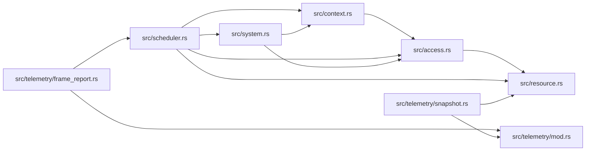

# zela-schedule

> **本文件的「事实（自动生成）」一节由 `cargo verify --step docs` 生成，勿手动编辑。**
> 手写内容放在 `## 职责` 及之后的章节：生成器只替换自动区，手写区逐字节保留。
> 导航与阅读顺序见 [`docs/README.md`](../README.md)。

<!-- AUTO:BEGIN -->
## 事实（自动生成）

- 层：`schedule`（`crates/schedule`）
- 路径：`crates/schedule/zela-schedule`
- 生产依赖（上游，dev-deps 不计）：（无）
- 被依赖（下游）：`zela-app`、`zela-egui`、`zela-gui`、`zela-playback`、`zela-render`、`zela-scene-ecs`
- 源文件：11 个 · 2353 行

### 文件清单

| 文件 | 行数 | `//!` 首行 |
|---|---|---|
| `src/access.rs` | 172 | — |
| `src/context.rs` | 329 | — |
| `src/lib.rs` | 29 | — |
| `src/resource.rs` | 246 | — |
| `src/scheduler.rs` | 586 | — |
| `src/system.rs` | 389 | — |
| `src/telemetry/clock.rs` | 61 | — |
| `src/telemetry/frame_report.rs` | 136 | — |
| `src/telemetry/log.rs` | 75 | — |
| `src/telemetry/mod.rs` | 25 | — |
| `src/telemetry/snapshot.rs` | 305 | — |

### 模块内关系（`use crate::…` / `use super::…`）

### 对外 API（模块级 `pub` 项；impl 方法见源码）

| 文件 | 项 |
|---|---|
| `src/access.rs` | `pub struct Access` |
| `src/context.rs` | `pub struct BorrowTracker` |
| `src/context.rs` | `pub struct ExecutorContext<'frame>` |
| `src/resource.rs` | `pub trait Resource: Send + Sync + 'static` |
| `src/resource.rs` | `pub struct Resources` |
| `src/resource.rs` | `pub trait ResourceTuple: 'static` |
| `src/resource.rs` | `pub trait ResourceTupleDefault: ResourceTuple` |
| `src/scheduler.rs` | `pub enum Phase` |
| `src/scheduler.rs` | `pub struct Scheduler` |
| `src/system.rs` | `pub trait System: Send + Sync + 'static` |
| `src/system.rs` | `pub struct Sys<F = SysClosure, R = (), W = ()>` |
| `src/system.rs` | `pub fn sys<R, W>(` |
| `src/system.rs` | `pub trait InitSystem: System` |
| `src/system.rs` | `pub trait ErasedSystem: Send + Sync + 'static` |
| `src/telemetry/clock.rs` | `pub trait FrameClock` |
| `src/telemetry/clock.rs` | `pub struct ZeroClock` |
| `src/telemetry/clock.rs` | `pub struct InstantClock` |
| `src/telemetry/frame_report.rs` | `pub struct SystemTelemetry` |
| `src/telemetry/frame_report.rs` | `pub struct FrameReport` |
| `src/telemetry/log.rs` | `pub fn init_tracing()` |
| `src/telemetry/log.rs` | `pub fn init_tracing_headless()` |
| `src/telemetry/snapshot.rs` | `pub struct WorldSnapshot` |
| `src/telemetry/snapshot.rs` | `pub struct EntitySnapshot` |
| `src/telemetry/snapshot.rs` | `pub struct ComponentInfo` |
| `src/telemetry/snapshot.rs` | `pub struct ResourceSnapshot` |
| `src/telemetry/snapshot.rs` | `pub struct SnapshotRegistry` |
| `src/telemetry/snapshot.rs` | `pub fn write_snapshot_json(` |
<!-- AUTO:END -->

## 职责

通用 ECS 调度框架：资源容器、系统契约与闭包适配器、六阶段调度器、访问冲突检测与可观测性设施，不含任何场景或渲染概念。

## 运行机制

资源按类型存进资源容器，系统声明自己的读集合与写集合；调度器按 Input → LogicUpdate → SceneSync → Prepare → RenderCommit → FrameEnd 的固定顺序逐个执行已注册系统，执行前用访问声明做读写冲突校验，运行期由执行上下文提供受控借用（debug 构建下另有借用追踪器）。初始化系统在装配期只跑一次。telemetry feature 下再提供逐系统与逐帧的统计报告、World 快照的 JSON 落盘，以及 headless / GUI 两套 tracing 初始化。

## 边界与不做什么

- 只依赖外部 crate hecs（telemetry feature 下再开 tracing / serde 系依赖）；不引任何内部 crate，也不依赖场景、渲染、egui 与 wgpu。
- 不认识场景对象、组件语义与渲染队列 —— 这些由上层注册的系统自行解释。
- 不提供 UI，也不定义序列化协议。
